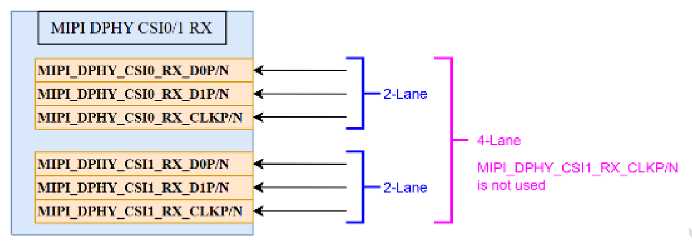
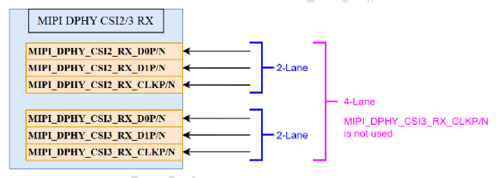
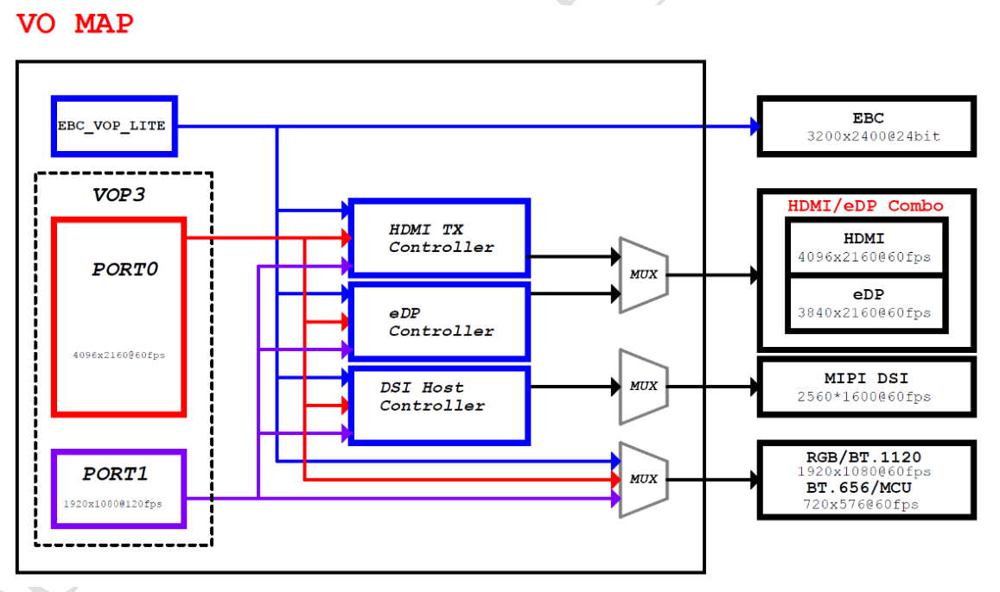
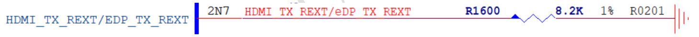
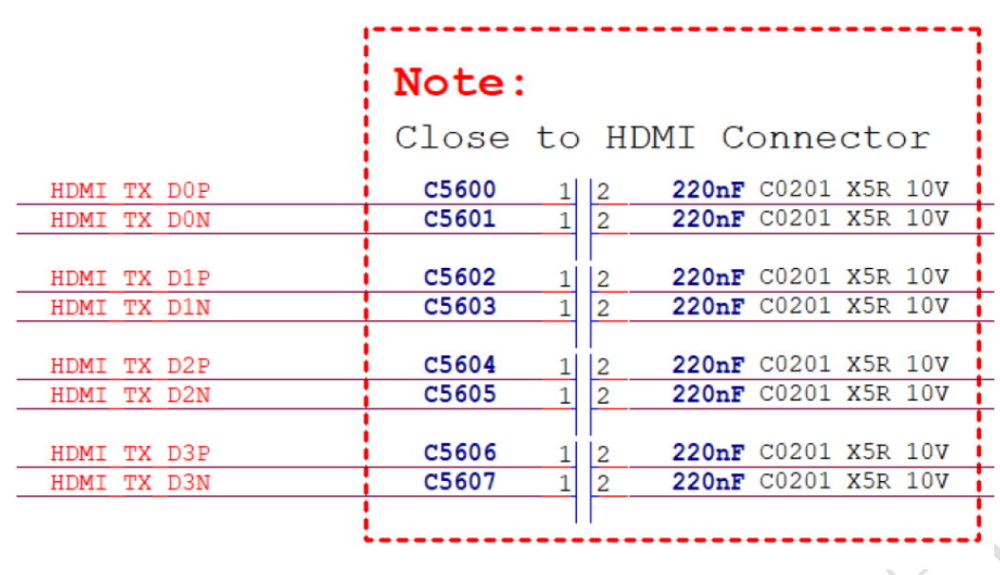
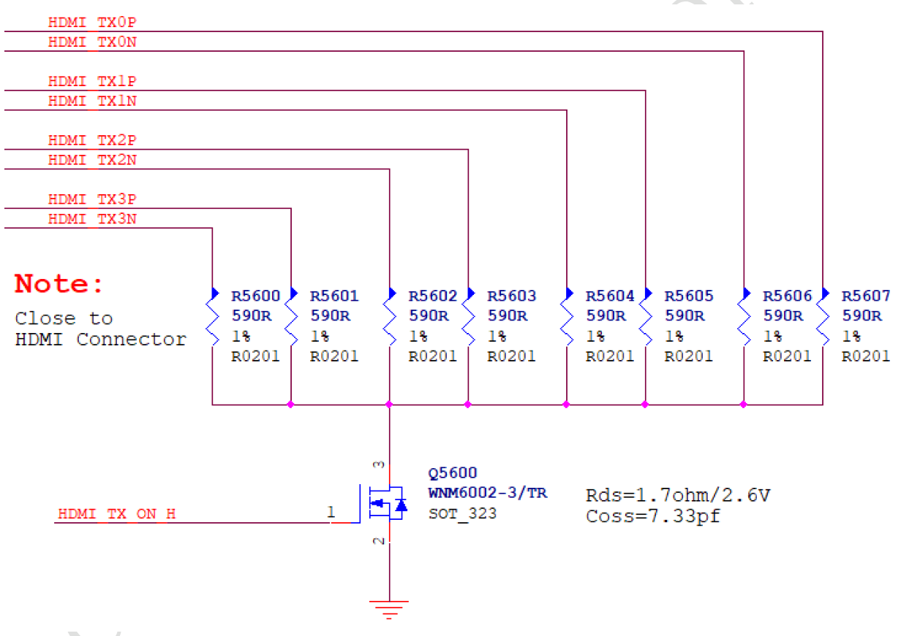
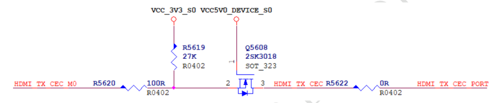
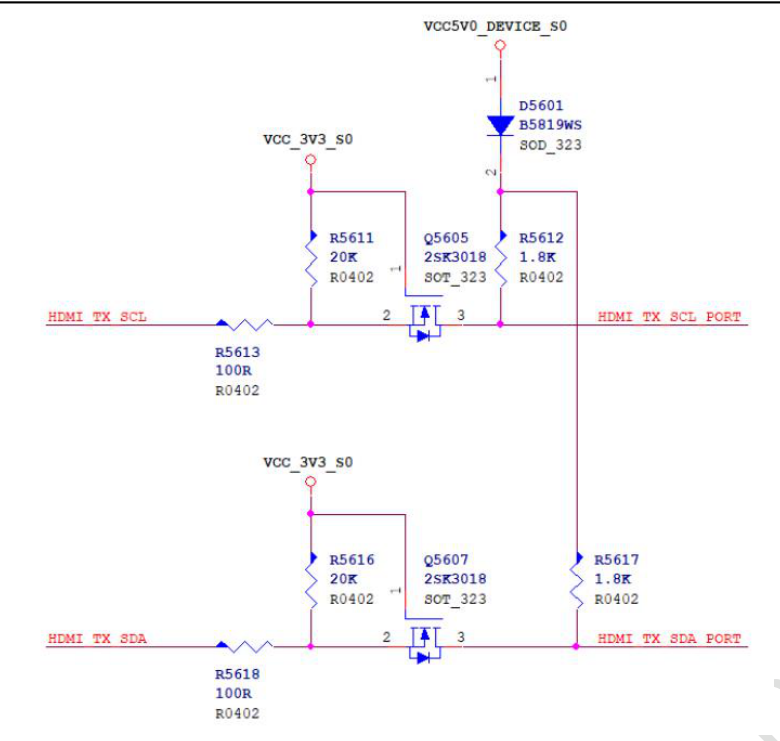
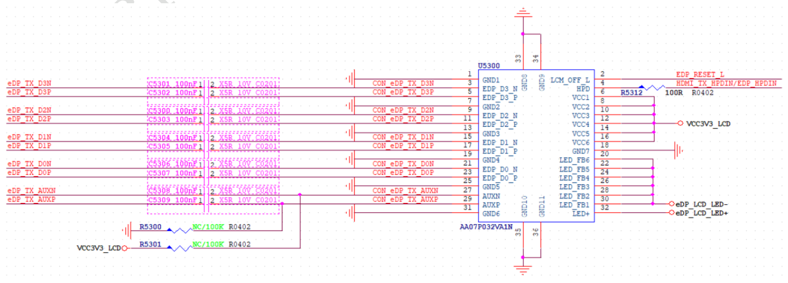
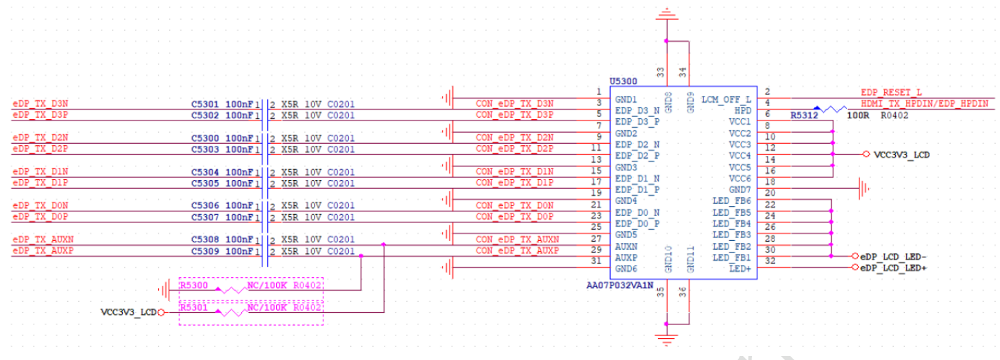

## Geltungsbereich

Dieser Leitfaden unterstützt den Entwurf von RK3572-Platinen und die Bewertung des ArmSoM-Zero5-Projekts. Grundlage sind der Hardware Design Guide V1.1 und das vorliegende Hardwarepaket. Schnittstellen des SoC sind nicht zwangsläufig auf einer Platine herausgeführt. Die endgültige Zero5-Konfiguration sowie verfügbare Betriebssysteme und Kernelversionen sind anhand der Dokumentation der jeweiligen Hardwareversion zu prüfen. Für diesen Artikel wurden keine ArmSoM-Hardwaremessungen durchgeführt.

Bei RK3572-Displays und -Kameras zuerst Pixeldurchsatz, VOP/ISP, PHY-Multiplexing und Pegel abgleichen. Mechanische Steckbarkeit bestätigt weder Auflösung und Bildrate noch Lanes, Einschaltfolge oder Treiber. Kameraeingänge und Displayausgänge werden daher getrennt geprüft.

## 1. Zwei CSI-Gruppen mit vier Lanes und Split-Modi

RK3572 besitzt zwei MIPI-D-PHY-CSI-RX-Gruppen gemäß D-PHY 1.2 mit bis zu 2.5 Gbit/s je Lane. Jede Vier-Lane-Gruppe lässt sich gemäß Referenz in zwei Zwei-Lane-Schnittstellen mit zugehörigen Taktpaaren teilen. Vier Datenleitungen dürfen nicht beliebig vier Sensoren zugewiesen werden.

| Datenressource | Schnittstelle nach Aufteilung |
|---|---|
| CSI0 D0/D1 | CSI0 D0/D1 + CLK0 |
| CSI0 D2/D3 | CSI1 D0/D1 + CLK1 |
| CSI2 D0/D1 | CSI2 D0/D1 + CLK2 |
| CSI2 D2/D3 | CSI3 D0/D1 + CLK3 |

*CSI0/CSI1-Lane-Zuordnung*

*CSI2/CSI3-Lane-Zuordnung*

## 2. Sensorversorgung, MCLK und I2C

Die Kamerareferenz nutzt 1.8 V, 1.2 V und 2.8 V; ein Sensor kann jedoch 1.5 V oder 1.8 V DVDD benötigen. Maßgeblich ist dessen Datenblatt. Bei mehr als 100 mA Kernstrom DC/DC prüfen. DOVDD an VCCIO2/VCCIO4 und I2C-Pegel anpassen. Zwei Sensoren mit gleicher I2C-Adresse brauchen getrennte Busse oder eine validierte Adressverwaltung.

Autofokus-2.8-V von Analogversorgung trennen oder mit Ferrit entkoppeln; Kondensatoren nah am Stecker platzieren. PWDN-/RESET-Startzustände müssen unbeabsichtigtes Starten verhindern; Referenz-RESET-Kapazität ist 100 nF. MCLK-Frequenz, Pegel und Sequenz für das gewählte Modul bestätigen; die Referenz ist nicht universell.

## 3. Bitbreite und Reihenfolge paralleler Videoeingänge

CIF unterstützt BT.601 RAW mit 8/10/12 Bit und 8-Bit-YCbCr422, BT.656 mit 8 Bit sowie BT.1120 mit 16 Bit. Niedrige Ausrichtung nutzt data[0:n−1], hohe data[16−n:15]. BT.1120-Y/C-Reihenfolge mit der Quelle abstimmen. Der Referenztakt erhält 22 Ω am jeweiligen Sender; Dämpfung und ESD bei Platinenverbindungen nach Signalintegrität prüfen.

## 4. VOP-Ausgänge und HDMI/eDP-Multiplexing

*VOP- und Display-Zuordnung*

HDMI und eDP teilen einen Combo PHY und sind keine zwei unabhängigen parallelen Ausgänge. Datenblatt V1.1 nennt für VideoPort1 2048×1080@60 mit 8 Bit, der Leitfaden dagegen ein zweites Display mit 2560×1600@60. Daher wird diese Maximalkombination nicht zugesichert. Linkbandbreite, VOP-Grenzen und BSP-Modi getrennt prüfen; daraus folgt auch kein Type-C-DP-Alt-Mode.

## 5. HDMI: REXT, Kopplung und TMDS-Bias

*HDMI-REXT-Referenzwiderstand*

*HDMI-Differenzkopplung*

*TMDS-Bias und Schaltstufe*

REXT mit 8.2 kΩ, 1% nahe am SoC nach Masse legen; Differenzkanäle mit 220 nF, bevorzugt 0201, koppeln. MOS-Schalter steuern das 590-Ω-TMDS-Biasnetz für unterschiedliche FRL-/TMDS-Zustände. Eine spezielle RK628F-TMDS-Verbindung ersetzt keinen externen HDMI-Anschluss mit Abschaltleckstrom- und Konformitätsprüfung. Genannte FRL-Protokollstufen belegen nicht alle Stufen des SoC; RK3572-PHY und BSP sind maßgeblich.

## 6. Pegelanpassung der HDMI-Steuersignale

*CEC-Isolationsreferenz*

*DDC-Pegelwandlung*

HPD an VCCIO6 beziehungsweise PMUIO1 anpassen. CEC nutzt 3.3 V und 27 kΩ; MOS-Leckstrom und Ausgangskapazität beeinflussen Standby und Signalform. Externes DDC führt 5 V, macht die SoC-Pins aber nicht 5-V-tolerant: Pegelwandlung beibehalten und etwa D5601 auf Rückwärtsleckstrom prüfen. HDMI-Pin 18 benötigt 4.8–5.3 V mit 1 µF Referenzentkopplung. ESD-Kapazität: schnelle Signale ≤0.2 pF, übrige ≤1 pF.

## 7. eDP, DSI und Panelsteuerung

*AC-Kopplung des eDP-Hauptlinks*

*eDP-AUX-Referenzbeschaltung*

eDP 1.3 unterstützt 1/2/4 Lanes mit 1.62/2.7/5.4 Gbit/s und 1-Mbit/s-AUX; Lanes nicht beliebig tauschen. Der Schaltungsteil nennt 100 nF für Hauptlink und AUX sowie optionale 100-kΩ-Pull-downs an AUXP und Pull-ups nach 3.3 V an AUXN gemäß Panel. Der PCB-Teil nennt dagegen 220 nF. Dieser Konflikt bleibt offen dokumentiert; vor Fertigung aktuelle Herstellerfreigabe und Paneldaten prüfen.

MIPI DSI bietet vier Ausgangslanes; Initialisierung, Versorgung, RESET und Backlight richten sich nach dem Panel. Feedbackwiderstände der Beleuchtung mit 1% und EN/PWM standardmäßig low auslegen, um Aufblitzen zu vermeiden. Touch-I2C-Pegel und Adresse getrennt prüfen. RGB-, BT.1120- und MCU-Displaymodi brauchen passende IOMUX ohne Doppelbelegung; beim MCU-Displayinterface keine Lesefunktion voraussetzen.

## 8. PCB-Regeln und Systemabnahme

| Merkmal | MIPI | HDMI | eDP |
|---|---|---|---|
| Differenzimpedanz | 100 Ω ±10% | 100 Ω ±10% | 90 Ω ±10% |
| Abweichung innerhalb des Paars | <1 ps / 6 mil | <1 ps / 6 mil | <1 ps / 6 mil |
| Länge | <6 in | <4 in | <6 in |
| Signalvias | ≤4 | Möglichst vermeiden | ≤2 |
| Paarabstand | ≥4W; min 3W | ≥7W | ≥4W |

MIPI-Takt-zu-Daten-Abweichung zusätzlich mit <2 ps/12 mil und HDMI zwischen Paaren mit <80 ps/480 mil prüfen. Die Tabellenwerte sind keine universelle Zeit-Längen-Umrechnung. Zielauflösung, Bildrate, Farbtiefe, Hotplug, Bildwiederherstellung, Beleuchtung, Touch, Kameraframeverluste und Parallelbelastung testen. Einzel- und Mehrfachbetrieb samt Kabeln, Panel-/Sensortyp und BSP dokumentieren; ein funktionierendes Display bestätigt nicht jede Kombination.

## ArmSoM-Produkte und nächste Schritte

Für ein kompaktes RK3572-Produkt empfiehlt sich zunächst der ArmSoM-Plan für das Zero-Format sowie eine Liste der benötigten Display-, Speicher-, Netzwerk- und Versorgungsschnittstellen. Der Planungsartikel ist keine Spezifikation eines veröffentlichten Modells und kein endgültiger Schaltplan. Für verfügbare Plattformen und deren Schnittstellen dienen der offizielle Produktkatalog und Docs.

- [RK3572 / ArmSoM Zero: Produktplanung](/de/articles/rockchip-rk3572-armsom-zero-preview/)
- [ArmSoM](https://www.armsom.org/category/all-products) · [ArmSoM Docs](https://docs.armsom.org/)

## Lesepfad durch die Reihe

- [RK3572-Datenblatt V1.1: Spezifikationen, Schnittstellen und Änderungen](/de/articles/rk3572-datasheet-v10/)
- [RK3572-Hardwaredesign: von der Referenzauswahl zur ersten Platine](/de/articles/rk3572-hardware-design-series/)
- [RK3572-Minimalsystem: 24-MHz-Takt, Reset, Boot und UART](/de/articles/rk3572-minimum-system-bringup/)
- [RK3572-Stromversorgung: Domänen, RK806-5 und zwei PMICs](/de/articles/rk3572-power-domains-pmic/)
- [RK3572-DDR-Design: LPDDR4X/LPDDR5-Schaltung und Leiterplattenregeln](/de/articles/rk3572-ddr-circuit-pcb/)
- [RK3572-DDRBIN-Konfiguration: Vorlagen, ADC-Auswahl und mehrere Profile](/de/articles/rk3572-ddrbin-adc-configuration/)
- [RK3572-Speicher und Boot: eMMC, UFS und FSPI anschließen und versorgen](/de/articles/rk3572-storage-boot-design/)
- [RK3572 USB und Type-C: Programmierung, Rollen und Versorgungserkennung](/de/articles/rk3572-usb-typec-power-design/)
- [RK3572 PCIe und SATA: Combo-PHY-Multiplexing, Takte und Routing](/de/articles/rk3572-high-speed-interface-design/)
- [RK3572-Displays und Kameras: HDMI, eDP, MIPI und Pegelanpassung](/de/articles/rk3572-display-camera-design/)
