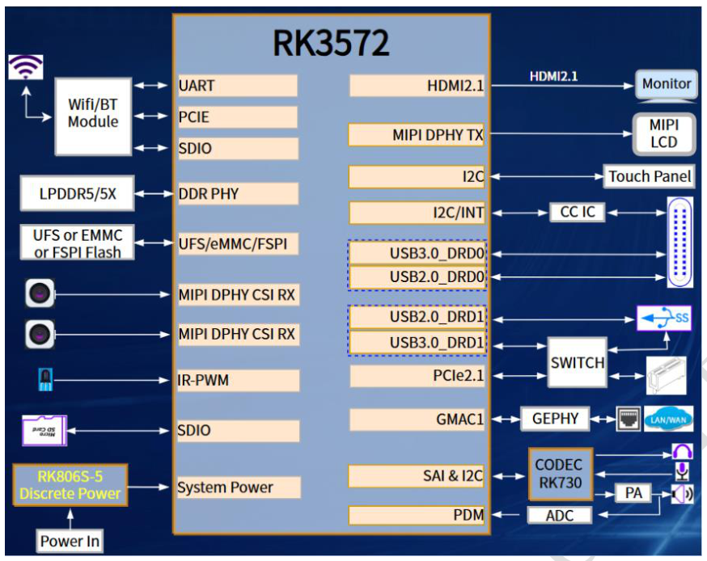
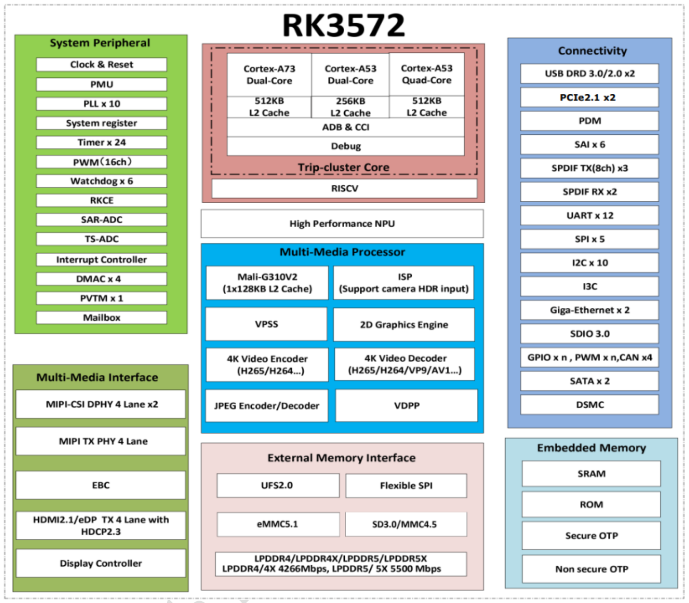

## Geltungsbereich

Dieser Leitfaden unterstützt den Entwurf von RK3572-Platinen und die Bewertung des ArmSoM-Zero5-Projekts. Grundlage sind der Hardware Design Guide V1.1 und das vorliegende Hardwarepaket. Schnittstellen des SoC sind nicht zwangsläufig auf einer Platine herausgeführt. Die endgültige Zero5-Konfiguration sowie verfügbare Betriebssysteme und Kernelversionen sind anhand der Dokumentation der jeweiligen Hardwareversion zu prüfen. Für diesen Artikel wurden keine ArmSoM-Hardwaremessungen durchgeführt.

Das RK3572-Paket enthält Datenblätter, Hardwareleitfaden, EVB-Handbücher, DDR-Vorlagen, Referenzschaltungen und Prüfberichte. Nacharbeit entsteht häufig durch vermischte Revisionen und Referenzen mit unterschiedlichen Einsatzzwecken. Diese Reihe folgt den technischen Entscheidungen und bindet jedes Schnittstellenthema an den passenden Hardwarestand.

*RK3572-EVB-Referenzanwendung*

*RK3572-Funktions- und Schnittstellendiagramm*

## Zuerst die richtige Referenz auswählen

| Unterlage | Zweck | Behandlung in dieser Serie |
|---|---|---|
| RK3572 Datasheet V1.1 | SoC-Funktionen, Pins und elektrische Grenzen | Bestehenden Artikel aktualisieren |
| Hardware Design Guide V1.1 CN/EN | Schaltplan- und PCB-Empfehlungen | Nach Aufgaben aufteilen; chinesische Bilder für ZH, englische für EN/RU/DE |
| RK3572_AIOT_REF_SCH_V13 | Basis für AIoT-Platinen ohne Akku | Gesamtreferenz und TMI3255S-Footprintkorrektur prüfen |
| RK809C-8 + RK805B-8 V14 | Referenz für akkubetriebene Designs | Adapter-/Type-C-Erkennung und HUSB311 prüfen |
| EVB1 / EVB2 / EVB3 | Bedienung und Funktionsverständnis | Nicht automatisch der aktuelle Serienschaltplan |
| NVR / E-ink DEMO | Anwendungsspezifische Demonstratoren | Aktualisierungs- und Standbygrenzen beachten |

Laut Auswahlhinweisen wird EVB1 nicht mehr aktualisiert und soll nicht direkt als Basis für Serien-PCB und Schaltplan dienen. NVR-Referenzen haben Grenzen bei Aktualität und Standby; auch die E-ink-DEMO ersetzt keine vollständige Stromsparlösung. Zuerst die Versorgungsarchitektur auswählen, dann DDR-Vorlage und Firmware und anschließend die multiplexierten Schnittstellen zuordnen.

## Sechs Prüfpunkte von der Anforderung bis zur ersten Platine

1. Eine Funktionsmatrix mit Controller, PHY, MUX, Versorgungsdomäne und Stecker für Display, Kamera, USB, PCIe, SATA und GPIO erstellen.
2. Prüfpunkte für Haupttakt, Reset, Boot-ADC, UART0 und USB-DRD0-Programmierung vorsehen.
3. DRAM-Bauteil, Kapazität, Ranks, PCB-Vorlage, ADC Config und DDRBIN gemeinsam verwalten.
4. Spannungen, Einschaltfolge, Retention-Versorgungen und Weckquellen zusammen prüfen.
5. Vor Fertigung Impedanz, Laufzeitausgleich, Referenzflächen, Rückstromvias, Stecker und ESD prüfen.
6. Bei der ersten Platine mit Versorgung und Download beginnen, danach Speicher und einzelne Schnittstellen prüfen; Parallelbetrieb und Resume folgen zuletzt.

## Was der Prüfbericht belegt

Der Hardwareprüfbericht hilft bei Testfällen und Messbedingungen. Seine Ergebnisse gelten für die tatsächlich geprüfte EVB, Firmware und Umgebung. Änderungen an Lagenaufbau, DRAM, PMIC, Steckern, Kabeln oder Gehäuse erfordern neue Prüfungen der betroffenen Punkte. Der Ablauf ist eine technische Empfehlung, kein Nachweis bestandener ArmSoM-Zero5-Tests.

## Umfang dieses Pakets

Dieses Paket ergänzt neun Themen zu Einstieg, Minimalsystem, Versorgung, DDR, DDRBIN, Speicher, USB, PCIe/SATA sowie Displays und Kameras und aktualisiert Datenblatt und RK730-Artikel. Es beansprucht keine vollständige kapitelweise Übersetzung der Abschnitte zu Audio, GMAC, langsamen I/Os, EMV, Fertigung und Löten; diese bleiben eigene Folgethemen.

## ArmSoM-Produkte und nächste Schritte

Für ein kompaktes RK3572-Produkt empfiehlt sich zunächst der ArmSoM-Plan für das Zero-Format sowie eine Liste der benötigten Display-, Speicher-, Netzwerk- und Versorgungsschnittstellen. Der Planungsartikel ist keine Spezifikation eines veröffentlichten Modells und kein endgültiger Schaltplan. Für verfügbare Plattformen und deren Schnittstellen dienen der offizielle Produktkatalog und Docs.

- [RK3572 / ArmSoM Zero: Produktplanung](/de/articles/rockchip-rk3572-armsom-zero-preview/)
- [ArmSoM](https://www.armsom.org/category/all-products) · [ArmSoM Docs](https://docs.armsom.org/)

## Lesepfad durch die Reihe

- [RK3572-Datenblatt V1.1: Spezifikationen, Schnittstellen und Änderungen](/de/articles/rk3572-datasheet-v10/)
- [RK3572-Hardwaredesign: von der Referenzauswahl zur ersten Platine](/de/articles/rk3572-hardware-design-series/)
- [RK3572-Minimalsystem: 24-MHz-Takt, Reset, Boot und UART](/de/articles/rk3572-minimum-system-bringup/)
- [RK3572-Stromversorgung: Domänen, RK806-5 und zwei PMICs](/de/articles/rk3572-power-domains-pmic/)
- [RK3572-DDR-Design: LPDDR4X/LPDDR5-Schaltung und Leiterplattenregeln](/de/articles/rk3572-ddr-circuit-pcb/)
- [RK3572-DDRBIN-Konfiguration: Vorlagen, ADC-Auswahl und mehrere Profile](/de/articles/rk3572-ddrbin-adc-configuration/)
- [RK3572-Speicher und Boot: eMMC, UFS und FSPI anschließen und versorgen](/de/articles/rk3572-storage-boot-design/)
- [RK3572 USB und Type-C: Programmierung, Rollen und Versorgungserkennung](/de/articles/rk3572-usb-typec-power-design/)
- [RK3572 PCIe und SATA: Combo-PHY-Multiplexing, Takte und Routing](/de/articles/rk3572-high-speed-interface-design/)
- [RK3572-Displays und Kameras: HDMI, eDP, MIPI und Pegelanpassung](/de/articles/rk3572-display-camera-design/)
