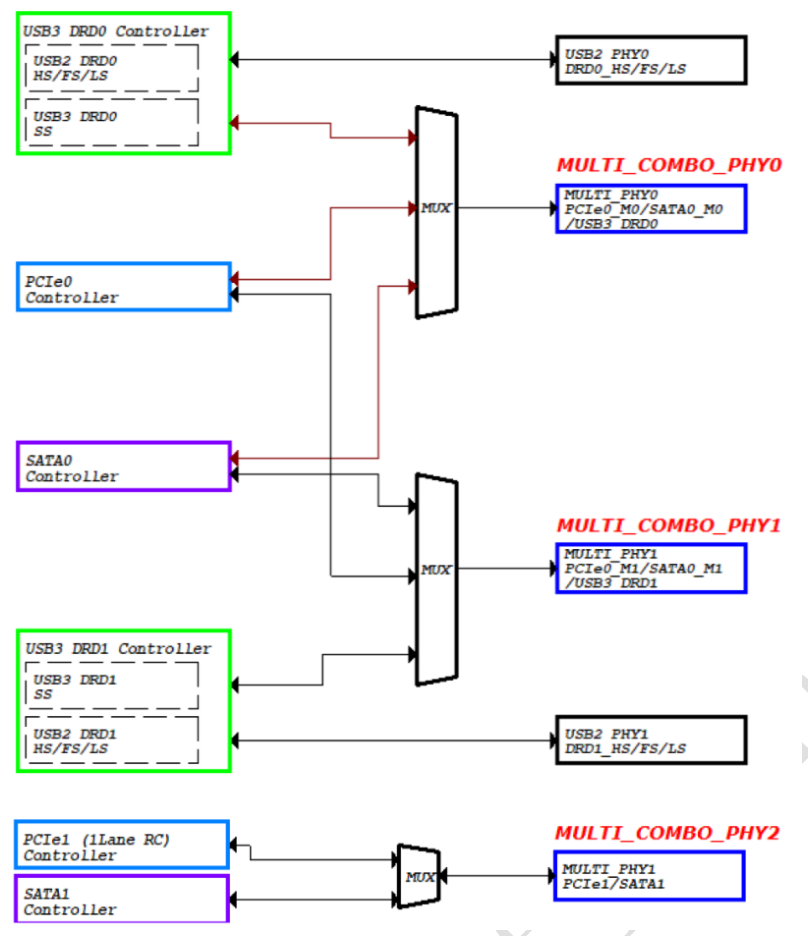
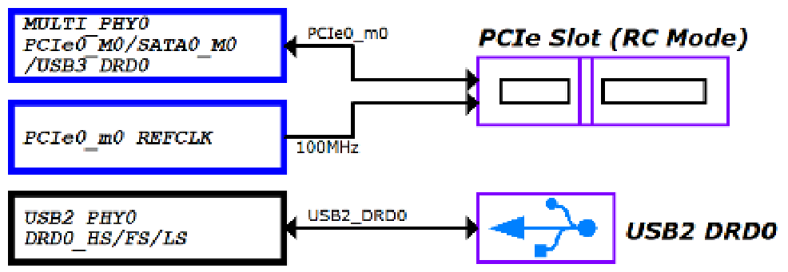
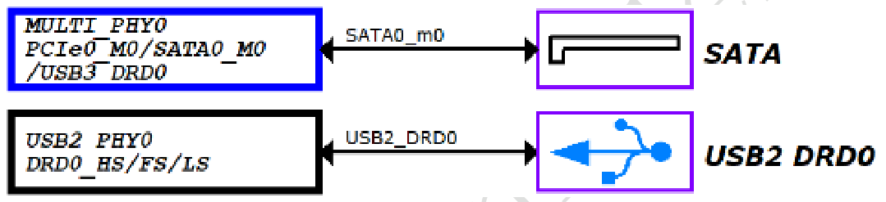
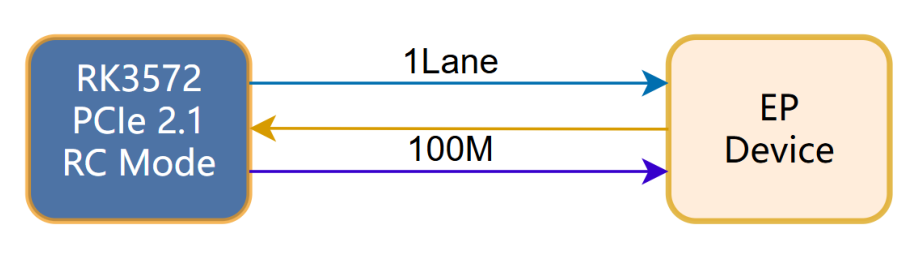
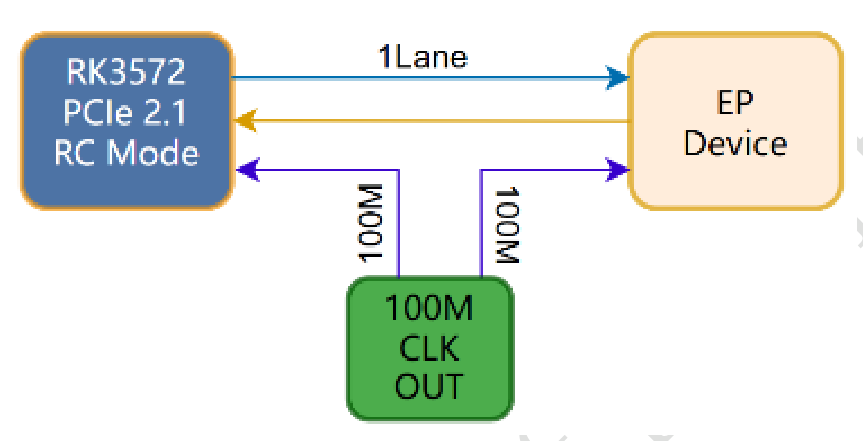
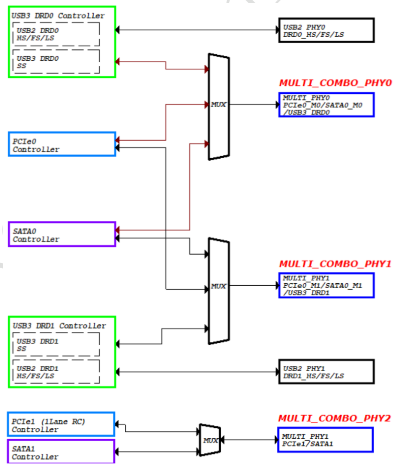

## Geltungsbereich

Dieser Leitfaden unterstützt den Entwurf von RK3572-Platinen und die Bewertung des ArmSoM-Zero5-Projekts. Grundlage sind der Hardware Design Guide V1.1 und das vorliegende Hardwarepaket. Schnittstellen des SoC sind nicht zwangsläufig auf einer Platine herausgeführt. Die endgültige Zero5-Konfiguration sowie verfügbare Betriebssysteme und Kernelversionen sind anhand der Dokumentation der jeweiligen Hardwareversion zu prüfen. Für diesen Artikel wurden keine ArmSoM-Hardwaremessungen durchgeführt.

Bei SSDs, SATA-Laufwerken und schneller RK3572-Peripherie zuerst Controller und PHY zuordnen. Drei Combo PHYs bedeuten nicht drei unabhängige PCIe- und drei SATA-Controller. M0/M1 eines Controllers sind keine zwei gleichzeitig nutzbaren Ports.

## 1. Schnittstellenzahl und Multiplexing zuerst klären

| PHY | Wählbare Funktionen |
|---|---|
| Combo PHY0 | PCIe0_M0 / SATA0_M0 / USB3_DRD0 |
| Combo PHY1 | PCIe0_M1 / SATA0_M1 / USB3_DRD1 |
| Combo PHY2 | PCIe1 / SATA1 |

*Zuordnung von PCIe-Controllern und PHYs*

Hardware Guide V1.1 nennt ausdrücklich zwei PCIe-2.1-x1-Controller, nur RC ohne EP, sowie zwei SATA-Controller. Datenblatt V1.1 nennt zwei PCIe/SATA/USB- und eine PCIe/SATA-Combo-Schnittstelle: drei multiplexierte PHY-Pfade. Controller- und PHY-Zahlen beschreiben verschiedene Ressourcen. Alternative MUX-Routen dürfen nicht zu drei unabhängigen PCIe-/SATA-Ports addiert werden; herausgeführte Schnittstellen hängen vom Board ab.

*Referenzkombination aus USB2 und PCIe0*

*Referenzkombination aus USB2 und SATA0*

## 2. PCIe-Referenztakt und Seitenbandsignale

PCIE0/1_REFCLKP/N kann Eingang oder Ausgang sein, standardmäßig Ausgang zum EP. Die 100-MHz-Taktquelle festlegen und nicht beide Enden als Ausgang konfigurieren. TX erhält 100 nF in Serie, bevorzugt 0201; RX und REFCLK werden direkt verbunden. Protokollseitige TXP/TXN-Polaritätsumkehr erlaubt keine beliebigen weiteren Signalvertauschungen.

*Referenztakt als Ausgang*

*Referenztakt als Eingang*

| Merkmal | Anforderung |
|---|---|
| CLKREQN | Funktionspin verwenden, keinen gewöhnlichen GPIO |
| PERSTN / WAKEN / PRSNT | Pegelgerechte GPIOs möglich; Richtung und Startzustand prüfen |
| CLKREQN M0 / M1 / M2 / M3 | VCCIO4 / VCCIO3 / VCCIO2 / VCCIO6 |
| Steuerpegel eines Standardslots | 3.3 V |

## 3. SATA-Beschaltung, Hotplug und Port-Multiplier

*SATA-Controller und Combo PHYs*

SATA unterstützt 1.5/3/6 Gbit/s und eSATA. Ein Port-Multiplier erlaubt laut Leitfaden bis zu fünf Geräte je Port mit gemeinsamem Uplink, keine zusätzlichen Controller. SATA-TX und -RX erhalten jeweils 10 nF, bevorzugt 0201; nicht den PCIe-TX-Wert von 100 nF übernehmen. eSATA-Schutz am Stecker mit höchstens 0.4 pF vorsehen.

SATA0_ACTLED und SATA1_ACTLED zeigen Aktivität; MUX-Positionen liegen in VCCIO4/VCCIO6. CPDET, MPSWIT und CPPOD sind gemeinsam genutzte, per Register einem Controller zugewiesene Ressourcen. Zwei Hotplug-Stecker dürfen sie nicht unabhängig doppelt belegen. Leistungsschalter, Steckersequenz und Betriebssystemunterstützung müssen zusammenpassen.

## 4. PCB-Impedanz, Länge und Schutz

| Merkmal | PCIe | SATA |
|---|---|---|
| Differenzimpedanz | 85 Ω ±10%; REFCLK 100 Ω ±10% | 100 Ω ±10% |
| Abweichung innerhalb des Paars | <1 ps / 6 mil | <1 ps / 6 mil |
| Länge | <6 in | <6 in |
| Signalvias | ≤2 | ≤2 |
| AC-Kopplung | TX 100 nF ±20% | TX/RX 10 nF ±20% |
| Paarabstand | ≥4W | ≥4W |

Den PCIe-Referenztakt separat auf weniger als 12 mil Abweichung im Paar prüfen. Zu anderen Signalen vorzugsweise 5W, mindestens 4W Abstand halten. Für SATA sind 100 Ω bevorzugt; ein im Leitfaden genannter niedrigerer Zielwert benötigt Prüfung von Lagenaufbau und Simulation. Toleranz ersetzt keine Impedanzkontrolle. Rückstrompfade sichern und Flächentrennungen vermeiden.

## 5. Ungenutzte Schnittstellen und Inbetriebnahme

Die Anleitung für ungenutztes PCIe betrifft offene Daten-/Taktleitungen, Versorgung und deaktivierte DTS-Knoten. Zuerst prüfen, ob USB oder SATA denselben PHY nutzt; deaktiviertes PCIe erlaubt kein Erden einer anderweitig benötigten Versorgung. Bei der Inbetriebnahme Versorgung, REFCLK, PERSTN und PHY-Auswahl sichern, danach Linkrate, Breite, Fehler und Dauer-I/O prüfen. Resume und Peripherie-Power-Cycling separat testen.

## ArmSoM-Produkte und nächste Schritte

Für ein kompaktes RK3572-Produkt empfiehlt sich zunächst der ArmSoM-Plan für das Zero-Format sowie eine Liste der benötigten Display-, Speicher-, Netzwerk- und Versorgungsschnittstellen. Der Planungsartikel ist keine Spezifikation eines veröffentlichten Modells und kein endgültiger Schaltplan. Für verfügbare Plattformen und deren Schnittstellen dienen der offizielle Produktkatalog und Docs.

- [RK3572 / ArmSoM Zero: Produktplanung](/de/articles/rockchip-rk3572-armsom-zero-preview/)
- [ArmSoM](https://www.armsom.org/category/all-products) · [ArmSoM Docs](https://docs.armsom.org/)

## Lesepfad durch die Reihe

- [RK3572-Datenblatt V1.1: Spezifikationen, Schnittstellen und Änderungen](/de/articles/rk3572-datasheet-v10/)
- [RK3572-Hardwaredesign: von der Referenzauswahl zur ersten Platine](/de/articles/rk3572-hardware-design-series/)
- [RK3572-Minimalsystem: 24-MHz-Takt, Reset, Boot und UART](/de/articles/rk3572-minimum-system-bringup/)
- [RK3572-Stromversorgung: Domänen, RK806-5 und zwei PMICs](/de/articles/rk3572-power-domains-pmic/)
- [RK3572-DDR-Design: LPDDR4X/LPDDR5-Schaltung und Leiterplattenregeln](/de/articles/rk3572-ddr-circuit-pcb/)
- [RK3572-DDRBIN-Konfiguration: Vorlagen, ADC-Auswahl und mehrere Profile](/de/articles/rk3572-ddrbin-adc-configuration/)
- [RK3572-Speicher und Boot: eMMC, UFS und FSPI anschließen und versorgen](/de/articles/rk3572-storage-boot-design/)
- [RK3572 USB und Type-C: Programmierung, Rollen und Versorgungserkennung](/de/articles/rk3572-usb-typec-power-design/)
- [RK3572 PCIe und SATA: Combo-PHY-Multiplexing, Takte und Routing](/de/articles/rk3572-high-speed-interface-design/)
- [RK3572-Displays und Kameras: HDMI, eDP, MIPI und Pegelanpassung](/de/articles/rk3572-display-camera-design/)
