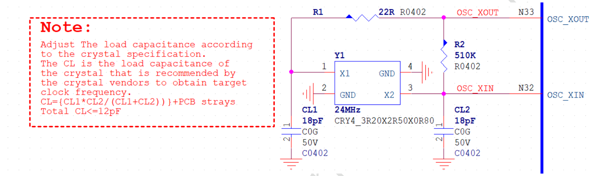
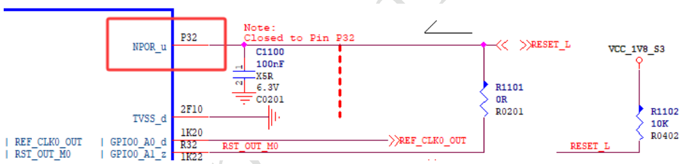
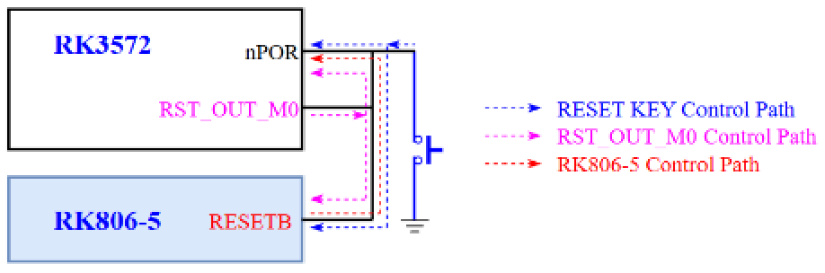
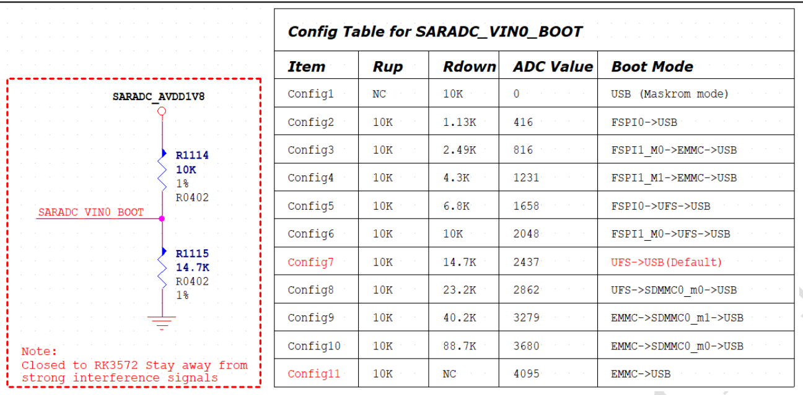

## Geltungsbereich

Dieser Leitfaden unterstützt den Entwurf von RK3572-Platinen und die Bewertung des ArmSoM-Zero5-Projekts. Grundlage sind der Hardware Design Guide V1.1 und das vorliegende Hardwarepaket. Schnittstellen des SoC sind nicht zwangsläufig auf einer Platine herausgeführt. Die endgültige Zero5-Konfiguration sowie verfügbare Betriebssysteme und Kernelversionen sind anhand der Dokumentation der jeweiligen Hardwareversion zu prüfen. Für diesen Artikel wurden keine ArmSoM-Hardwaremessungen durchgeführt.

Bleibt die UART-Ausgabe der ersten RK3572-Platine aus, sind zunächst Versorgung, Haupttakt, Reset und Bootauswahl zu prüfen, anschließend DDR und Systemabbild. UART0, USB DRD0 und ein erzwungener Maskrom-Einstieg müssen auch bei beschädigtem Bootspeicher erreichbar bleiben.

## 1. 24-MHz-Haupttakt und Lastkondensatoren

*Referenzschaltung des 24-MHz-Quarzes*

| Prüfpunkt | Anforderung |
|---|---|
| Crystal | 24 MHz; CL ≤12 pF; ±20 ppm |
| XOUT | 22 Ω |
| Rückkopplungswiderstand | 510 kΩ |
| Referenz-Lastkondensatoren | 18 pF; an CL und parasitäre Kapazitäten anpassen, bevorzugt C0G/NP0 |

18 pF ist ein Referenzwert und gilt nicht für jeden 24-MHz-Quarz. Massepads eines vierpoligen Quarzes anbinden und Quarz samt Kondensatoren nah am SoC, fern von Schaltreglern und schnellen Leitungen platzieren. Die Tastkopfkapazität berücksichtigen: Ein durch die Messung angehaltener Oszillator belegt keinen SoC-Defekt.

## 2. 32.768 kHz, Taktausgänge und Standby

Für den externen RTC-Takt gelten 32.768 kHz, ±30 ppm und 45%–55% Tastgrad; der High-Pegel liegt zwischen 0.7 der PMUIO0-Versorgung und deren voller Spannung. CLK32K_IN-IOMUX konfigurieren und bei Open-Drain-Quellen den internen Pull-down prüfen. PMU_PVTM beziehungsweise externen Niederfrequenztakt gemeinsam mit der Retention-Versorgung auswählen.

| Ausgang | Im Leitfaden genannte Frequenzen |
|---|---|
| REF_CLK0 / REF_CLK1 / REF_CLK2 | 10, 12, 20, 24, 25, 26, 27, 37.125, 40, 50, 58.5, 74.25, 100 MHz |
| ETH0_CLK25M / ETH1_CLK25M | 25 MHz |
| CAM_CLK0 / CAM_CLK1 / CAM_CLK2 | 24 MHz; 27 / 37.125 / 74.25 MHz |
| CLK0_32K_OUT / CLK1_32K_OUT | Vom 24-MHz-Oszillator abhängig; stoppen bei dessen Abschaltung |

## 3. Resetpuls und Einschwingzeit der Versorgung unterscheiden sich

*RK3572-Resetschaltung*

NPOR_u liegt an P32 und ist aktiv low. Gefordert sind mindestens 100 Perioden des 24-MHz-Takts, im Leitfaden ungefähr als 4 µs bezeichnet. Tatsächlich sind es etwa 4.17 µs; die Periodenvorgabe mit Reserve ist maßgeblich. Nach Stabilisierung der letzten Versorgung bleibt Reset mindestens 1 ms aktiv; der Referenzbereich beträgt 5–200 ms. Beide Zeiten sind getrennt zu behandeln.

RESET_L nach PMUIO0_VCC1V8 ziehen; der Referenzkondensator beträgt 100 nF. Ein externer Watchdog sollte Open Drain nutzen, um Konflikte mit dem bidirektionalen RESETB des PMIC zu vermeiden. Der Übertemperaturschutz kann über TSADC, RST_OUT und die Resetkette wirken; diesen Pfad nicht als gewöhnlichen Debug-GPIO verwenden.

*Reset- und Übertemperaturpfade*

## 4. Boot-ADC-Auswahl und Wiederherstellungszugang

SARADC_IN0_BOOT wählt die Bootreihenfolge; low aktiviert USB Maskrom. Die Taste an SARADC_IN1 dient dagegen Recovery. Teilerwiderstände mit 1% Toleranz nahe am SoC vorsehen. Die folgende Boot-Tabelle ist nicht die ADC-Config-Tabelle für DDRBIN.

| Config | Rup | Rdown | ADC | Bootreihenfolge |
|---|---|---|---|---|
| 1 | NC | 10 kΩ | 0 | USB (Maskrom) |
| 2 | 10 kΩ | 1.13 kΩ | 416 | FSPI0 → USB |
| 3 | 10 kΩ | 2.49 kΩ | 816 | FSPI1_M0 → EMMC → USB |
| 4 | 10 kΩ | 4.3 kΩ | 1231 | FSPI1_M1 → EMMC → USB |
| 5 | 10 kΩ | 6.8 kΩ | 1658 | FSPI0 → UFS → USB |
| 6 | 10 kΩ | 10 kΩ | 2048 | FSPI1_M0 → UFS → USB |
| 7 | 10 kΩ | 14.7 kΩ | 2437 | UFS → USB |
| 8 | 10 kΩ | 23.2 kΩ | 2862 | UFS → SDMMC0_m0 → USB |
| 9 | 10 kΩ | 40.2 kΩ | 3279 | EMMC → SDMMC0_m1 → USB |
| 10 | 10 kΩ | 88.7 kΩ | 3680 | EMMC → SDMMC0_m0 → USB |
| 11 | 10 kΩ | NC | 4095 | EMMC → USB |

*Widerstandskonfiguration des Boot-ADC*

BootROM bootet nicht direkt von einer PCIe-SSD. Zunächst wird ein Bootloader von unterstütztem Speicher wie SPI Flash geladen und anschließend PCIe initialisiert. Ein Betriebssystem auf SSD bedeutet keine PCIe-BootROM-Unterstützung.

## 5. UART, JTAG und Prüfung der ersten Platine

Standardmäßig dient UART0 M0 mit 1500000 Baud zur Diagnose. JTAG M0 teilt Pins mit SDMMC0. SDMMC0_DETN_M0 (T33) wird beim Start abgetastet, besitzt einen internen Pull-up und einen Referenzkondensator von 1 nF: high wählt zunächst JTAG, low SD; danach gilt IOMUX. JTAG M1 teilt UART0 M0: U33 ist TX/TCK, V32 RX/TMS. 100-Ω-Serienwiderstände und TVS-Plätze sowie einen 2.54-mm-Stecker oder mindestens 0.7 mm große Testpads vorsehen und die I/O-Pegel beachten.

Reihenfolge: Kurzschlussprüfung → Versorgungsequenz → 24 MHz → Freigabe von RESET_L → Maskrom-Erkennung → DDR-Initialisierung → Bootmedium → Kernelprotokoll. Oszillogramme, UART-Protokolle und Firmwareversionen sichern. Jeweils nur eine Konfiguration ändern, um Versorgungs-, Speichertraining- und Softwarefehler zu unterscheiden.

## ArmSoM-Produkte und nächste Schritte

Für ein kompaktes RK3572-Produkt empfiehlt sich zunächst der ArmSoM-Plan für das Zero-Format sowie eine Liste der benötigten Display-, Speicher-, Netzwerk- und Versorgungsschnittstellen. Der Planungsartikel ist keine Spezifikation eines veröffentlichten Modells und kein endgültiger Schaltplan. Für verfügbare Plattformen und deren Schnittstellen dienen der offizielle Produktkatalog und Docs.

- [RK3572 / ArmSoM Zero: Produktplanung](/de/articles/rockchip-rk3572-armsom-zero-preview/)
- [ArmSoM](https://www.armsom.org/category/all-products) · [ArmSoM Docs](https://docs.armsom.org/)

## Lesepfad durch die Reihe

- [RK3572-Datenblatt V1.1: Spezifikationen, Schnittstellen und Änderungen](/de/articles/rk3572-datasheet-v10/)
- [RK3572-Hardwaredesign: von der Referenzauswahl zur ersten Platine](/de/articles/rk3572-hardware-design-series/)
- [RK3572-Minimalsystem: 24-MHz-Takt, Reset, Boot und UART](/de/articles/rk3572-minimum-system-bringup/)
- [RK3572-Stromversorgung: Domänen, RK806-5 und zwei PMICs](/de/articles/rk3572-power-domains-pmic/)
- [RK3572-DDR-Design: LPDDR4X/LPDDR5-Schaltung und Leiterplattenregeln](/de/articles/rk3572-ddr-circuit-pcb/)
- [RK3572-DDRBIN-Konfiguration: Vorlagen, ADC-Auswahl und mehrere Profile](/de/articles/rk3572-ddrbin-adc-configuration/)
- [RK3572-Speicher und Boot: eMMC, UFS und FSPI anschließen und versorgen](/de/articles/rk3572-storage-boot-design/)
- [RK3572 USB und Type-C: Programmierung, Rollen und Versorgungserkennung](/de/articles/rk3572-usb-typec-power-design/)
- [RK3572 PCIe und SATA: Combo-PHY-Multiplexing, Takte und Routing](/de/articles/rk3572-high-speed-interface-design/)
- [RK3572-Displays und Kameras: HDMI, eDP, MIPI und Pegelanpassung](/de/articles/rk3572-display-camera-design/)
