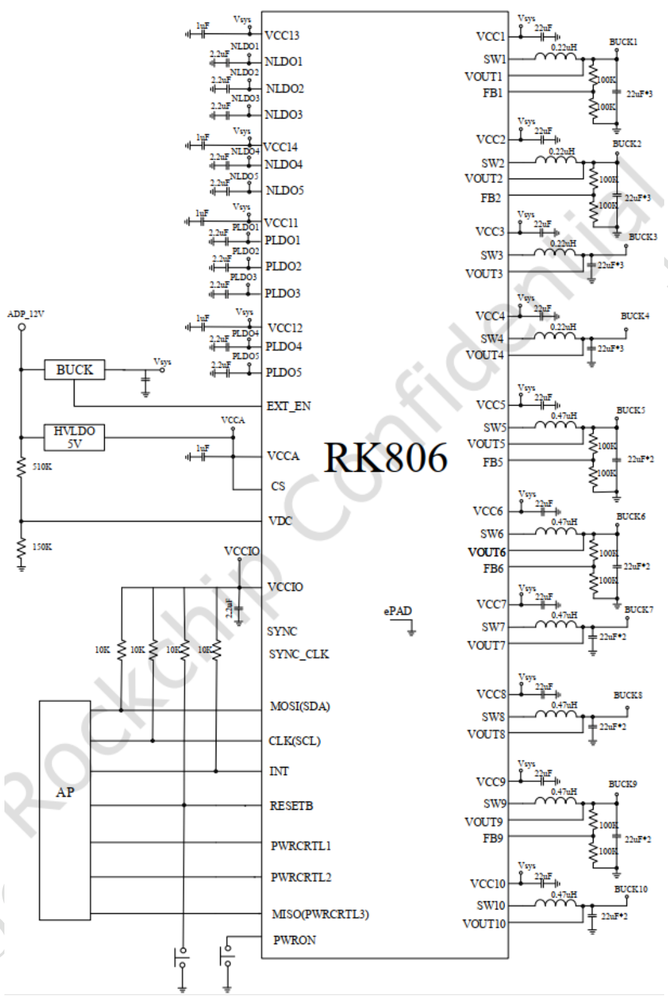
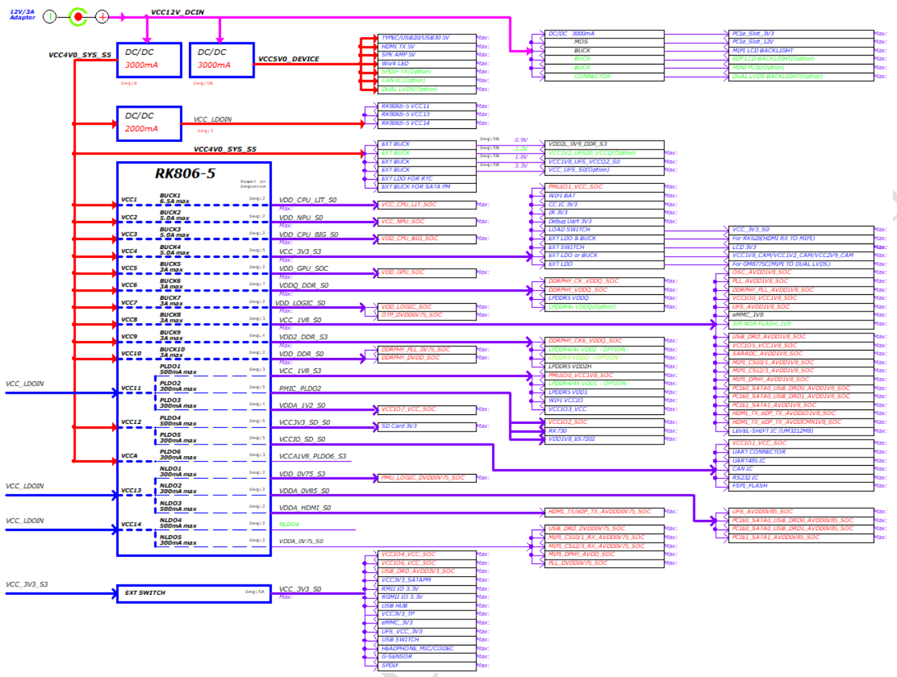

## Geltungsbereich

Dieser Leitfaden unterstützt den Entwurf von RK3572-Platinen und die Bewertung des ArmSoM-Zero5-Projekts. Grundlage sind der Hardware Design Guide V1.1 und das vorliegende Hardwarepaket. Schnittstellen des SoC sind nicht zwangsläufig auf einer Platine herausgeführt. Die endgültige Zero5-Konfiguration sowie verfügbare Betriebssysteme und Kernelversionen sind anhand der Dokumentation der jeweiligen Hardwareversion zu prüfen. Für diesen Artikel wurden keine ArmSoM-Hardwaremessungen durchgeführt.

Die Versorgung des RK3572 umfasst mehr als passende Spannungen: Domänenreihenfolge, dynamische Lasten, DDR-Retention, Weckpfade und Rückspeisung durch Peripherie gehören zusammen. RK806-5 und RK809C-8 plus RK805B-8 sind nicht allein anhand der Ausgangszahl austauschbar.

## 1. Referenzarchitektur auswählen

Das Paket empfiehlt RK806-5/RK806S-5 für übliche AIoT-Geräte ohne Akku und den Zweig RK809C-8 plus RK805B-8 für Akkuanwendungen. Entsprechende -5-Varianten werden als kompatibel beschrieben; Hersteller, Eingangsempfehlung und OTP-Konfiguration sind dennoch zu prüfen. RK806-2 ersetzt RK806-5 nicht direkt. Die Grundbezeichnung RK806 legt die Einschaltfolge nicht fest.

*Typische RK806-Beschaltung*

## 2. Versorgungsbaum und lokale Schnittstellenfolgen

*RK3572-Versorgungsbaum*

| Block | Lokale Reihenfolge |
|---|---|
| UFS | 0.85 V → 1.8 V |
| USB | 0.75 V → 1.8 V → 3.3 V |
| MIPI / HDMI / eDP | 0.75 V → 1.8 V |
| PCIe / SATA / USB Combo PHY | 0.85 V → 1.8 V |
| DDR PHY | DVDD → VDDQH → VDDQ / CKVDDQ |

Lokale Schnittstellenfolgen bilden nur einen Teil des Versorgungsbaums. In der Referenz folgen auf die Kernversorgungen 1.8 V, DDR VDD2/1.2 V, bestimmte 3.3-V- und SD-Versorgungen, DDR 0.9 V und aktive 3.3 V, DDRPHY_VDDQ und zuletzt die Freigabe von RESET_L. S0/S3-Suffixe beschreiben die Referenz und definieren nicht automatisch das Standby-Verhalten einer anderen Platine.

## 3. Weckquellen bestimmen die Retention-Versorgung

| Anwendung | Zu prüfende Retention-Bedingungen |
|---|---|
| Referenzzustand mit geringster Leistungsaufnahme | DDRPHY_VDDQH + PMU_LOGIC + PMUIO0/1 |
| USB HID | OSC + USB2 PHY |
| Wecken über USB-4G | OSC + PLL + LOGIC + USB |
| Sprach- / GMAC-Wecken | OSC + PLL + LOGIC |
| CEC | OSC + LOGIC |
| IR / PWM | OSC; PWM aus der PMU-Domäne wählen |
| Weitere GPIO | OSC + LOGIC + zugehöriges VCCIO |

Diese Weckbedingungen sind mit den Anforderungen von DDR, PMIC und Peripherie zu kombinieren. GPIO-Retention vor dem Abschalten von LOGIC konfigurieren. Bei versorgter Peripherie und abgeschalteten SoC-I/Os Rückspeisung und unerwünschte Pull-ups prüfen. Suspend/Resume anhand von Strom, Domänenspannungen, Weckquelle und Protokollen bewerten.

## 4. RK806-Steuerung, Tasten und Eingangsspannung

| Prüfpunkt | Anforderung |
|---|---|
| VCCA | Zuerst oder gleichzeitig mit anderen Eingängen versorgen |
| I2C | CS → VCCA; SDA/SCL: 2.2 kΩ → PMUIO0 |
| RESETB | 100 nF; Gesamtkapazität ≤0.3 µF |
| PWRON | 45 kΩ interner Pull-up; 20 ms low starten das Einschalten |
| VDC | High-Schwelle etwa 0.8 V; empfohlen >1 V und höchstens VCCA |

Der RK806-Betriebsbereich von 2.7–5.5 V ist von der 4-V-Empfehlung für die gewöhnliche RK806-Referenz zu trennen. Auch die konkrete RK806S-Variante prüfen. Für langes Drücken zum Abschalten sind 6/8/10/12 s wählbar. Ein dauerhaft hoher VDC-Pegel beeinflusst das Hardwareabschalten und muss zu Tasten und Autostart passen.

## 5. Buck-Induktivitäten, Kondensatoren und dynamische Lasten

| Buck | Iout max | Cin / Cout | L | Isat | DCR |
|---|---|---|---|---|---|
| 1 | 6.5 A | 22 / 66 µF | 0.24 µH | ≥7.8 A | <15 mΩ |
| 2–4 | 5 A | 22 / 66 µF | 0.24 µH | ≥6.5 A | <20 mΩ |
| 5–10 | 3 A | 10 / 44 µF | 0.47 µH | ≥4 A | <40 mΩ |

Die Tabelle enthält Auswahlbedingungen, keine addierbaren Verbrauchswerte des RK3572. Erwärmung und transiente Sättigung der Induktivität sowie die unter DC-Vorspannung verbleibende Keramikkapazität prüfen. LDO-Ausgänge benötigen mindestens 2.2 µF. PLDO benötigt mindestens 0.2 V Reserve über dem Ausgang und mindestens 2 V Eingangsspannung. Für NLDO gelten ebenfalls 0.2 V Reserve und zusätzlich die Ausgangsgrenze VCCA − 1.5 V.

## 6. Type-C-Erkennung der Zwei-PMIC-Referenz V1.4

Die Zwei-PMIC-Referenz V1.4 vom 2026-10-12 ergänzt HUSB311 für gemeinsam von Netzteil und Type-C genutztes RK809C-VDC an Pin 61. HUSB311 ist laut Änderungsnotiz die Standardvariante; alternative GPIO-Erkennungsbauteile bleiben unbestückt. GPIO-Pegelerkennung ersetzt keine vollständige USB-PD-Implementierung. Bei älteren Schaltungen CC-Erkennung, VDC, Ein-/Ausstecken und Abschalten gemeinsam prüfen.

## 7. Prüfung vor Fertigung und an der ersten Platine

Vollständigen PMIC-Suffix, OTP, Eingangsquelle, Spannungen und Strombudgets dokumentieren. GPIO-Startzustände, Rückspeisung, RESET_L und DDR-Sequenz prüfen. Kaltstart, Warmstart, langes Drücken und Versorgungstrennung messen. CPU-, NPU-, DDR- und Peripherielasten kombinieren und mit dem Oszilloskop Spannungseinbrüche und Ripple statt nur Multimeter-Mittelwerte bewerten.

## ArmSoM-Produkte und nächste Schritte

Für ein kompaktes RK3572-Produkt empfiehlt sich zunächst der ArmSoM-Plan für das Zero-Format sowie eine Liste der benötigten Display-, Speicher-, Netzwerk- und Versorgungsschnittstellen. Der Planungsartikel ist keine Spezifikation eines veröffentlichten Modells und kein endgültiger Schaltplan. Für verfügbare Plattformen und deren Schnittstellen dienen der offizielle Produktkatalog und Docs.

- [RK3572 / ArmSoM Zero: Produktplanung](/de/articles/rockchip-rk3572-armsom-zero-preview/)
- [ArmSoM](https://www.armsom.org/category/all-products) · [ArmSoM Docs](https://docs.armsom.org/)

## Lesepfad durch die Reihe

- [RK3572-Datenblatt V1.1: Spezifikationen, Schnittstellen und Änderungen](/de/articles/rk3572-datasheet-v10/)
- [RK3572-Hardwaredesign: von der Referenzauswahl zur ersten Platine](/de/articles/rk3572-hardware-design-series/)
- [RK3572-Minimalsystem: 24-MHz-Takt, Reset, Boot und UART](/de/articles/rk3572-minimum-system-bringup/)
- [RK3572-Stromversorgung: Domänen, RK806-5 und zwei PMICs](/de/articles/rk3572-power-domains-pmic/)
- [RK3572-DDR-Design: LPDDR4X/LPDDR5-Schaltung und Leiterplattenregeln](/de/articles/rk3572-ddr-circuit-pcb/)
- [RK3572-DDRBIN-Konfiguration: Vorlagen, ADC-Auswahl und mehrere Profile](/de/articles/rk3572-ddrbin-adc-configuration/)
- [RK3572-Speicher und Boot: eMMC, UFS und FSPI anschließen und versorgen](/de/articles/rk3572-storage-boot-design/)
- [RK3572 USB und Type-C: Programmierung, Rollen und Versorgungserkennung](/de/articles/rk3572-usb-typec-power-design/)
- [RK3572 PCIe und SATA: Combo-PHY-Multiplexing, Takte und Routing](/de/articles/rk3572-high-speed-interface-design/)
- [RK3572-Displays und Kameras: HDMI, eDP, MIPI und Pegelanpassung](/de/articles/rk3572-display-camera-design/)
