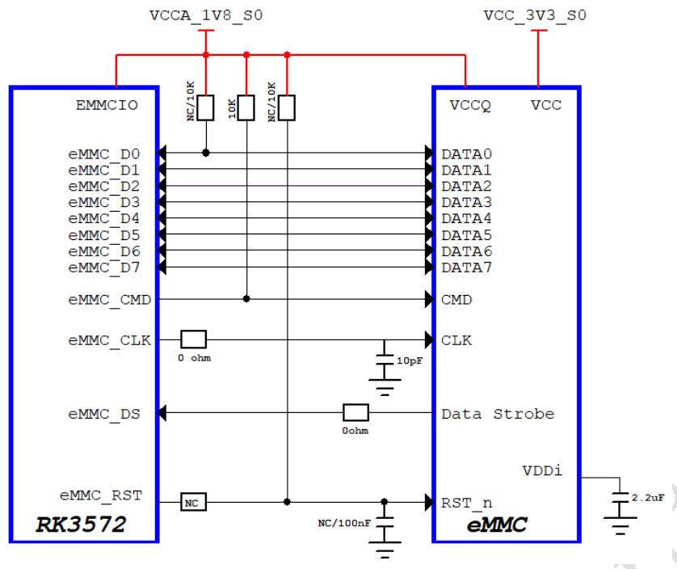
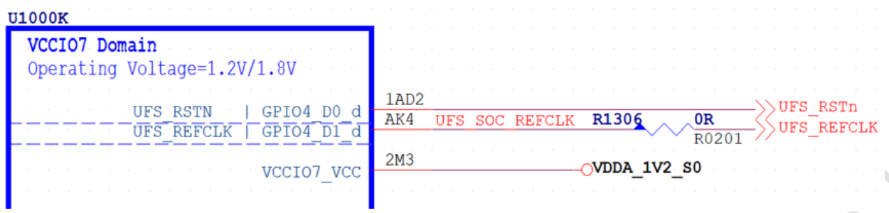
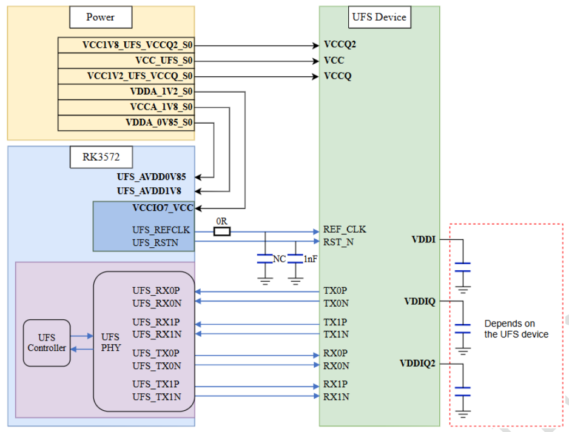
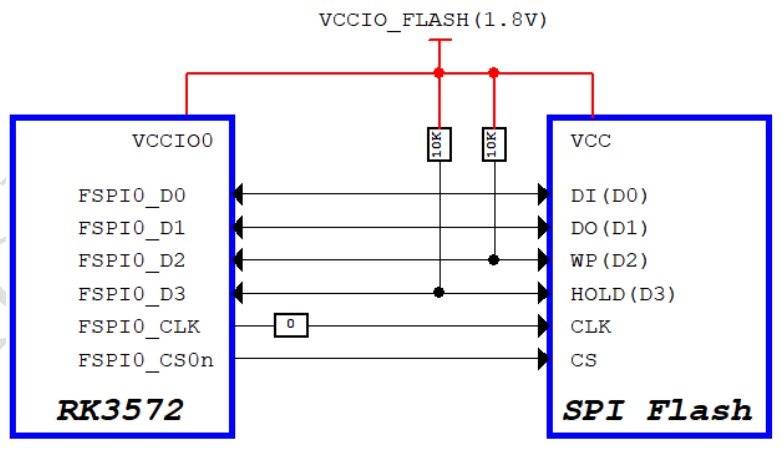
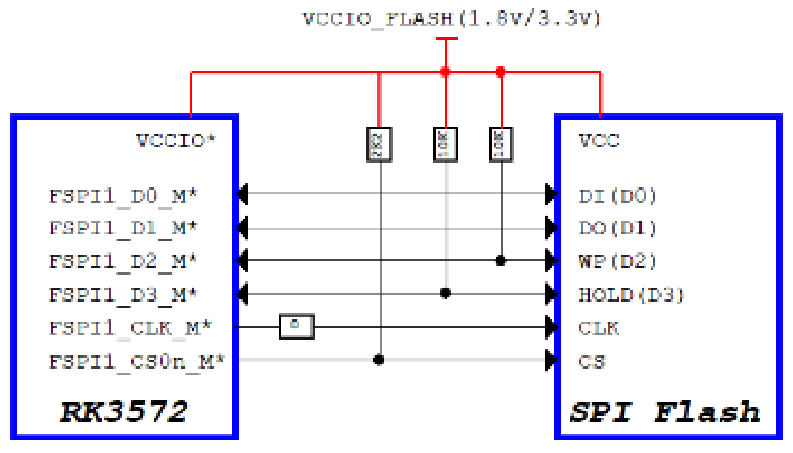

## Geltungsbereich

Dieser Leitfaden unterstützt den Entwurf von RK3572-Platinen und die Bewertung des ArmSoM-Zero5-Projekts. Grundlage sind der Hardware Design Guide V1.1 und das vorliegende Hardwarepaket. Schnittstellen des SoC sind nicht zwangsläufig auf einer Platine herausgeführt. Die endgültige Zero5-Konfiguration sowie verfügbare Betriebssysteme und Kernelversionen sind anhand der Dokumentation der jeweiligen Hardwareversion zu prüfen. Für diesen Artikel wurden keine ArmSoM-Hardwaremessungen durchgeführt.

Bei eMMC, UFS oder SPI Flash für RK3572 sind BootROM, Controller, I/O-Pegel, Pin-Multiplexing und PCB gemeinsam zu prüfen. Die UFS-Geräteversion ist von der Hostgeschwindigkeit zu unterscheiden: Ein neuerer Speicher aktualisiert den UFS-2.0-Controller nicht.

## 1. Speicherpfad auswählen

| Merkmal | Anforderung |
|---|---|
| eMMC | eMMC 5.1; HS400 Enhanced Strobe / HS400 / HS200 / DDR50; 1/4/8-bit |
| UFS | UFS-2.0-Host, 2 Lanes mit 5.8 Gbit/s/Lane; Hostgrenzen gelten auch für kompatible Geräte |
| FSPI0 | Teilt eMMC-Pins; VCCIO0 beträgt 1.8 V |
| FSPI1 | M0 nutzt VCCIO1, M1 VCCIO4; gesamte Domäne konsistent konfigurieren |

Dateisystemunterstützung im SDK bedeutet keine direkte BootROM-Unterstützung. Eine PCIe-SSD als Systemlaufwerk benötigt weiterhin einen Bootloader auf einem unterstützten Medium. Boot-ADC und Bootloader bestimmen den Pfad. USB DRD0 zur Wartung erhalten, statt dafür ausschließlich funktionierenden Speicher vorauszusetzen.

## 2. eMMC: CMD, D0, CLK und STRB

*eMMC-Referenzbeschaltung*

| Merkmal | Anforderung |
|---|---|
| CMD | Externer 10-kΩ-Pull-up |
| D0 | 10-kΩ-Pull-up vorsehen; interne Pull-ups anderer Datenleitungen mit Referenz prüfen |
| CLK | 0 Ω in Serie am SoC; 10 pF nach Masse am eMMC vorsehen |
| STRB | 0 Ω am eMMC; 47-kΩ-Pull-down vorsehen |
| RST_n | Referenzmäßig offen bei CMD-Reset; Hardware-Reset mit Pull-up, 0 Ω und 100 nF prüfen |

eMMC und FSPI0 teilen die Spannungsdomäne. Ein 3.3-V-fähiger Flash rechtfertigt keine Umstellung von VCCIO0 auf 3.3 V. Kapazität, HS400 und Enhanced Strobe hängen auch von Bauteil und BSP ab. Ein langsamer Start bestätigt den vorgesehenen Hochgeschwindigkeitsmodus nicht.

## 3. UFS-Kompatibilität und Versorgung

Der Leitfaden nennt UFS 2.0/2.1/2.2/3.0/3.1, nicht UFS 4.0. VCCIO7 für RSTN und REFCLK beträgt 1.2 V. PHY mit 0.85/1.8 V, SoC-VCCIO7 und Geräte-VCC/VCCQ/VCCQ2 sind getrennte Netze und einzeln zu prüfen.

| UFS device | VCC | VCCQ | VCCQ2 |
|---|---|---|---|
| 2.0 | 3.3 V | 1.2 V | 1.8 V |
| 2.1 / 2.2 | 3.3 V | — | 1.8 V |
| 3.0 / 3.1 | 2.5 / 3.3 V | 1.2 V | — |

*UFS-I/O und Versorgungsdomänen*

*UFS-Referenzbeschaltung*

TX/RX werden direkt verbunden. REFCLK erhält 0 Ω am SoC und einen optionalen Kondensator am Speicher; RSTN wird direkt mit reservierten 1 nF angebunden. Referenzfolge: UFS 0.85 V → 1.8 V → VCCIO7. Geräte-VCCQ2/VCCQ nach Bauteilvorgabe schalten; VCC darf VCCIO7 nicht vorauseilen. JEDEC- und Bauteiltiming zusätzlich einhalten. Bei ungenutztem UFS dedizierte PHY-Versorgungen und Softwareknoten entsprechend behandeln; ein unversorgtes Gerät eignet sich nicht zur Linkprüfung.

## 4. FSPI: Chip-Select-Pull-ups nicht vergessen

*FSPI0-Referenz mit vier Datenleitungen*

*FSPI1-Referenz mit vier Datenleitungen*

FSPI1 M0 und M1 sind alternative Pinrouten eines Controllers. FSPI0-CS besitzt einen internen Pull-up; FSPI1-CS ist zunächst hochohmig und benötigt 2.2 kΩ nahe am Flash, einschließlich Prüfung der CS1/RST-Belegung. Im Einbitbetrieb einer Vierbit-Schnittstelle D2/D3 gemäß Referenz mit 10 kΩ beschalten. CLK-0-Ω-Widerstand am SoC, DQS-0-Ω-Widerstand für Achtbitbetrieb am Flash platzieren.

## 5. PCB und Validierung

| Merkmal | eMMC | UFS |
|---|---|---|
| Impedanz | 50 Ω ±10% | 100 Ω differential ±10% |
| Abweichung | CLK/data <20 ps / 120 mil | Im Paar <1 ps / 6 mil; zwischen Paaren <16 ps / 100 mil |
| Länge | <3.5 in | <4 in |
| Signalvias | ≤2 | ≤2 |
| Abstand zum Rückstromvia | ≤30 mil | ≤25 mil |

UFS-Paare mindestens 4W voneinander und 5W von anderen Signalen trennen; REFCLK mit Masse schützen, Viaabstand höchstens 400 mil. Bei eMMC mindestens 2W, um den Takt vorzugsweise 3W. Bauteilkennung, ausgehandelten Modus, Fehler, Dauerlast und Wiederherstellung nach Stromausfall dokumentieren. Durchsatz benötigt Kapazität, Firmware und Testbedingungen; Linkrate ist keine Dateitransferrate.

## ArmSoM-Produkte und nächste Schritte

Für ein kompaktes RK3572-Produkt empfiehlt sich zunächst der ArmSoM-Plan für das Zero-Format sowie eine Liste der benötigten Display-, Speicher-, Netzwerk- und Versorgungsschnittstellen. Der Planungsartikel ist keine Spezifikation eines veröffentlichten Modells und kein endgültiger Schaltplan. Für verfügbare Plattformen und deren Schnittstellen dienen der offizielle Produktkatalog und Docs.

- [RK3572 / ArmSoM Zero: Produktplanung](/de/articles/rockchip-rk3572-armsom-zero-preview/)
- [ArmSoM](https://www.armsom.org/category/all-products) · [ArmSoM Docs](https://docs.armsom.org/)

## Lesepfad durch die Reihe

- [RK3572-Datenblatt V1.1: Spezifikationen, Schnittstellen und Änderungen](/de/articles/rk3572-datasheet-v10/)
- [RK3572-Hardwaredesign: von der Referenzauswahl zur ersten Platine](/de/articles/rk3572-hardware-design-series/)
- [RK3572-Minimalsystem: 24-MHz-Takt, Reset, Boot und UART](/de/articles/rk3572-minimum-system-bringup/)
- [RK3572-Stromversorgung: Domänen, RK806-5 und zwei PMICs](/de/articles/rk3572-power-domains-pmic/)
- [RK3572-DDR-Design: LPDDR4X/LPDDR5-Schaltung und Leiterplattenregeln](/de/articles/rk3572-ddr-circuit-pcb/)
- [RK3572-DDRBIN-Konfiguration: Vorlagen, ADC-Auswahl und mehrere Profile](/de/articles/rk3572-ddrbin-adc-configuration/)
- [RK3572-Speicher und Boot: eMMC, UFS und FSPI anschließen und versorgen](/de/articles/rk3572-storage-boot-design/)
- [RK3572 USB und Type-C: Programmierung, Rollen und Versorgungserkennung](/de/articles/rk3572-usb-typec-power-design/)
- [RK3572 PCIe und SATA: Combo-PHY-Multiplexing, Takte und Routing](/de/articles/rk3572-high-speed-interface-design/)
- [RK3572-Displays und Kameras: HDMI, eDP, MIPI und Pegelanpassung](/de/articles/rk3572-display-camera-design/)
