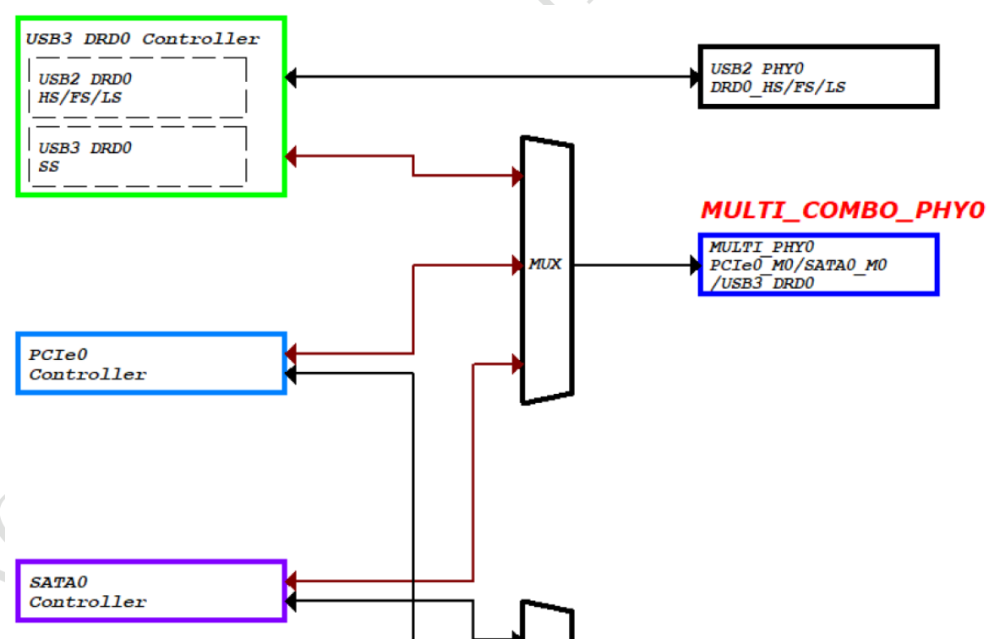
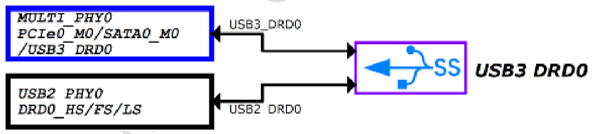
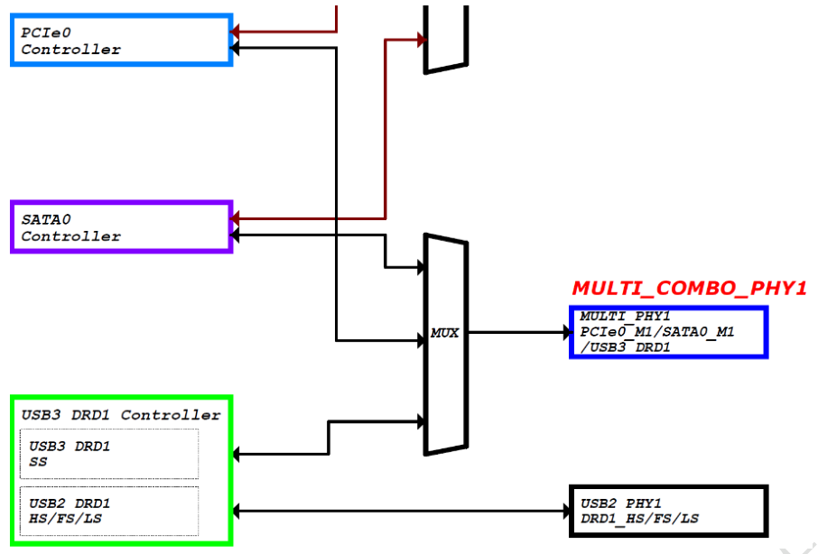
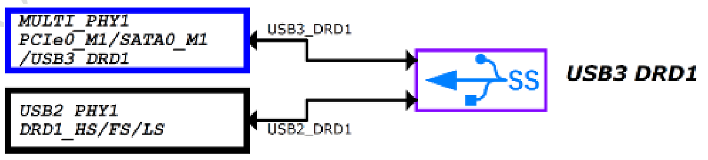
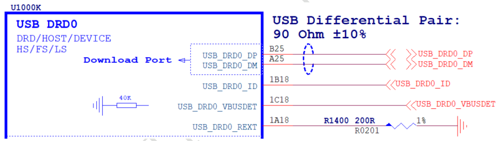
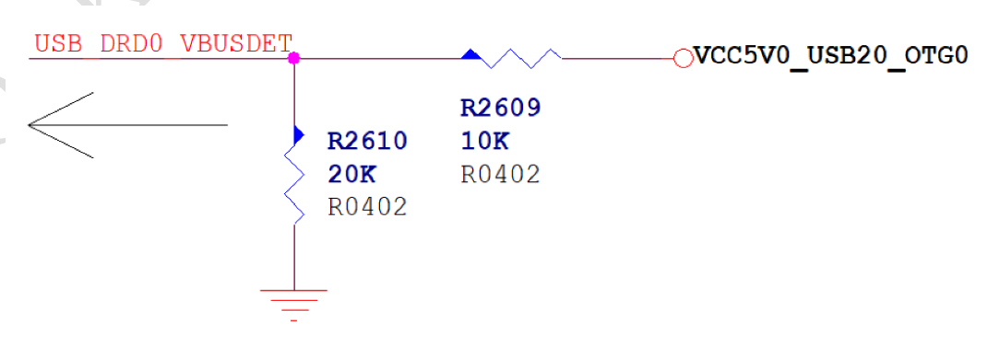
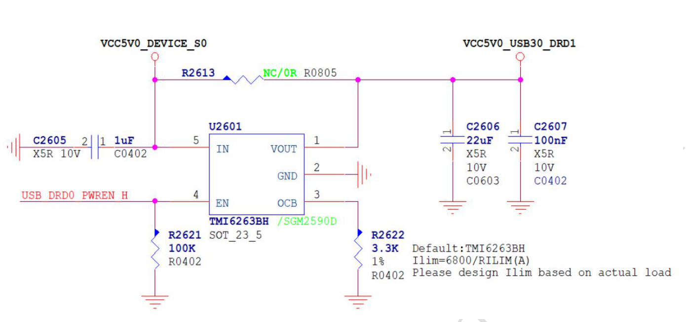
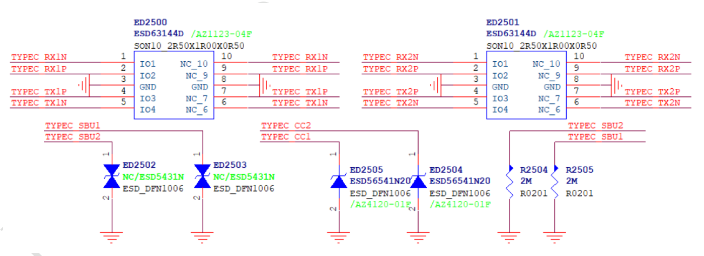

## Geltungsbereich

Dieser Leitfaden unterstützt den Entwurf von RK3572-Platinen und die Bewertung des ArmSoM-Zero5-Projekts. Grundlage sind der Hardware Design Guide V1.1 und das vorliegende Hardwarepaket. Schnittstellen des SoC sind nicht zwangsläufig auf einer Platine herausgeführt. Die endgültige Zero5-Konfiguration sowie verfügbare Betriebssysteme und Kernelversionen sind anhand der Dokumentation der jeweiligen Hardwareversion zu prüfen. Für diesen Artikel wurden keine ArmSoM-Hardwaremessungen durchgeführt.

Bei RK3572 müssen USB-Daten- und Versorgungsrollen zusammenpassen. Type-C ist eine Steckerform und kein Nachweis für DP Alt Mode oder USB PD. DRD-Controller, Combo PHY, VBUS, CC-Erkennung und Programmierpfad einzeln zuordnen, damit die Schaltung tatsächlich enumeriert und programmierbar ist.

## 1. USB3 DRD und Combo PHY

RK3572 besitzt zwei USB3-DRD-Pfade. USB2 und SuperSpeed eines Pfads benötigen dieselbe HOST/DEVICE-Rolle. Combo PHY0 bedient wahlweise USB3 DRD0, PCIe0 M0 oder SATA0 M0; PHY1 entsprechend USB3 DRD1, PCIe0 M1 oder SATA0 M1. Verschiedene Schnittstellennamen erlauben keine gleichzeitige Belegung eines PHY.

*Combo-PHY0-Multiplexing*

*USB3-DRD0-Referenzbeschaltung*

*Combo-PHY1-Multiplexing*

*USB3-DRD1-Referenzbeschaltung*

## 2. Programmierpfad erhalten

Auch ein vorwiegend als Host genutztes Produkt benötigt Wartungszugang zu DRD0-DP/DM, VBUSDET und Maskrom. Referenzen kombinieren USB2 DRD0 mit einem für PCIe/SATA gewählten Hochgeschwindigkeits-PHY; dabei die passende MUX-Schaltung befolgen und keine inaktive SuperSpeed-Verbindung weiterführen. DRD0/DRD1 in Schaltung und Device Tree konsistent halten.

*USB2 DRD0 und Wartungsanschluss*

## 3. VBUSDET, ID und 5-V-Eingang

| Merkmal | Anforderung |
|---|---|
| ID | Interner Pull-up etwa 12 kΩ nach 1.8 V; Pegel und Schutz beachten |
| VBUSDET | Interner Pull-down etwa 40 kΩ; typisch 3 V, empfohlen 2.7–3.3 V; Erkennungsschwelle >2.3 V |
| DP / DM | 2.2-Ω-Serienwiderstände |
| SuperSpeed TX / RX | TX: 100 nF, 0201; RX: 0 Ω |

*Referenzteiler für VBUS-Erkennung*

5-V-VBUS nicht direkt an VBUSDET legen. Den internen Pull-down von etwa 40 kΩ und Toleranzen in die Teilerrechnung einbeziehen. Type-C-, Micro-USB- und feste Host-Referenzen unterscheiden sich; zuerst eine eindeutige Topologie wählen und danach Versorgung sowie Rollenwechsel prüfen.

## 4. Host-Strombegrenzung und Type-C-CC-Erkennung

*Referenzschaltung der USB-Host-Strombegrenzung*

Host-5-V über einen Strombegrenzungsschalter führen und den GPIO-Pegel mit der 3.3-V-Referenzdomäne abgleichen. Genannt sind 22 µF plus 100 nF. Größere Kapazität für externe Laufwerke erfordert weiterhin Einschaltstrom-, Stromlimit- und Versorgungsanalyse; sie ersetzt kein ausreichend dimensioniertes Netzteil. Zwei-PMIC V1.4 nutzt HUSB311 für CC und gemeinsames Netzteil-/Type-C-VDC; GPIO-Erkennung ist kein USB PD.

## 5. ESD und PCB gemeinsam auslegen

*Type-C-Schutzreferenz*

| Merkmal | USB 2.0 | USB 3.x |
|---|---|---|
| Differenzimpedanz | 90 Ω ±10% | 90 Ω ±10% |
| Abweichung innerhalb des Paars | <3 ps / 20 mil | <1 ps / 6 mil |
| Länge | <6 in | <6 in |
| Signalvias | Bevorzugt ≤4, maximal 6 | ≤2 |
| Hier verwendete Schutzkapazitätsgrenze | ≤1 pF | ≤0.2 pF |

Der Schaltungsabschnitt nennt ≤3 pF für USB2 und ≤0.25 pF für SuperSpeed, der PCB-Abschnitt strengere ≤1 pF und ≤0.2 pF. Hier werden die strengeren Werte verwendet und die Differenz dokumentiert. S-Parameter des Schutzbauteils und Gesamtkanalverlust prüfen. Um SuperSpeed-Paare mindestens 4W Abstand und kontinuierliche Referenzflächen vorsehen.

## 6. Mehr als einmalige Enumeration prüfen

USB2 und SuperSpeed getrennt, beide Steckrichtungen, Rollenwechsel, beim Kaltstart angeschlossene Geräte, Hotplug, Kurzschlussbegrenzung, Resume und Maskrom prüfen. Kabel, Peripherie, BSP und Device Tree dokumentieren. Bei reinem USB2-Betrieb PHY-Auswahl, SuperSpeed-Pfad und Richtungsumschaltung prüfen; bei fehlender Enumeration mit VBUSDET, CC/ID, DP/DM und Versorgung beginnen.

## ArmSoM-Produkte und nächste Schritte

Für ein kompaktes RK3572-Produkt empfiehlt sich zunächst der ArmSoM-Plan für das Zero-Format sowie eine Liste der benötigten Display-, Speicher-, Netzwerk- und Versorgungsschnittstellen. Der Planungsartikel ist keine Spezifikation eines veröffentlichten Modells und kein endgültiger Schaltplan. Für verfügbare Plattformen und deren Schnittstellen dienen der offizielle Produktkatalog und Docs.

- [RK3572 / ArmSoM Zero: Produktplanung](/de/articles/rockchip-rk3572-armsom-zero-preview/)
- [ArmSoM](https://www.armsom.org/category/all-products) · [ArmSoM Docs](https://docs.armsom.org/)

## Lesepfad durch die Reihe

- [RK3572-Datenblatt V1.1: Spezifikationen, Schnittstellen und Änderungen](/de/articles/rk3572-datasheet-v10/)
- [RK3572-Hardwaredesign: von der Referenzauswahl zur ersten Platine](/de/articles/rk3572-hardware-design-series/)
- [RK3572-Minimalsystem: 24-MHz-Takt, Reset, Boot und UART](/de/articles/rk3572-minimum-system-bringup/)
- [RK3572-Stromversorgung: Domänen, RK806-5 und zwei PMICs](/de/articles/rk3572-power-domains-pmic/)
- [RK3572-DDR-Design: LPDDR4X/LPDDR5-Schaltung und Leiterplattenregeln](/de/articles/rk3572-ddr-circuit-pcb/)
- [RK3572-DDRBIN-Konfiguration: Vorlagen, ADC-Auswahl und mehrere Profile](/de/articles/rk3572-ddrbin-adc-configuration/)
- [RK3572-Speicher und Boot: eMMC, UFS und FSPI anschließen und versorgen](/de/articles/rk3572-storage-boot-design/)
- [RK3572 USB und Type-C: Programmierung, Rollen und Versorgungserkennung](/de/articles/rk3572-usb-typec-power-design/)
- [RK3572 PCIe und SATA: Combo-PHY-Multiplexing, Takte und Routing](/de/articles/rk3572-high-speed-interface-design/)
- [RK3572-Displays und Kameras: HDMI, eDP, MIPI und Pegelanpassung](/de/articles/rk3572-display-camera-design/)
