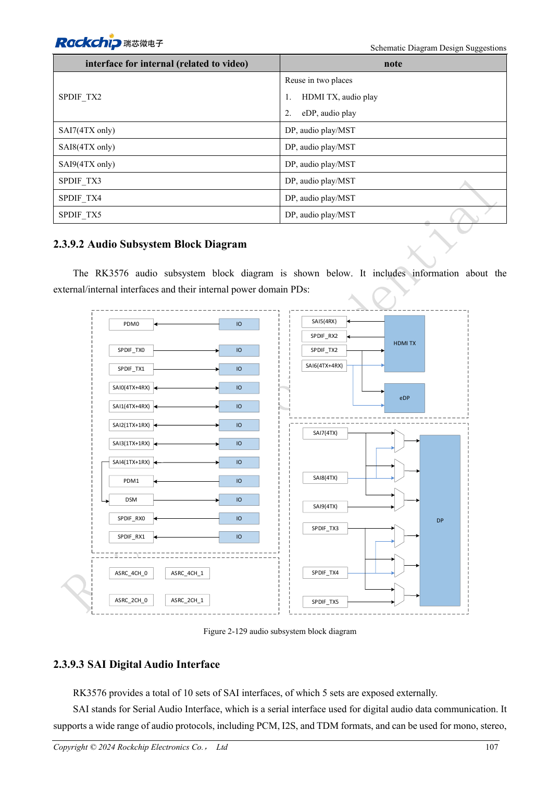
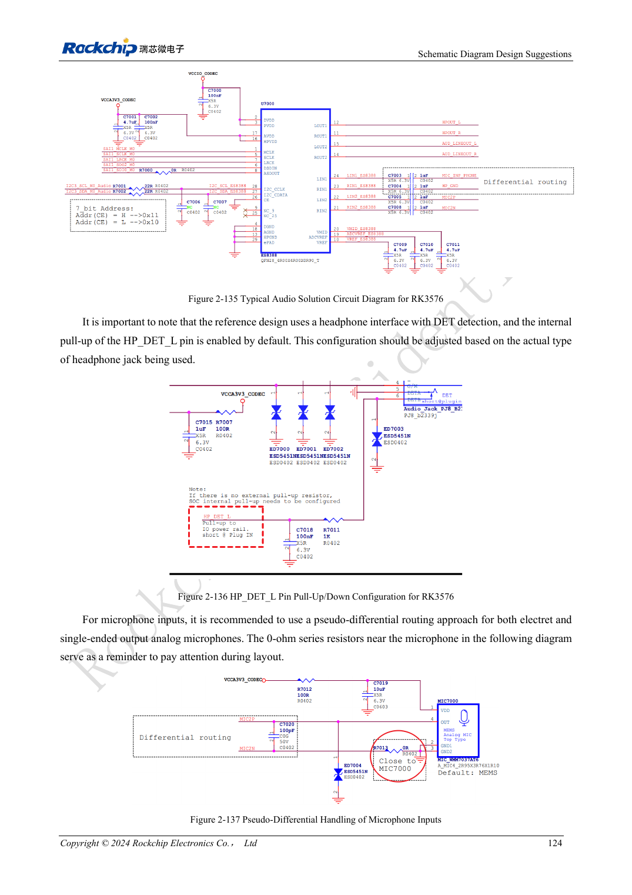

<!-- rk3576-hardware-v11-rest-20261109 -->

# RK3576-Audiohardware: SAI, PDM, ASRC und Mikrofonlayout

Grundlage sind die chinesische und englische Ausgabe des RK3576 Hardware Design Guide V1.1 (2024-05-28) für SoC-Platinen. CM5-Träger müssen der Moduldefinition folgen; Sige5 kann als Software-/Peripheriebasis dienen. Eine universelle SDK-/BSP- oder Kernelversion wird nicht vorgegeben; jede Platine prüfen. Werte stammen aus der Quelle, nicht aus ArmSoM-Messungen.

**RK3576_Hardware_Design_Guide_V1.1_20240528_EN.pdf** · §2.3.9; Audio PCB

## Interne und externe Ressourcen getrennt zählen

Zehn SAI-Blöcke bedeuten fünf externe SAI-Schnittstellen; hinzu kommen zwei PDM-Gruppen, zwei externe SPDIF-TX/RX-Gruppen und DSM. Weitere Ressourcen bedienen Video. Bei DSM entfällt externes SAI4. Für PCM/I2S/TDM zunächst Master/Slave, Taktrichtung, Slots und Bitbreite festlegen.

## Bandbreite und asynchrone Takte berechnen

Pro Datenleitung gilt IO rate/(slots×width). TDM16 mit 32bit/48kHz braucht 24.576MHz SCLK, TDM32 49.152MHz. Grenzen: 50MHz bei Master-TX/RX und Slave-RX, 25MHz bei Slave-TX, jeweils unter SI-Bedingungen. Vier ASRC-Blöcke wandeln Abtastraten oder asynchrone Takte; sie sind keine weiteren IO-Ports.

## Routing, Verstärker und Prüfung

Referenzmäßig 22Ω an Takten nahe der Quelle und Daisy-Chain bei mehreren Geräten verwenden; zwei phasengleiche PDM-Takte verkürzen Abzweige. Analoge Mikrofone pseudodifferentiell fern von DDR, LCD, Spulen und HF führen. Schutz an Buchsen platzieren. Codec, Verstärkerfreigabe und Buchsenerkennung mit Software abstimmen. Wiedergabe, Aufnahme, Rückführung, Umschaltknacken und Störungen prüfen; DSM ist kein hochwertiger DAC.

## Entwurfsparameter und Prüftabelle

| Punkt | Quellenreferenz |
| --- | --- |
| Externe SAI | 5 |
| PDM | 2 groups |
| TDM16: 32bit ×48kHz | 24.576MHz |
| Slave TX SCLK | ≤25MHz |
| ASRC | 8–384kHz |

## Quellenabbildungen

Die Referenzseiten enthalten die zugehörigen Schalt- oder Zeitdiagramme; für volle Auflösung anklicken. Bezeichner und Werte gehören zum Referenzentwurf, nicht zum Schaltplan eines ArmSoM-Produkts.

Englisches Original · PDF 126 · 2-129

Englisches Original · PDF 143 · 2-137

## Entwicklung mit ArmSoM

CM5 verringert die erneute Entwicklung des Rechenkerns auf eigenen Trägern; Sige5 dient als Ausgangspunkt für Software und Peripherie. Herausführung, Pins, Pegel und Image-Unterstützung anhand der Boarddokumentation prüfen.

- [ArmSoM CM5](https://www.armsom.org/cm5) · [CM5 Docs](https://docs.armsom.org/armsom-cm5)
- [ArmSoM Sige5](https://www.armsom.org/sige5) · [Sige5 Docs](https://docs.armsom.org/armsom-sige5)

## Weiterlesen

- [RK3576-Hardwaredesign: 30 Themen](/de/articles/rk3576-hardware-design-series/)
- [RK3576-DP/eDP: PHY-Zuordnung, AUX und abweichende Koppelwerte](/de/articles/rk3576-dp-edp-hardware-design/)
- [RK3576-Ethernet-Hardware: RGMII-Verzögerung, PHY-Takt und Schutz](/de/articles/rk3576-gmac-hardware-design/)
