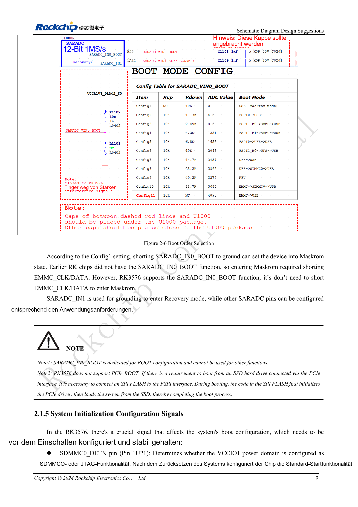

<!-- rk3576-hardware-v11-deep-20261109 -->

# RK3576-Boot und Debugging: Konfiguration, Maskrom, UART und JTAG

Ein zuverlässiger Wiederherstellungsweg gehört zum Serienentwurf. Bootwiderstände, Debug-UART und USB-Download bereits im Schaltplan vorsehen, statt nach einem Startfehler Drähte anzulöten.

Grundlage sind die chinesische und englische Ausgabe des RK3576 Hardware Design Guide V1.1 (2024-05-28) für SoC-Platinen. CM5-Träger müssen der Moduldefinition folgen; Sige5 kann als Software-/Peripheriebasis dienen. Eine universelle SDK-/BSP- oder Kernelversion wird nicht vorgegeben; jede Platine prüfen. Werte stammen aus der Quelle, nicht aus ArmSoM-Messungen.

**RK3576_Hardware_Design_Guide_V1.1_20240528_EN.pdf** · §2.1.3–2.1.6

## Bootauswahl und zwei Wiederherstellungsmodi

SARADC_IN0_BOOT (Pin A25) wählt die Startreihenfolge; die Originalabbildung enthält Config1–11. eMMC verwendet standardmäßig Config10/11, UFS Config7/8. Config1 legt diesen Eingang für Maskrom auf Masse, ohne eMMC-Takt oder Daten kurzzuschließen. SARADC_IN1 auf Masse aktiviert dagegen Recovery. BOOT nicht für andere Analogmessungen verwenden. Vollständige Widerstandskombinationen der Originalabbildung entnehmen.

## PCIe-SSD-Boot ist kein direkter BootROM-Start

Die Anleitung unterstützt keinen nativen PCIe-BootROM-Start. Code im SPI-Flash an FSPI initialisiert zuerst PCIe und lädt anschließend das SSD-System. SPI-Flash, Wiederherstellung und Imagepflege gemeinsam planen; eine NVMe-Buchse allein ist kein vollständiger Bootentwurf.

## Debugpins und Fertigungszugang

SDMMC0_DETN (Pin 1U21) vor dem Einschalten stabil halten: High wählt standardmäßig JTAG, Low SDMMC0; die Vorlage zeigt 1nF. Nach dem Start übernimmt IOMUX. Zweidraht-SWD nutzt TCK/TMS; M0 teilt SDMMC0 in VCCIO1, M1 teilt UART0_M0 in PMUIO1. UART0 verwendet standardmäßig 1500000bps. Serienwiderstände 100Ω, ESD-Schutz und zugängliche Testpunkte erhalten. Images können die Baudrate ändern; keinen 5V-UART-Adapter direkt anschließen.

## Entwurfsparameter und Prüftabelle

| Punkt | Wert/Netz | Prüfhinweis |
| --- | --- | --- |
| Maskrom | SARADC_IN0_BOOT = GND | Config1; von Recovery unterscheiden |
| UART-Spannungsdomäne | PMUIO1 | An tatsächliche Versorgung anpassen |
| Testpunkte | ≥0.7mm / 2.54mm | Testpaddurchmesser / optionales Rastermaß |

## Referenzschaltungen und Abbildungen

Die Referenzseiten enthalten die zugehörigen Schalt- oder Zeitdiagramme; für volle Auflösung anklicken. Bezeichner und Werte gehören zum Referenzentwurf, nicht zum Schaltplan eines ArmSoM-Produkts.

Englisches Original · PDF 28 · 2-6

## ArmSoM-Produkte und Entwicklungsweg

CM5 integriert Rechenleistung in einen eigenen Träger; Sige5 eignet sich zur ersten Linux-/Peripherieerprobung. Eine SoC-Funktion ist nicht zwangsläufig auf beiden Produkten herausgeführt. Vor Kauf oder Layout Steckverbinder, Boardrevision und Image prüfen.

- [ArmSoM CM5](https://www.armsom.org/cm5) · [CM5 Docs](https://docs.armsom.org/armsom-cm5)
- [ArmSoM Sige5](https://www.armsom.org/sige5) · [Sige5 Docs](https://docs.armsom.org/armsom-sige5)

## Lesereihenfolge

- [RK3576-Hardwaredesign: vom Minimalsystem zu DDR und USB](/de/articles/rk3576-hardware-design-series/)
- [RK3576-Minimalsystem: vom Schaltplan zum reproduzierbaren Erststart](/de/articles/rk3576-hardware-bringup/)
- [RK3576-Taktentwurf: 24MHz-Quarz, 32kHz-Standby und Peripherietakte](/de/articles/rk3576-clock-circuit-design/)
- [RK3576-Reset: NPOR, RK806S-5, Watchdog und Übertemperaturschutz](/de/articles/rk3576-reset-watchdog-design/)
- [RK3576-Spannungsdomänen: CPU, GPU, NPU, LOGIC und Entkopplung](/de/articles/rk3576-power-domain-design/)
- [RK3576 und RK806S-5: PMIC-Auswahl, Steuerpins und Rückkopplung](/de/articles/rk3576-rk806s5-pmic-design/)
- [RK3576-Power-Sequencing und Standby: Reset, Haltespannungen und Aufwecken](/de/articles/rk3576-power-sequencing-standby/)
- [RK3576-DDR-Schaltung und Versorgung: LPDDR4, LPDDR4X und LPDDR5](/de/articles/rk3576-ddr-circuit-power/)
- [RK3576-DDR-Layout: Impedanz, Längen, Rückstrompfade und PDN](/de/articles/rk3576-ddr-pcb-routing/)
- [RK3576-USB/Type-C-Ergänzung: Multiplexing, Wiederherstellung und Schutz](/de/articles/168-rockchip-rk3576-usb/)
