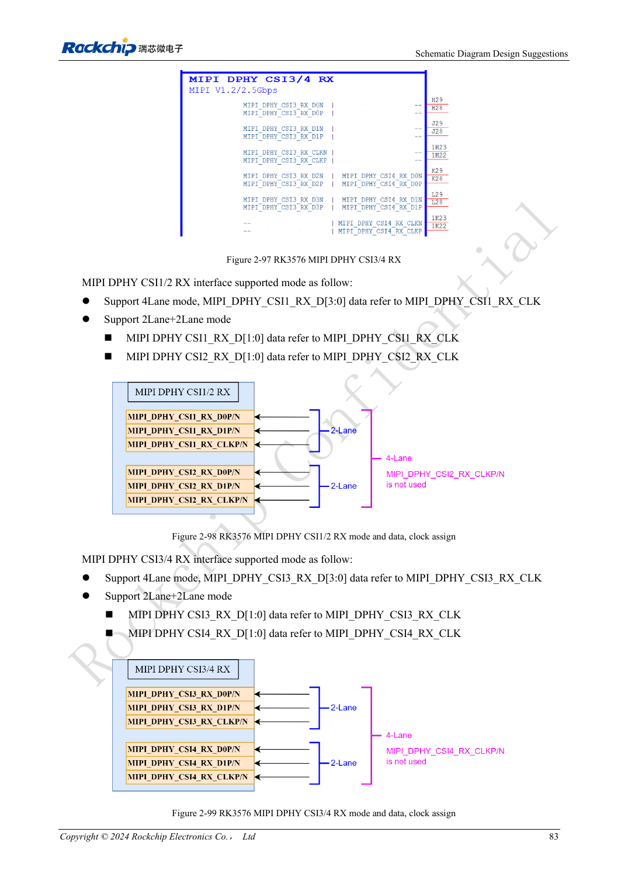
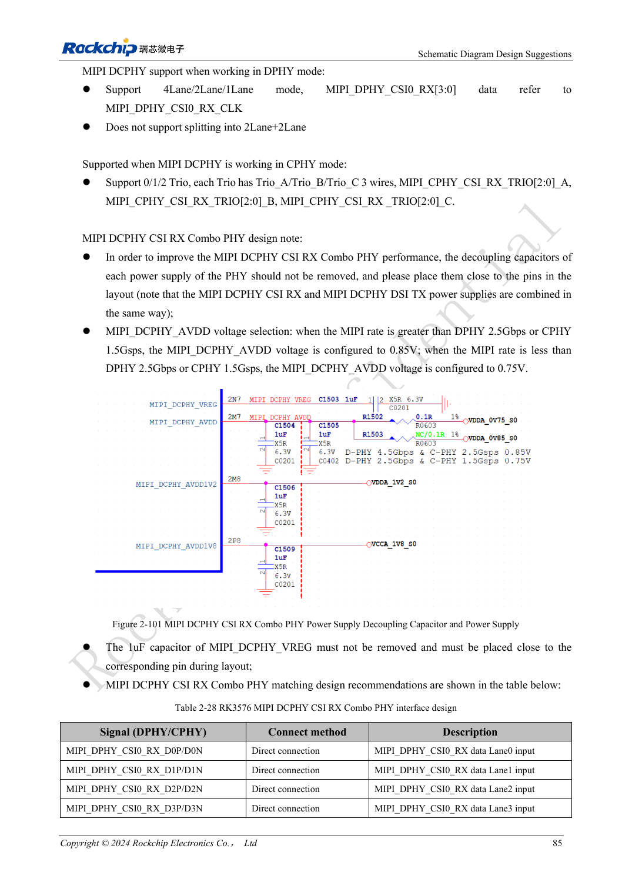

<!-- rk3576-hardware-v11-rest-20261109 -->

# RK3576-Kamerahardware: CSI-Gruppen, DCPHY-Modi und Versorgung

Grundlage sind die chinesische und englische Ausgabe des RK3576 Hardware Design Guide V1.1 (2024-05-28) für SoC-Platinen. CM5-Träger müssen der Moduldefinition folgen; Sige5 kann als Software-/Peripheriebasis dienen. Eine universelle SDK-/BSP- oder Kernelversion wird nicht vorgegeben; jede Platine prüfen. Werte stammen aus der Quelle, nicht aus ArmSoM-Messungen.

**RK3576_Hardware_Design_Guide_V1.1_20240528_EN.pdf** · §2.3.7; Camera PCB

## Physische Gruppen zuerst prüfen

Zwei DPHY-CSI-Gruppen erlauben vier Lanes oder 2+2 bei bis zu 2.5Gbps/lane. CSI0 nutzt DCPHY: vier DPHY-Lanes bis 4.5Gbps/lane oder drei CPHY-Trios bis 5.7Gbps/trio; kein 2+2 bei CSI0. DCPHY-TX/RX müssen denselben PHY-Modus verwenden. Herausführung dieser SoC-Ressourcen auf CM5/Sige5 separat prüfen.

## Drei Spannungen nicht blind kopieren

Sensor-DVDD kann 1.2/1.5/1.8V betragen. Die Referenzsequenz 1.8→1.2→2.8V gilt nicht universell. PWDN, RESET und I2C-Pull-ups an DOVDD anpassen; 100nF am Reset und Steckverbinder-Entkopplung erhalten. Sensoren gleicher I2C-Adresse getrennten Bussen zuordnen. MIPI_DCPHY_VREG benötigt weiterhin 1μF. Ratenabhängige AVDD nach aktueller Spezifikation prüfen; Gleichheit an den Quellenschwellen ist nicht definiert.

## Quellenwiderspruch und Validierung

Der CIF-Abschnitt nennt VCCIO4, die Kamerahinweise VCCIO6: CN-PDF 98/100, EN 105/107. Keinen Wert ungeprüft verdrahten; PinOut, Mux und aktuelle Schaltung abgleichen. Steckerpaare durch Massepins trennen, MCLK isolieren. Bei wenig Licht auch DVDD-Rauschen bewerten. Parallelbetrieb, Bildfehler, Belichtungswechsel und Erwärmung testen.

## Entwurfsparameter und Prüftabelle

| Punkt | Quellenreferenz |
| --- | --- |
| CSI-DPHY-Gruppen | 4 lanes / 2+2 |
| CSI0 DCPHY | No 2+2 |
| VREG | 1μF |
| RESET | 100nF |
| CIF-Quellenwiderspruch | VCCIO4 / VCCIO6 |

## Quellenabbildungen

Die Referenzseiten enthalten die zugehörigen Schalt- oder Zeitdiagramme; für volle Auflösung anklicken. Bezeichner und Werte gehören zum Referenzentwurf, nicht zum Schaltplan eines ArmSoM-Produkts.

Englisches Original · PDF 102 · 2-98

Englisches Original · PDF 104 · 2-101

## Entwicklung mit ArmSoM

CM5 verringert die erneute Entwicklung des Rechenkerns auf eigenen Trägern; Sige5 dient als Ausgangspunkt für Software und Peripherie. Herausführung, Pins, Pegel und Image-Unterstützung anhand der Boarddokumentation prüfen.

- [ArmSoM CM5](https://www.armsom.org/cm5) · [CM5 Docs](https://docs.armsom.org/armsom-cm5)
- [ArmSoM Sige5](https://www.armsom.org/sige5) · [Sige5 Docs](https://docs.armsom.org/armsom-sige5)

## Weiterlesen

- [RK3576-Hardwaredesign: 30 Themen](/de/articles/rk3576-hardware-design-series/)
- [RK3576-SATA-Hardware: PHY-Aufteilung, Kopplung und Laufwerksversorgung](/de/articles/rk3576-sata-hardware-design/)
- [RK3576-Displayhardware: MIPI, RGB, Hintergrundbeleuchtung und Touch](/de/articles/rk3576-display-panel-hardware/)
