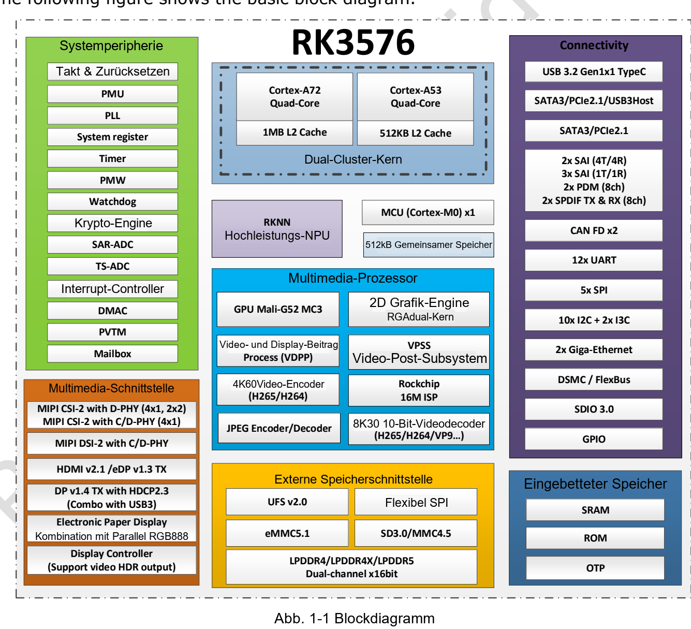
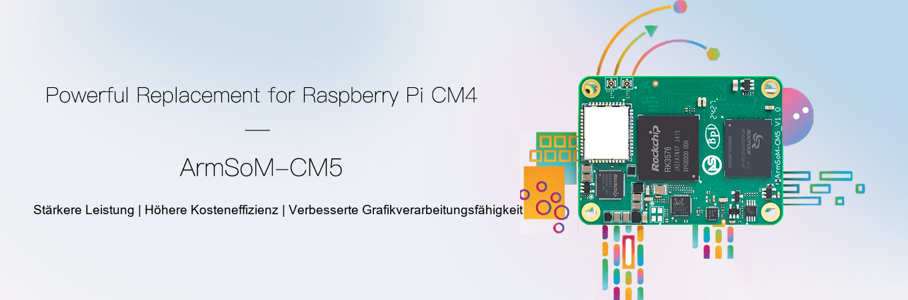

RK3576 vereint Bildverarbeitung, Inferenz, Anzeige und Vernetzung in einem Edge-Gerät. Entscheidend ist nicht allein die Zahl der CPU-Kerne: Ordnen Sie die Schritte Ihrer Anwendung den passenden Recheneinheiten zu und wählen Sie anschließend ein ArmSoM-Board oder -Modul mit den benötigten Anschlüssen.

## Aufgaben von CPU, GPU und NPU

| Baustein | Angaben in V1.0 | Aufgabe |
|---|---|---|
| CPU | 4× Cortex-A72 + 4× Cortex-A53; 1MB / 512KB L2 | Betriebssystem, Protokolle, Logik und Vor-/Nachverarbeitung |
| GPU | Mali-G52 MC3 | Oberfläche und vom Treiber unterstützte Grafikberechnungen |
| NPU | Zwei Kerne, gemeinsam oder unabhängig; 6 TOPS INT8 mit Sternchen | Konvertierte Netze mit unterstützten Operatoren |
| Speicher | Zwei 16-bit-Kanäle; LPDDR4/4X-4266, LPDDR5-4800; bis 16GB Adressraum | Modelle, Bildpuffer und Anwendungsdaten |
| Bild/Video | 16MP ISP, RGA und Video-Codecs | Aufnahme, Skalierung und Kompression |

Dies sind Chipfähigkeiten, keine Garantie für sämtliche Anschlüsse auf jedem Board. Seite 41 der V1.0 bezeichnet maximale CPU-, GPU- und NPU-Takte weiterhin als TBD. Die Betriebsfrequenzen hängen vom Produkt und Systemabbild ab. V1.0 und das neuere offizielle Brief V1.2 erklären das Sternchen bei 6 TOPS als **Sparsity**. Daraus folgt weder eine Modellbildrate noch Vergleichbarkeit mit anders definierten TOPS.

## Eine praktische Bildverarbeitungskette

Bei einer Arbeitsplatzkontrolle nimmt die Kamera ein Werkstück auf. Der konfigurierte ISP verarbeitet das Bild, RGA kann Skalierung und Farbumwandlung übernehmen, die NPU führt ein konvertiertes Modell aus. Die CPU wendet Entscheidungsregeln an, speichert Ereignisse und meldet Ergebnisse; ein Display zeigt Status und Kontrollbilder.

Lokale Verarbeitung kann die Übertragung von Rohvideo reduzieren. Das Ergebnis hängt von Kameratreibern, Beleuchtung, Trainingsdaten, Operatorunterstützung und Speichertransfers ab. Messen Sie Gesamtlatenz, Fehlentscheidungen und Temperatur im Dauerbetrieb, nicht nur einen einzelnen Inferenzaufruf.

## Videogrenzen nach Format lesen

Die Übersicht der V1.0 nennt bis zu 8K30 oder 4K120 beim Decodieren; die Detailangaben begrenzen einzelne Codecs. H.264 darf nicht den Höchstwert eines anderen Formats übernehmen. Das neuere Brief V1.2 nennt vor allem 4K-Modi je Codec. Hier werden diese Revisionen nicht zu einem bedingungslosen Maximalwert vermischt.

Decodierung, Bildausgabe und parallele Streams sind verschiedene Anforderungen. Prüfen Sie Dateien mit der vorgesehenen Auflösung, Bildrate, Bitrate, Farbtiefe und Codierung sowie die tatsächliche Hardwarebeschleunigung. Eine HDMI-Versionsnummer garantiert nicht jeden Anzeigemodus.

## Vom Sige5-Prototyp zum CM5-Produkt

Sige5 ist ein SBC zum direkten Anschluss von Peripherie und zum Erproben von Algorithmen, Netzwerk und Bedienung. CM5 ist ein Rechenmodul für einen Träger passend zu Gehäuse, Anschlüssen und speziellen Geräten. Die gemeinsame RK3576-Plattform erleichtert die Wiederverwendung von Anwendungserfahrung; Device Tree, Pin-Multiplexing, Stromversorgung und Kühlung müssen trotzdem geprüft werden.

Erfassen Sie für Terminal, HMI oder Gateway zuerst die erforderliche Peripherie. PCIe, SATA und USB an gemeinsam genutzten Combo-PHYs sind nicht zwangsläufig gleichzeitig verfügbare Einzelanschlüsse.

## Empfohlene Prüfreihenfolge

1. Boardrevision, Systemabbild, Kernel und NPU-Runtime festlegen.
2. Kamera, Netzwerk, Speicher und Anzeige einzeln prüfen.
3. Modell konvertieren und Genauigkeit sowie Gesamtlaufzeit mit echten Daten messen.
4. Wiederanlauf, Logrotation, Stromausfallbehandlung und Updates ergänzen.
5. Dauerlast und Temperatur im endgültigen Gehäuse testen.

Dies ist eine technische Einordnung mit Entwicklungsvorschlägen, kein Bericht über bereits gemessene ArmSoM-Anwendungsergebnisse.

## Artikelserie und Produkte

- [ArmSoM CM5 als Raspberry-Pi-CM4/CM5-Alternative: Auswahl und Migration](/de/articles/cm5-raspberry-pi-cm4-cm5-alternative/)
- [Was kann Sige5? Sechs Anwendungen für RK3576-Edge-Computing](/de/articles/sige5-rk3576-applications/)
- [RK3576 Datasheet V1.0: Download, Gehäuse, Elektrik und Kühlung](/de/articles/rk3576-datasheet-v10/)
- [ArmSoM CM5](https://www.armsom.org/cm5) · [ArmSoM Sige5](https://docs.armsom.org/armsom-sige5)

## Quellen

- [Rockchip RK3576](https://www.rock-chips.com/a/en/products/RK35_Series/2024/1212/2033.html)
- [RK3576 Brief V1.2 (2025-08-28)](https://www.rock-chips.com/uploads/pdf/2024.3.18/191/RK3576%20Brief%20Datasheet%20V1.2-20250828.pdf)
- [ArmSoM CM5](https://docs.armsom.org/armsom-cm5)
- [ArmSoM Sige5](https://docs.armsom.org/armsom-sige5)
- [Raspberry Pi CM5](https://www.raspberrypi.com/products/compute-module-5/)
