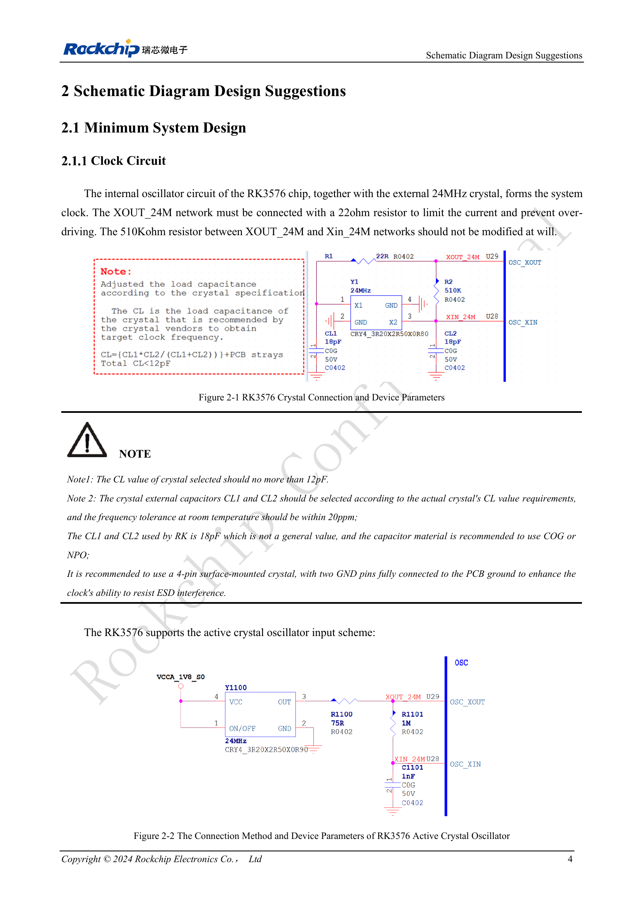

<!-- rk3576-hardware-v11-deep-20261109 -->

# RK3576-Taktentwurf: 24MHz-Quarz, 32kHz-Standby und Peripherietakte

Taktfehler können Start-, USB- oder Aufwachprobleme verursachen. Zu prüfen sind Oszillatorschaltung, Genauigkeit, Pegel und die im Standby aktiven Quellen; ein eingezeichneter 24MHz-Quarz genügt nicht.

Grundlage sind die chinesische und englische Ausgabe des RK3576 Hardware Design Guide V1.1 (2024-05-28) für SoC-Platinen. CM5-Träger müssen der Moduldefinition folgen; Sige5 kann als Software-/Peripheriebasis dienen. Eine universelle SDK-/BSP- oder Kernelversion wird nicht vorgegeben; jede Platine prüfen. Werte stammen aus der Quelle, nicht aus ArmSoM-Messungen.

**RK3576_Hardware_Design_Guide_V1.1_20240528_EN.pdf** · §2.1.1

## Bauteile am passiven Quarz

Der Serienwiderstand 22Ω an XOUT_24M begrenzt die Anregung; den 510kΩ-Widerstand zwischen XOUT und XIN nicht beliebig ändern. Die Quarzlastkapazität CL darf 12pF nicht überschreiten. CL1/CL2 für den konkreten Quarz bestimmen und prüfen; 18pF ist ein Referenzwert. C0G/NP0 und einen vierpoligen Quarz mit beiden Massepads verwenden. Die Tastkopfkapazität kann die Schwingung beeinflussen.

## Aktiver Eingang und Tastverhältnis

Für den aktiven Takt nennt die Vorlage 1.35–1.8V, 50% Tastverhältnis und 20ppm Genauigkeit. Der durchgeschleifte 24MHz-Takt wird an REF_CLK0_OUT (Pin V29) beobachtet und R1100 angepasst; daraus folgt kein universeller Registerbefehl. Bei 0.8V Eingang sind 50% möglicherweise nicht erreichbar. Ein schwingendes Signal allein bestätigt daher keine korrekte Auslegung.

## Standby und Ausgangstakte gemeinsam prüfen

Vor dem Abschalten von 24MHz auf PMU_PVTM oder externe 32.768kHz wechseln und die Taktabhängigkeit aller Aufweckquellen prüfen. Minimaler Standby nutzt PMUIO0/1-Interrupts. Bei einem Open-Drain-RTC an CLK32K_IN den internen GPIO-Pulldown deaktivieren. CLK0/1_32K_OUT steht nach Abschalten von 24MHz nicht zuverlässig weiter bereit. Auch für Kamera- und Ethernet-Takte Pin-Multiplexing und Peripheriepegel prüfen.

## Entwurfsparameter und Prüftabelle

| Punkt | Wert/Netz | Prüfhinweis |
| --- | --- | --- |
| Quarztoleranz | ≤20ppm | Bei Raumtemperatur laut Quelle |
| Externer Standbytakt | 32.768kHz ±30ppm; 45–55% | Amplitude 0.7×VDD bis VDD; VDD=PMUIO0 |
| Referenztaktausgänge | REF_CLK0/1/2_OUT | 12/24/25/26/27/37.125/74.25/10/20/40/50/58.5/100MHz |
| Kameratakte | CAM_CLK0/1/2_OUT | Standard 24MHz; alternativ 27/37.125/74.25MHz |

## Referenzschaltungen und Abbildungen

Die Referenzseiten enthalten die zugehörigen Schalt- oder Zeitdiagramme; für volle Auflösung anklicken. Bezeichner und Werte gehören zum Referenzentwurf, nicht zum Schaltplan eines ArmSoM-Produkts.

Englisches Original · PDF 23 · 2-1 / 2-2

## ArmSoM-Produkte und Entwicklungsweg

CM5 integriert Rechenleistung in einen eigenen Träger; Sige5 eignet sich zur ersten Linux-/Peripherieerprobung. Eine SoC-Funktion ist nicht zwangsläufig auf beiden Produkten herausgeführt. Vor Kauf oder Layout Steckverbinder, Boardrevision und Image prüfen.

- [ArmSoM CM5](https://www.armsom.org/cm5) · [CM5 Docs](https://docs.armsom.org/armsom-cm5)
- [ArmSoM Sige5](https://www.armsom.org/sige5) · [Sige5 Docs](https://docs.armsom.org/armsom-sige5)

## Lesereihenfolge

- [RK3576-Hardwaredesign: vom Minimalsystem zu DDR und USB](/de/articles/rk3576-hardware-design-series/)
- [RK3576-Minimalsystem: vom Schaltplan zum reproduzierbaren Erststart](/de/articles/rk3576-hardware-bringup/)
- [RK3576-Reset: NPOR, RK806S-5, Watchdog und Übertemperaturschutz](/de/articles/rk3576-reset-watchdog-design/)
- [RK3576-Boot und Debugging: Konfiguration, Maskrom, UART und JTAG](/de/articles/rk3576-boot-debug-design/)
- [RK3576-Spannungsdomänen: CPU, GPU, NPU, LOGIC und Entkopplung](/de/articles/rk3576-power-domain-design/)
- [RK3576 und RK806S-5: PMIC-Auswahl, Steuerpins und Rückkopplung](/de/articles/rk3576-rk806s5-pmic-design/)
- [RK3576-Power-Sequencing und Standby: Reset, Haltespannungen und Aufwecken](/de/articles/rk3576-power-sequencing-standby/)
- [RK3576-DDR-Schaltung und Versorgung: LPDDR4, LPDDR4X und LPDDR5](/de/articles/rk3576-ddr-circuit-power/)
- [RK3576-DDR-Layout: Impedanz, Längen, Rückstrompfade und PDN](/de/articles/rk3576-ddr-pcb-routing/)
- [RK3576-USB/Type-C-Ergänzung: Multiplexing, Wiederherstellung und Schutz](/de/articles/168-rockchip-rk3576-usb/)
