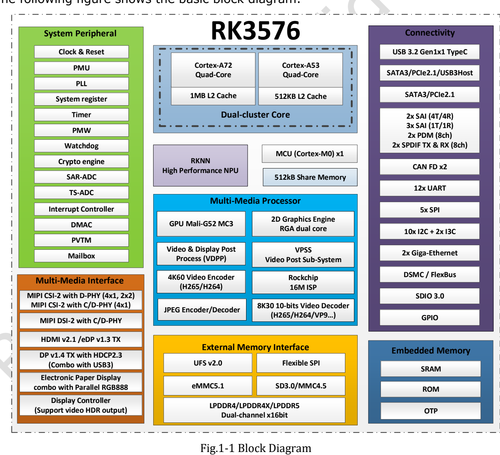
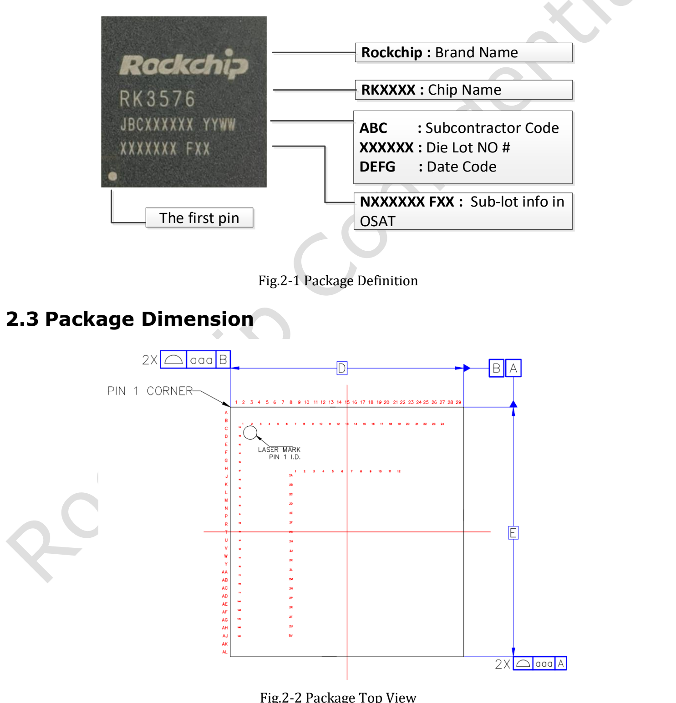
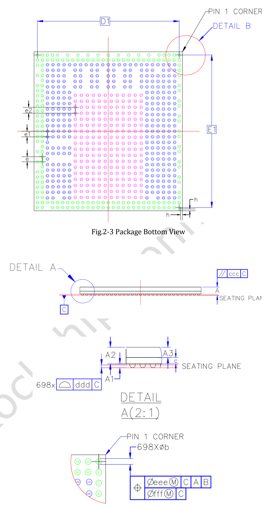
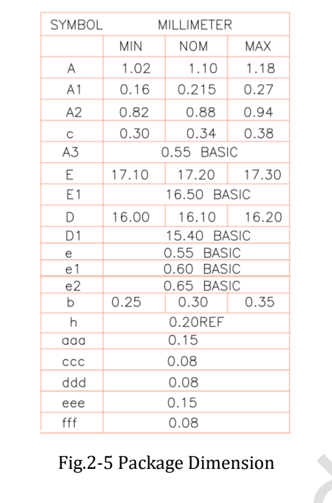

Das **RK3576 Datasheet V1.0 vom 2024-03-15 umfasst 46 Seiten** zu Architektur, Gehäuse, Pins und elektrischen Bedingungen. Dieser Beitrag ist eine Lesehilfe, keine vollständige Übersetzung und keine Behauptung, die Erstversion sei der neueste Spezifikationsstand.

[Vollständiges Original-PDF herunterladen](/assets/rk3576/Rockchip-RK3576-Datasheet-V1.0-20240315.pdf)

## Wegweiser durch das Dokument

| Originalseiten | Inhalt | Zweck |
|---|---|---|
| 6–22 | CPU, Speicher, System, Multimedia, Schnittstellen, Blockdiagramm | Architektur und Schnittstellen planen |
| 23–25 | Beschriftung, Zeichnungen, Maße, MSL, Kugelmaterial | Gehäuse- und Fertigungsreferenz |
| 26–37 | Pinnummerntabelle | Versorgungsdomänen und Signale prüfen |
| 38 | Absolute Ratings | Grenzwerte, keine Arbeitspunkte |
| 39–45 | Empfohlene Bedingungen und Schnittstelleneigenschaften | Versorgung und Signale entwerfen |
| 46 | Thermik und Randbedingungen | Kühlungsreferenz |

## Architektur und Speicher

Vier Cortex-A72 und vier Cortex-A53 besitzen laut V1.0 jeweils 1MB beziehungsweise 512KB gemeinsamen L2. Zwei 16-bit-Speicherkanäle unterstützen LPDDR4/4X-4266 und LPDDR5-4800 bei bis zu 16GB Adressraum. eMMC 5.1, UFS 2.0 und serieller Flash sind Chipoptionen; die Anschlüsse hängen vom Board ab.

## Drei wichtige Versionsdetails

- **Takt:** Seite 41 kennzeichnet maximale A72-, A53-, GPU- und NPU-Frequenzen als TBD. Aktuelle Produktwerte sind keine Originalwerte der V1.0.
- **NPU:** Seite 11 nennt 6 TOPS* INT8 mit der Fußnote Sparsity; das neuere offizielle Brief V1.2 behält diese Angabe bei. Diese Einschränkung auch in Werbetexten beibehalten.
- **Grafik und Video:** V1.0 nennt Vulkan 1.1 und OpenCL 2.0, das neuere Brief Vulkan 1.2 und OpenCL 2.1 sowie anders dargestellte Videogrenzen. Treiber und konkreten Codec, Farbtiefe und Modus prüfen.

## Gehäuse und Pins

V1.0 nennt FCCSP698L, 16.1 × 17.2mm Gehäusekörper, 0.30mm Kugeldurchmesser und gemischte Raster von 0.55/0.60/0.65mm. MSL beträgt 3, das Kugelmaterial ist SnAgCu. Einen Footprint nicht aus einer vereinfachten Einzelrasterangabe erzeugen; Originaltabelle und offizielle Designdaten verwenden.

## Elektrische Bedingungen und Kühlung

Absolute Grenzwerte und empfohlene Betriebsbedingungen stehen in getrennten Tabellen. Kern-, Speicher- und IO-Domänen haben unterschiedliche Spannungen. Ein 5V-Boardeingang bedeutet keine 5V-festen SoC-Pins. Einige Werte auf Seite 39 sind noch TBD und vor Designfreigabe zu bestätigen.

Seite 46 fordert eine Sperrschichttemperatur unter 125°C, keine Umgebungstemperatur. θJA=15.84, θJB=6.96, θJC=0.67 und ψJT=0.031°C/W sind Gehäusereferenzwerte unter angegebenen Bedingungen. Der Text bezeichnet sie als Simulationsdaten, die real zu prüfen sind. θJA nicht auf beliebige Gehäuse übertragen und ψJT nicht als gewöhnlichen Wärmewiderstand behandeln.

## Bedeutung für CM5 und Sige5

Bei fertigen Boards gelten zuerst deren Versorgungs-, Pin- und Kühlungsanforderungen. Für einen CM5-Träger sind Modulsteckerbelegung und Referenzdesign maßgeblich, nicht die SoC-Kugeltabelle. Die elektrischen Werte wurden hier nicht erneut gemessen. Original-PDF und ursprüngliche Bildkennzeichnungen bleiben erhalten.

## Artikelserie und Produkte

- [RK3576 erklärt: acht CPU-Kerne und Edge-AI-Produkte von ArmSoM](/de/articles/rk3576-chip-guide/)
- [ArmSoM CM5 als Raspberry-Pi-CM4/CM5-Alternative: Auswahl und Migration](/de/articles/cm5-raspberry-pi-cm4-cm5-alternative/)
- [Was kann Sige5? Sechs Anwendungen für RK3576-Edge-Computing](/de/articles/sige5-rk3576-applications/)
- [ArmSoM CM5](https://www.armsom.org/cm5) · [ArmSoM Sige5](https://docs.armsom.org/armsom-sige5)

## Quellen

- [Rockchip RK3576](https://www.rock-chips.com/a/en/products/RK35_Series/2024/1212/2033.html)
- [RK3576 Brief V1.2 (2025-08-28)](https://www.rock-chips.com/uploads/pdf/2024.3.18/191/RK3576%20Brief%20Datasheet%20V1.2-20250828.pdf)
- [ArmSoM CM5](https://docs.armsom.org/armsom-cm5)
- [ArmSoM Sige5](https://docs.armsom.org/armsom-sige5)
- [Raspberry Pi CM5](https://www.raspberrypi.com/products/compute-module-5/)

<!-- datasheet-related-20261110 -->
## Weitere Chipdatenblätter

Diese Links dienen der plattformübergreifenden Recherche; elektrische Bedingungen und Pins sind nicht austauschbar.

- [RK3506B](/de/articles/rk3506b-datasheet-v10/)
- [RK3588](/de/articles/rk3588-datasheet-v14/)
- [RK3528](/de/articles/rk3528-datasheet-v10/)
- [RK3568](/de/articles/rk3568-datasheet-v12/)
- [RK730](/de/articles/rk730-audio-codec-design/)
