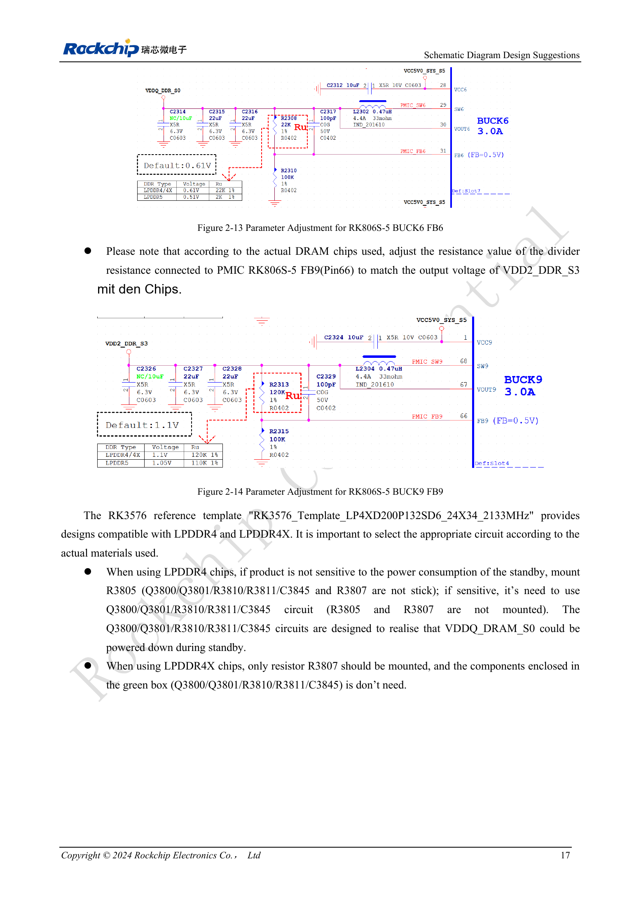
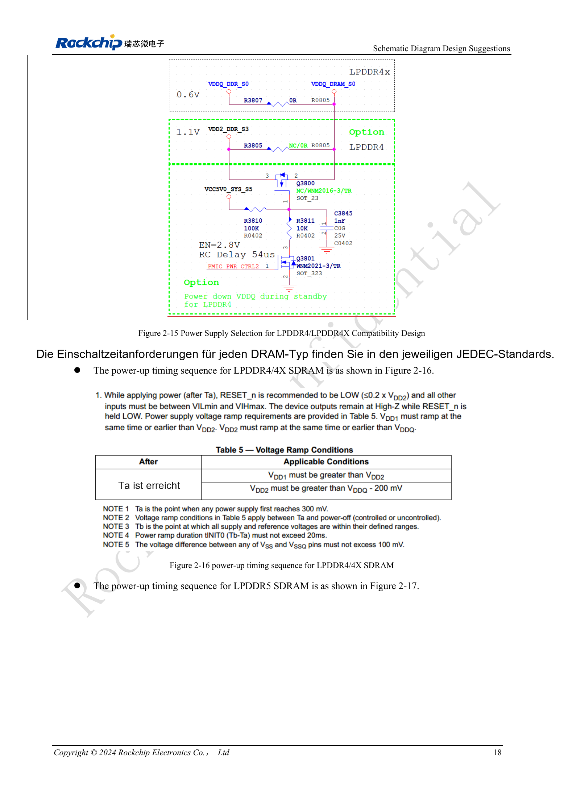

<!-- rk3576-hardware-v11-deep-20261109 -->

# RK3576-DDR-Schaltung und Versorgung: LPDDR4, LPDDR4X und LPDDR5

DDR-Kompatibilität hängt nicht nur vom Gehäuse ab. Speicher-/PHY-Spannungen, ZQ, Signalzuordnung, Standby und Firmware müssen passen. Die Tabelle trennt typische DRAM- und PHY-Werte, insbesondere 1.1V bei LPDDR4 gegenüber 0.61V am PHY.

Grundlage sind die chinesische und englische Ausgabe des RK3576 Hardware Design Guide V1.1 (2024-05-28) für SoC-Platinen. CM5-Träger müssen der Moduldefinition folgen; Sige5 kann als Software-/Peripheriebasis dienen. Eine universelle SDK-/BSP- oder Kernelversion wird nicht vorgegeben; jede Platine prüfen. Werte stammen aus der Quelle, nicht aus ArmSoM-Messungen.

**RK3576_Hardware_Design_Guide_V1.1_20240528_EN.pdf** · §2.1.7

## Schnittstelle und Kapazität

RK3576 unterstützt LPDDR4/4X/5 mit zwei 16-Bit-Kanälen, insgesamt 32 Bit. Bis 8GB je Kanal und 16GB insgesamt beschreiben die SoC-Adressierung, nicht jede CM5-/Sige5-Variante. DQ/CA nicht beliebig tauschen; Pins mit Vorlage und Tabelle 2-4 abgleichen. LPDDR5 nutzt WCK mit 2× oder 4× CK; LPDDR4-CKE und weitere Zuordnungen lassen sich nicht einfach übernehmen.

## ZQ und PMIC-Teiler

PHY-ZQ verwendet 240Ω, 1% nach DDRPHY_VDDQ_S0. Speicher-ZQ von LPDDR4X/5 liegt an derselben Domäne, LPDDR4-ZQ dagegen an VDD2_DDR_S3. ODT_CA von LPDDR4/4X liegt an VDD2_DDR_S3. Nach Speicherwahl die Teiler an RK806S-5 FB6 (Pin31) für VDDQ_DDR_S0 und FB9 (Pin66) für VDD2_DDR_S3 prüfen. Typische Werte ersetzen keine Bausteintoleranzen oder Sequenzvorgaben.

## Bestückungsvarianten und Standby

Bei RK3576_Template_LP4XD200P132SD6_24X34_2133MHz nutzt die stromsparende LPDDR4-Variante Q3800/Q3801/R3810/R3811/C3845 ohne R3805/R3807; alternativ wird bei LPDDR4 R3805 bestückt. LPDDR4X nutzt R3807 ohne die zugehörige grün markierte Schaltung. Diese Bezeichner gelten nur für die Vorlage, nicht für beliebige CM5-Trägerumbauten. DDRPHY_CKE_VDDQ im Standby erhalten und alle Spannungen gegen die JEDEC-Sequenz des Speichers prüfen.

## Entwurfsparameter und Prüftabelle

| Punkt | Wert/Netz | Prüfhinweis |
| --- | --- | --- |
| DRAM VDD1 | 1.8 / 1.8 / 1.8V | Reihenfolge: LPDDR4 / 4X / 5 |
| DRAM VDD2/VDD2H | 1.1 / 1.1 / 1.05V | LPDDR5 zusätzlich VDD2L=0.9V |
| DRAM VDDQ | 1.1 / 0.61 / 0.51V | Nicht mit PHY-Spannungen verwechseln |
| PHY VDDQ/CK_VDDQ | 0.61 / 0.61 / 0.51V | Typisch |
| PHY CKE_VDDQ | 1.1 / 1.1 / 1.05V | Im Standby erhalten |
| PHY DVDD / PLL_DVDD | 0.75–0.85V | PLL_AVDD1V8=1.8V |

## Referenzschaltungen und Abbildungen

Die Referenzseiten enthalten die zugehörigen Schalt- oder Zeitdiagramme; für volle Auflösung anklicken. Bezeichner und Werte gehören zum Referenzentwurf, nicht zum Schaltplan eines ArmSoM-Produkts.

Englisches Original · PDF 36 · 2-13

Englisches Original · PDF 37 · 2-15

## ArmSoM-Produkte und Entwicklungsweg

CM5 integriert Rechenleistung in einen eigenen Träger; Sige5 eignet sich zur ersten Linux-/Peripherieerprobung. Eine SoC-Funktion ist nicht zwangsläufig auf beiden Produkten herausgeführt. Vor Kauf oder Layout Steckverbinder, Boardrevision und Image prüfen.

- [ArmSoM CM5](https://www.armsom.org/cm5) · [CM5 Docs](https://docs.armsom.org/armsom-cm5)
- [ArmSoM Sige5](https://www.armsom.org/sige5) · [Sige5 Docs](https://docs.armsom.org/armsom-sige5)

## Lesereihenfolge

- [RK3576-Hardwaredesign: vom Minimalsystem zu DDR und USB](/de/articles/rk3576-hardware-design-series/)
- [RK3576-Minimalsystem: vom Schaltplan zum reproduzierbaren Erststart](/de/articles/rk3576-hardware-bringup/)
- [RK3576-Taktentwurf: 24MHz-Quarz, 32kHz-Standby und Peripherietakte](/de/articles/rk3576-clock-circuit-design/)
- [RK3576-Reset: NPOR, RK806S-5, Watchdog und Übertemperaturschutz](/de/articles/rk3576-reset-watchdog-design/)
- [RK3576-Boot und Debugging: Konfiguration, Maskrom, UART und JTAG](/de/articles/rk3576-boot-debug-design/)
- [RK3576-Spannungsdomänen: CPU, GPU, NPU, LOGIC und Entkopplung](/de/articles/rk3576-power-domain-design/)
- [RK3576 und RK806S-5: PMIC-Auswahl, Steuerpins und Rückkopplung](/de/articles/rk3576-rk806s5-pmic-design/)
- [RK3576-Power-Sequencing und Standby: Reset, Haltespannungen und Aufwecken](/de/articles/rk3576-power-sequencing-standby/)
- [RK3576-DDR-Layout: Impedanz, Längen, Rückstrompfade und PDN](/de/articles/rk3576-ddr-pcb-routing/)
- [RK3576-USB/Type-C-Ergänzung: Multiplexing, Wiederherstellung und Schutz](/de/articles/168-rockchip-rk3576-usb/)
