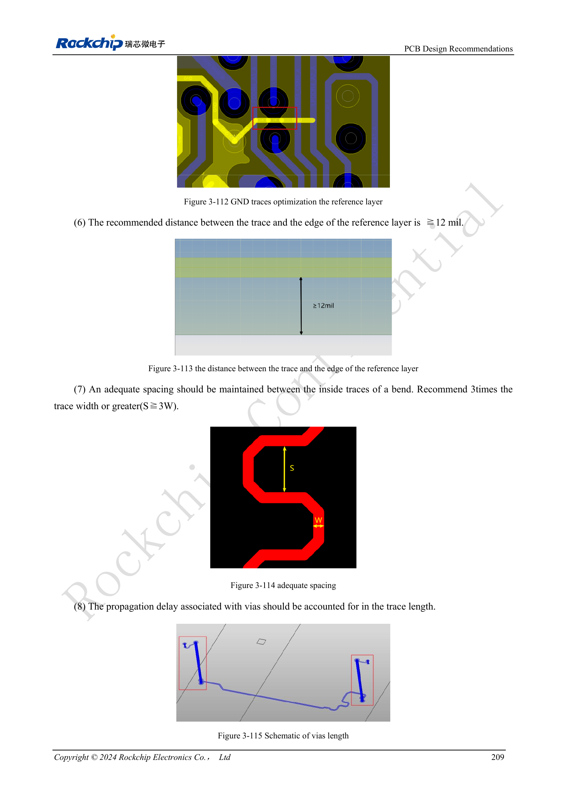

<!-- rk3576-hardware-v11-deep-20261109 -->

# RK3576-DDR-Layout: Impedanz, Längen, Rückstrompfade und PDN

Mit geprüfter PCB-Vorlage und passender DDR-Firmware beginnen. Längenabgleich allein genügt nicht: Referenzflächen, Via-Rückstrom, Impedanz, Übersprechen und PDN bestimmen gemeinsam die Reserve. Grundlage ist §3.5.3.

Grundlage sind die chinesische und englische Ausgabe des RK3576 Hardware Design Guide V1.1 (2024-05-28) für SoC-Platinen. CM5-Träger müssen der Moduldefinition folgen; Sige5 kann als Software-/Peripheriebasis dienen. Eine universelle SDK-/BSP- oder Kernelversion wird nicht vorgegeben; jede Platine prüfen. Werte stammen aus der Quelle, nicht aus ArmSoM-Messungen.

**RK3576_Hardware_Design_Guide_V1.1_20240528_EN.pdf** · §3.5.3; Tables 3-18 / 3-19

## Zuerst durchgehende Rückstrompfade

GND-Vias der Vorlage unter SoC/DRAM nicht entfernen. Innerhalb 25mil vom Signalvia-Mittelpunkt mindestens ein GND-Via vorsehen, das beide Referenzflächen verbindet. Signal- und Massevias abwechseln statt gruppieren. Mindestens eine durchgehende GND-Fläche und ≥12mil Abstand zu deren Rand erhalten. Zusätzliche Mäander reparieren keinen unterbrochenen Rückstrompfad.

## Länge, Abstand und Vias zusammen betrachten

W bezeichnet die tatsächliche Leiterbahnbreite, keinen festen mil-Wert. Mäanderabstand S≥3W; mindestens 8mil Abstand zu Via-Pads halten. Via-Laufzeit in den Abgleich einbeziehen; Differenz innerhalb eines Paares ≤5mil. Masseabschirmungen von DQS/CLK/WCLK in Abständen ≤400mil anbinden. Entfernen nichtfunktionaler Pads mit dem Fertiger abstimmen.

## PDN-Ziele und Abnahme

Für LPDDR4X VDD2/VDDQ und LPDDR5 VDD2H gelten in 100kHz–1MHz, 1–30MHz und 30–100MHz die Grenzen 0.03/0.03/0.04Ω. LPDDR5 VDD2L verwendet 0.07/0.07/0.08Ω. Referenzentkopplung erhalten und reale Kondensatormodelle prüfen. Die chinesische Einleitung nennt „4266bps“, die englische „4266Mbps“; dieser Einheitenunterschied wird dokumentiert, nicht als garantierte Produktrate ausgelegt. Simulation, konkrete DDR-Firmware, Kaltstart und Laststabilität prüfen.

## Entwurfsparameter und Prüftabelle

| Punkt | Wert/Netz | Prüfhinweis |
| --- | --- | --- |
| DQ/DM unsymmetrisch | LPDDR5:40Ω±10%; LPDDR4/4X:45Ω±10% | Breite anhand des realen Lagenaufbaus bestimmen |
| CA/Steuerung | 50Ω±10% | Differenzpaare 90Ω±10% |
| Abweichung im Byte | ≤90mil | DQ/DM relativ zu DQS/WCLK |
| Adress-/Steuerabweichung | ≤90mil | Relativ zu CLK |
| Strobe zu Takt | DQS/WCLK ↔ CLK ≤230mil | Via-Laufzeit einbeziehen |
| Leiterbahnabstand | ≥2W; DQ↔DQS/WCLK, CLK: ≥3W preferred | Kritische Gruppen: mindestens 2W, bevorzugt 3W |

## Referenzschaltungen und Abbildungen

Die Referenzseiten enthalten die zugehörigen Schalt- oder Zeitdiagramme; für volle Auflösung anklicken. Bezeichner und Werte gehören zum Referenzentwurf, nicht zum Schaltplan eines ArmSoM-Produkts.

Englisches Original · PDF 228 · 3-112 / 3-113

## ArmSoM-Produkte und Entwicklungsweg

CM5 integriert Rechenleistung in einen eigenen Träger; Sige5 eignet sich zur ersten Linux-/Peripherieerprobung. Eine SoC-Funktion ist nicht zwangsläufig auf beiden Produkten herausgeführt. Vor Kauf oder Layout Steckverbinder, Boardrevision und Image prüfen.

- [ArmSoM CM5](https://www.armsom.org/cm5) · [CM5 Docs](https://docs.armsom.org/armsom-cm5)
- [ArmSoM Sige5](https://www.armsom.org/sige5) · [Sige5 Docs](https://docs.armsom.org/armsom-sige5)

## Lesereihenfolge

- [RK3576-Hardwaredesign: vom Minimalsystem zu DDR und USB](/de/articles/rk3576-hardware-design-series/)
- [RK3576-Minimalsystem: vom Schaltplan zum reproduzierbaren Erststart](/de/articles/rk3576-hardware-bringup/)
- [RK3576-Taktentwurf: 24MHz-Quarz, 32kHz-Standby und Peripherietakte](/de/articles/rk3576-clock-circuit-design/)
- [RK3576-Reset: NPOR, RK806S-5, Watchdog und Übertemperaturschutz](/de/articles/rk3576-reset-watchdog-design/)
- [RK3576-Boot und Debugging: Konfiguration, Maskrom, UART und JTAG](/de/articles/rk3576-boot-debug-design/)
- [RK3576-Spannungsdomänen: CPU, GPU, NPU, LOGIC und Entkopplung](/de/articles/rk3576-power-domain-design/)
- [RK3576 und RK806S-5: PMIC-Auswahl, Steuerpins und Rückkopplung](/de/articles/rk3576-rk806s5-pmic-design/)
- [RK3576-Power-Sequencing und Standby: Reset, Haltespannungen und Aufwecken](/de/articles/rk3576-power-sequencing-standby/)
- [RK3576-DDR-Schaltung und Versorgung: LPDDR4, LPDDR4X und LPDDR5](/de/articles/rk3576-ddr-circuit-power/)
- [RK3576-USB/Type-C-Ergänzung: Multiplexing, Wiederherstellung und Schutz](/de/articles/168-rockchip-rk3576-usb/)
