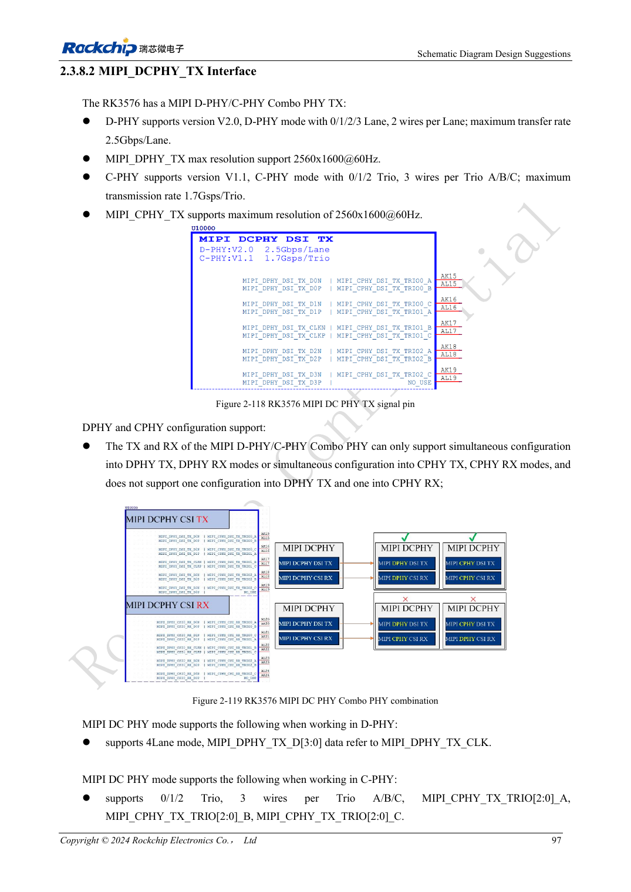
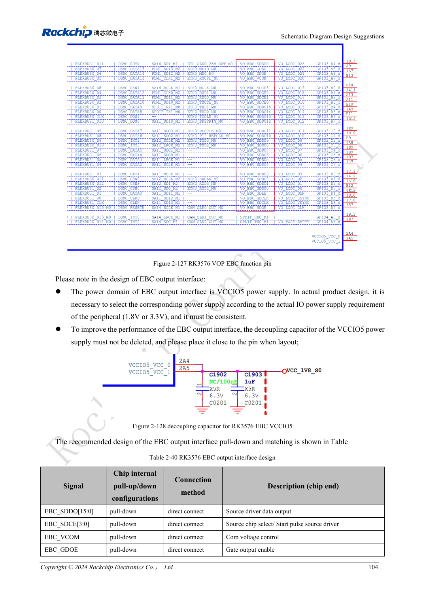

<!-- rk3576-hardware-v11-rest-20261109 -->

# RK3576-Displayhardware: MIPI, RGB, Hintergrundbeleuchtung und Touch

Grundlage sind die chinesische und englische Ausgabe des RK3576 Hardware Design Guide V1.1 (2024-05-28) für SoC-Platinen. CM5-Träger müssen der Moduldefinition folgen; Sige5 kann als Software-/Peripheriebasis dienen. Eine universelle SDK-/BSP- oder Kernelversion wird nicht vorgegeben; jede Platine prüfen. Werte stammen aus der Quelle, nicht aus ArmSoM-Messungen.

**RK3576_Hardware_Design_Guide_V1.1_20240528_EN.pdf** · §2.3.8.2, §2.3.8.4–6; MIPI/RGB PCB

## Panel nach Schnittstelle statt nur Auflösung wählen

MIPI TX bietet vier DPHY-Lanes bis 2.5Gbps/lane oder drei CPHY-Trios bis 1.7Gsps; genannt werden 2560×1600@60. Gemeinsamer DCPHY-TX/RX benötigt denselben Modus. RGB/BT1120 nutzt VCCIO5 mit passenden 1.8/3.3V. RGB666/RGB565 verwenden obere Datenbits; nicht automatisch bei D0 beginnen.

## Panel und Beleuchtung zunächst ausschalten

Schaltbare, anfangs ausgeschaltete Panelversorgung vorsehen. EN/PWM der Beleuchtung mit internem und externem Pull-down gegen Aufblitzen sichern. Boost-Spule, Diode und Kondensatoren auch für Leerlauf auslegen; FB-Stromwiderstand mit 1% Genauigkeit. Touch-I2C über 2.2kΩ nach VCC3V3_TP, bevorzugt eigener Bus. Bei gemeinsamem Bus Adressen, Sequenz und Rückspeisung prüfen.

## DPHY- und CPHY-Regeln trennen

DPHY als Paare, CPHY als Dreiergruppen führen. FPC, Stecker, ESD und Testpunkte zum Kanal zählen; Stubs kurz halten. Kaltstart, Helligkeit, Schlaf/Aufwachen, Touch-Interrupts und Daueranzeige prüfen. Initialisierung nach konkretem Panel statt allein nach SoC wählen.

## Entwurfsparameter und Prüftabelle

| Punkt | Quellenreferenz |
| --- | --- |
| DPHY Zdiff | 100Ω ±10% preferred |
| DPHY-Paardifferenz / Takt-Daten | <6mil / <12mil |
| CPHY Zsingle | 50Ω ±10% |
| CPHY-Differenz innerhalb / zwischen Trios | <6mil / <100mil |
| DPHY-/CPHY-Länge | <6inch / <5inch |

## Quellenabbildungen

Die Referenzseiten enthalten die zugehörigen Schalt- oder Zeitdiagramme; für volle Auflösung anklicken. Bezeichner und Werte gehören zum Referenzentwurf, nicht zum Schaltplan eines ArmSoM-Produkts.

Englisches Original · PDF 116 · 2-118

Englisches Original · PDF 123 · 2-127

## Entwicklung mit ArmSoM

CM5 verringert die erneute Entwicklung des Rechenkerns auf eigenen Trägern; Sige5 dient als Ausgangspunkt für Software und Peripherie. Herausführung, Pins, Pegel und Image-Unterstützung anhand der Boarddokumentation prüfen.

- [ArmSoM CM5](https://www.armsom.org/cm5) · [CM5 Docs](https://docs.armsom.org/armsom-cm5)
- [ArmSoM Sige5](https://www.armsom.org/sige5) · [Sige5 Docs](https://docs.armsom.org/armsom-sige5)

## Weiterlesen

- [RK3576-Hardwaredesign: 30 Themen](/de/articles/rk3576-hardware-design-series/)
- [RK3576-Kamerahardware: CSI-Gruppen, DCPHY-Modi und Versorgung](/de/articles/rk3576-camera-hardware-design/)
- [RK3576-HDMI-Hardware: FRL/TMDS, DDC-Pegel und Schutz](/de/articles/rk3576-hdmi-hardware-design/)
