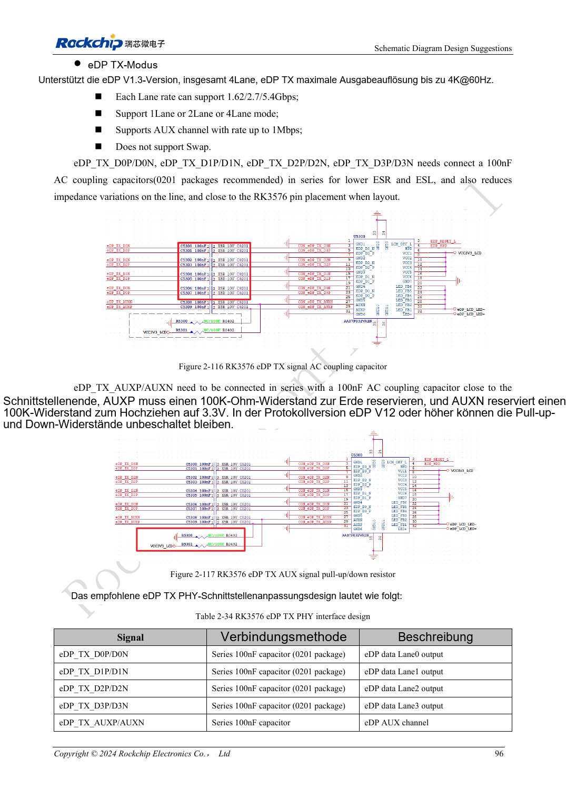
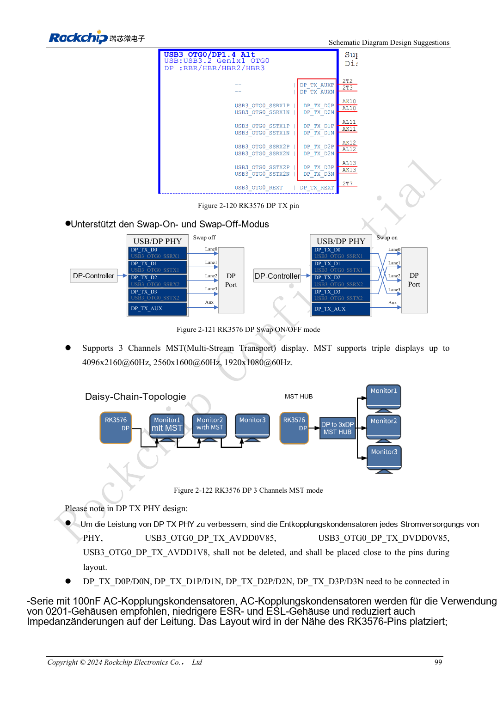

<!-- rk3576-hardware-v11-rest-20261109 -->

# RK3576-DP/eDP: PHY-Zuordnung, AUX und abweichende Koppelwerte

Grundlage sind die chinesische und englische Ausgabe des RK3576 Hardware Design Guide V1.1 (2024-05-28) für SoC-Platinen. CM5-Träger müssen der Moduldefinition folgen; Sige5 kann als Software-/Peripheriebasis dienen. Eine universelle SDK-/BSP- oder Kernelversion wird nicht vorgegeben; jede Platine prüfen. Werte stammen aus der Quelle, nicht aus ArmSoM-Messungen.

**RK3576_Hardware_Design_Guide_V1.1_20240528_EN.pdf** · §2.3.8.1, §2.3.8.3; DP/eDP PCB

## DP und eDP belegen unterschiedliche Ressourcen

DP 1.4 teilt Combo PHY mit USB3 OTG0: 1/2/4 Lanes bei 1.62/2.7/5.4/8.1Gbps. eDP 1.3 teilt den PHY mit HDMI: 1/2/4 Lanes bei 1.62/2.7/5.4Gbps; laut Quelle kein Lane-Swap. Bei MST, mehreren Displays und Type-C tatsächlichen Mux und Boardanschlüsse prüfen.

## AUX und ein Quellenwiderspruch

DP-Daten und AUX verwenden 100nF, AUX-Kondensatoren nahe am Stecker. Referenzwiderstand: 8.2kΩ, 1%. eDP-Schaltungshinweise nennen 100nF, die PCB-Tabelle 220nF±20%: CN-PDF 106–107/222; auch englische Schaltung und PDF 244 weichen ab. Beide Angaben bleiben sichtbar. BOM erst nach Abgleich mit aktueller Referenz, Empfänger und Hersteller festlegen.

## Versorgung neben Link-Training prüfen

Referenzimpedanz: 100Ω für dediziertes DP, 95Ω bei USB-Teilung, 90Ω für eDP passend zum Kabel. AUX, HPD, Training, Panel-/Backlight-Sequenz und Aufwachen prüfen. Schwarzes Bild in fehlendes AUX, Trainingsfehler oder deaktivierte Beleuchtung eingrenzen, bevor Videotimings geändert werden.

## Entwurfsparameter und Prüftabelle

| Punkt | Quellenreferenz |
| --- | --- |
| DP / eDP Zdiff | 100Ω (95Ω shared) / 90Ω |
| Paarinterne Differenz | <6mil |
| Leiterlänge | <6inch |
| eDP-Kopplung: ungeklärt | 100nF / 220nF ±20% |
| Empfohlene Viazahl | ≤2 |

## Quellenabbildungen

Die Referenzseiten enthalten die zugehörigen Schalt- oder Zeitdiagramme; für volle Auflösung anklicken. Bezeichner und Werte gehören zum Referenzentwurf, nicht zum Schaltplan eines ArmSoM-Produkts.

Englisches Original · PDF 115 · 2-116

Englisches Original · PDF 118 · 2-121

## Entwicklung mit ArmSoM

CM5 verringert die erneute Entwicklung des Rechenkerns auf eigenen Trägern; Sige5 dient als Ausgangspunkt für Software und Peripherie. Herausführung, Pins, Pegel und Image-Unterstützung anhand der Boarddokumentation prüfen.

- [ArmSoM CM5](https://www.armsom.org/cm5) · [CM5 Docs](https://docs.armsom.org/armsom-cm5)
- [ArmSoM Sige5](https://www.armsom.org/sige5) · [Sige5 Docs](https://docs.armsom.org/armsom-sige5)

## Weiterlesen

- [RK3576-Hardwaredesign: 30 Themen](/de/articles/rk3576-hardware-design-series/)
- [RK3576-HDMI-Hardware: FRL/TMDS, DDC-Pegel und Schutz](/de/articles/rk3576-hdmi-hardware-design/)
- [RK3576-Audiohardware: SAI, PDM, ASRC und Mikrofonlayout](/de/articles/rk3576-audio-hardware-design/)
