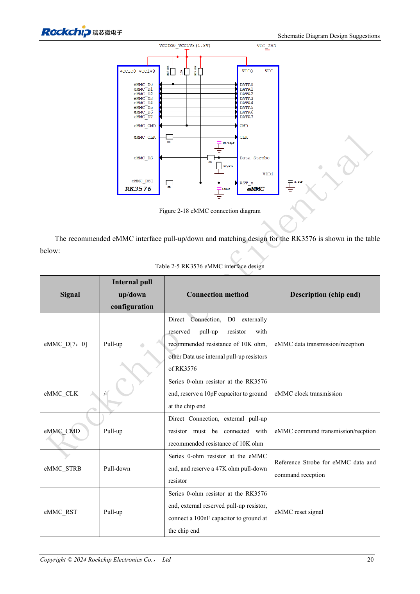
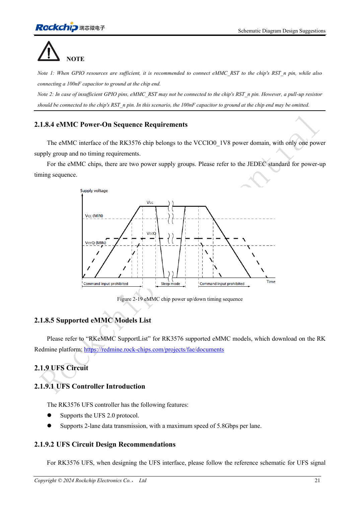

<!-- rk3576-hardware-v11-rest-20261109 -->

# RK3576-eMMC-Hardware: Versorgung, Pull-ups und HS400-Routing

Grundlage sind die chinesische und englische Ausgabe des RK3576 Hardware Design Guide V1.1 (2024-05-28) für SoC-Platinen. CM5-Träger müssen der Moduldefinition folgen; Sige5 kann als Software-/Peripheriebasis dienen. Eine universelle SDK-/BSP- oder Kernelversion wird nicht vorgegeben; jede Platine prüfen. Werte stammen aus der Quelle, nicht aus ArmSoM-Messungen.

**RK3576_Hardware_Design_Guide_V1.1_20240528_EN.pdf** · §2.1.8; eMMC PCB

## Die gesamte Bootspeicher-Verbindung planen

RK3576 unterstützt eMMC 5.1, 5.0, 4.51 und 4.41 einschließlich HS400ES, HS400, HS200 und DDR50. Die Controllerfähigkeit bestätigt nicht jede Kombination aus Speicher und PCB. Baustein, Loader, IO-Versorgung und Routing festlegen, dann den ausgehandelten Modus prüfen. eMMC teilt Pins mit FSPI0; beide können dieselben Pins nicht gleichzeitig belegen.

## CMD, D0 und Reset getrennt prüfen

VCCIO0 ist fest auf 1.8V ausgelegt; Kern- und IO-Versorgung des Speichers folgen dessen Spezifikation und Sequenz. CMD benötigt extern 10kΩ Pull-up. Für D0 10kΩ vorsehen; weitere Datenleitungen verwenden die internen Pull-ups der Referenz. CLK: 0Ω am SoC, optional 10pF am Speicher. STRB: 0Ω am Speicher und optional 47kΩ Pull-down. Bei GPIO-Reset bleiben 100nF am Speicher; ohne GPIO benötigt RST_n weiterhin einen Pull-up.

## Vom Routing zur Validierung

Die folgenden Vorgaben setzen und Masse-Rückwege bei Lagenwechseln erhalten. Kaltstart, längere Lese-/Schreibvorgänge, Neustart und Wiederherstellung nach Stromunterbrechung prüfen. Baustein, Busmodus, Image und Fehler dokumentieren. Funktion bei kleinerem Takt ist ein Diagnosehinweis, kein Ersatz für Versorgungs- und Signalintegritätsprüfungen.

## Entwurfsparameter und Prüftabelle

| Punkt | Quellenreferenz |
| --- | --- |
| Z | 50Ω ±10% |
| CLK ↔ DATA | <120mil |
| Leiterlänge | <3.5inch |
| Freier Abstand | ≥2W |
| Empfohlene Viazahl | ≤2 |
| Abstand Massevia | ≤30mil |

## Quellenabbildungen

Die Referenzseiten enthalten die zugehörigen Schalt- oder Zeitdiagramme; für volle Auflösung anklicken. Bezeichner und Werte gehören zum Referenzentwurf, nicht zum Schaltplan eines ArmSoM-Produkts.

Englisches Original · PDF 39 · 2-18

Englisches Original · PDF 40 · 2-19

## Entwicklung mit ArmSoM

CM5 verringert die erneute Entwicklung des Rechenkerns auf eigenen Trägern; Sige5 dient als Ausgangspunkt für Software und Peripherie. Herausführung, Pins, Pegel und Image-Unterstützung anhand der Boarddokumentation prüfen.

- [ArmSoM CM5](https://www.armsom.org/cm5) · [CM5 Docs](https://docs.armsom.org/armsom-cm5)
- [ArmSoM Sige5](https://www.armsom.org/sige5) · [Sige5 Docs](https://docs.armsom.org/armsom-sige5)

## Weiterlesen

- [RK3576-Hardwaredesign: 30 Themen](/de/articles/rk3576-hardware-design-series/)
- [RK3576-UFS-Hardware: Speicherkompatibilität, Sequenz und Differenzleitungen](/de/articles/rk3576-ufs-hardware-design/)
