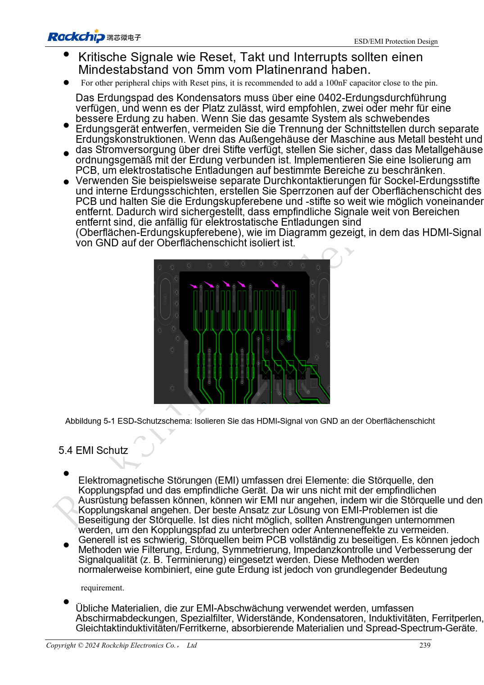

<!-- rk3576-hardware-v11-rest-20261109 -->

# RK3576-ESD und EMI: Ableitwege, Reset-Störfestigkeit und Fertigungsprüfung

Grundlage sind die chinesische und englische Ausgabe des RK3576 Hardware Design Guide V1.1 (2024-05-28) für SoC-Platinen. CM5-Träger müssen der Moduldefinition folgen; Sige5 kann als Software-/Peripheriebasis dienen. Eine universelle SDK-/BSP- oder Kernelversion wird nicht vorgegeben; jede Platine prüfen. Werte stammen aus der Quelle, nicht aus ArmSoM-Messungen.

**RK3576_Hardware_Design_Guide_V1.1_20240528_EN.pdf** · Chapters 5–6

## Schutz braucht einen wirksamen Ableitweg

ESD am Steckereintritt vor dem Chip platzieren. Ableitung kurz und fern empfindlicher Bereiche führen. Bei schnellen Signalen zählt neben Spannung auch Kapazität. Allgemeine ESD-Widerstandsbereiche ersetzen keine HDMI-, USB- oder SDIO-spezifischen Werte.

## Reset, Takte und Gehäuse gemeinsam prüfen

Reset-, Takt- und Interruptnetze laut Quelle mindestens 5mm vom Rand halten. NPOR 100nF chipnah mit Massevia platzieren. Taktdämpfung an der Quelle, möglichst innen mit Rückweg führen. Kühlkörper und Gehäuse können abstrahlen; Erdung am Gesamtsystem validieren statt wahllos Gleichtaktdrosseln ergänzen.

## Hinweise in nachvollziehbare Prüfungen überführen

Port, Polarität, Prüfpunkt, Betriebsart und Fehlerbild dokumentieren. Nach ESD Reset, Kommunikation, Speicher und Wiederanlauf prüfen; kein Absturz beweist keine Datenintegrität. Vor Fertigung Löten, Feuchte und Verpackung prüfen. MSL3-Referenz: 168 Stunden bei ≤30°C/60%RH, keine beliebige Lagerzusage. Prüfniveau nach Produktstandard wählen; keine Zertifizierung wird behauptet.

## Entwurfsparameter und Prüftabelle

| Punkt | Quellenreferenz |
| --- | --- |
| Randabstand empfindlicher Netze | ≥5mm |
| NPOR-Filter | 100nF |
| Taktdämpfungsabstand | ≤400mil |
| MSL3-Referenz-Offenzeit | 168h; ≤30°C / 60%RH |

## Quellenabbildungen

Die Referenzseiten enthalten die zugehörigen Schalt- oder Zeitdiagramme; für volle Auflösung anklicken. Bezeichner und Werte gehören zum Referenzentwurf, nicht zum Schaltplan eines ArmSoM-Produkts.

Englisches Original · PDF 258 · 5-1

## Entwicklung mit ArmSoM

CM5 verringert die erneute Entwicklung des Rechenkerns auf eigenen Trägern; Sige5 dient als Ausgangspunkt für Software und Peripherie. Herausführung, Pins, Pegel und Image-Unterstützung anhand der Boarddokumentation prüfen.

- [ArmSoM CM5](https://www.armsom.org/cm5) · [CM5 Docs](https://docs.armsom.org/armsom-cm5)
- [ArmSoM Sige5](https://www.armsom.org/sige5) · [Sige5 Docs](https://docs.armsom.org/armsom-sige5)

## Weiterlesen

- [RK3576-Hardwaredesign: 30 Themen](/de/articles/rk3576-hardware-design-series/)
- [RK3576-Thermik: Wärmewiderstand, PCB-Wärmeleitung und Dauerlast](/de/articles/rk3576-thermal-hardware-design/)
