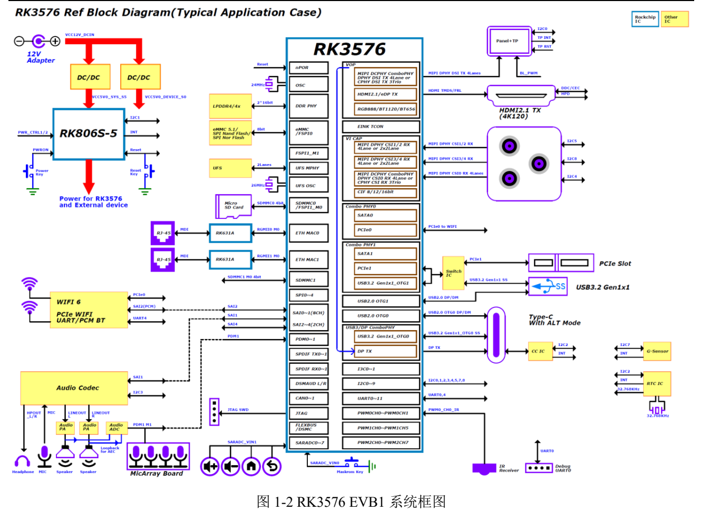
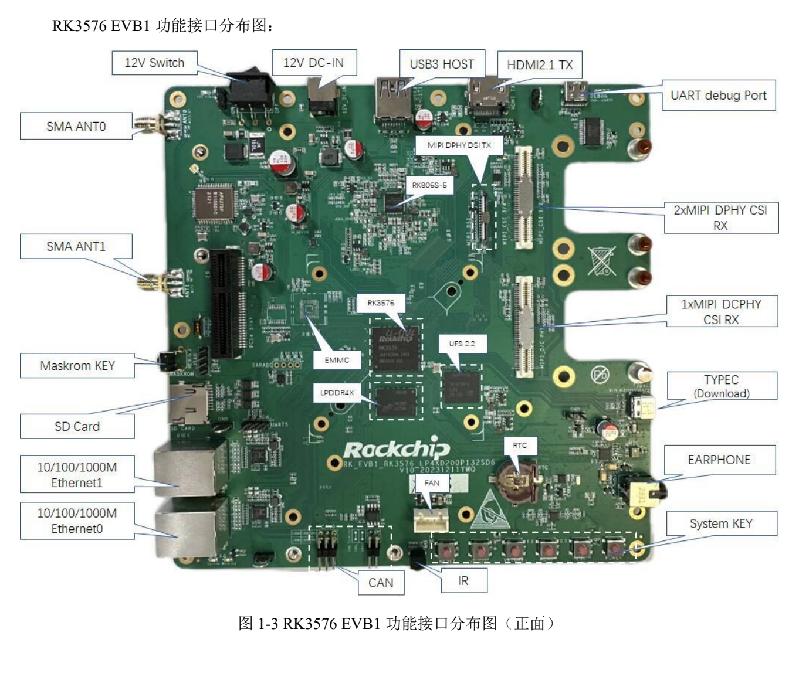
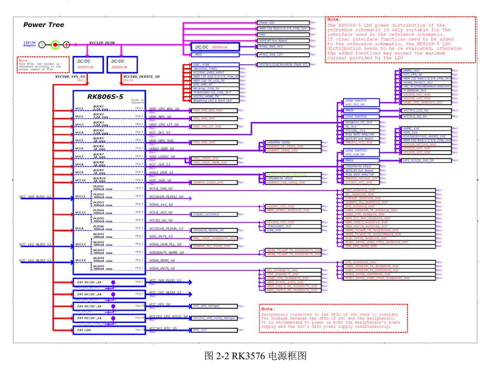

Dieser thematische Leitfaden erläutert das Quelldokument mit wichtigen Daten, Grenzen und Originalabbildungen. Er ist keine seitenweise Übersetzung und kein vollständiges Pin- oder Registerhandbuch. Herstellerbeispiele sind keine ArmSoM-Messungen. Vor der Anwendung sind Platinenrevision, Schaltplan, SDK/BSP, Kernel und Treiber zu prüfen; für diesen Artikel wurden keine neuen Hardwaretests durchgeführt.

**Hauptquelle：** `Rockchip_RK3576_EVB1_User_Guide_V1.0_CN.pdf` · PDF 53 Seiten.

## Referenzrevision bestimmen

Das Handbuch gilt für `RK_EVB1_RK3576_LP4XD200P132SD6_V10_20231211YWQ_final`. Die Tabelle nennt 8GB LPDDR4x, 128GB UFS, eMMC N/A und 12V/3A für das Kit. Das ist EVB1, keine CM5-/Sige5-Konfiguration. Beide ArmSoM-Produkte verwenden RK3576, benötigen aber eigene Schaltpläne und BSPs.


[](/assets/hardware-reference-20261110/rk3576-evb-p12.png)

*RK3576-EVB1-Systemdiagramm — Chinesische Originalabbildung; in dieser Auswahl liegt keine entsprechende englische Abbildung vor. `Rockchip_RK3576_EVB1_User_Guide_V1.0_CN.pdf`, PDF p. 12.*


## Ports vor dem Einschalten unterscheiden

Der Haupt-Type-C dient Download und DP Alt Mode, ein anderer Type-C ist USB-UART Debug. COM-Port feststellen und die Quellenvorgabe `1500000` (1.5M) Baud verwenden. Der serielle Pfad muss das unterstützen; Logs ab Reset speichern.


[](/assets/hardware-reference-20261110/rk3576-evb-p14.png)

*RK3576-EVB1-Anschlüsse — Chinesische Originalabbildung; in dieser Auswahl liegt keine entsprechende englische Abbildung vor. `Rockchip_RK3576_EVB1_User_Guide_V1.0_CN.pdf`, PDF p. 14.*


## Loader, MASKROM und USB3-Download

1. Image, Loader, Parameter und Uboot auf Speicher und Revision abstimmen; Daten sichern.
2. MASKROM der Referenz: Download-Type-C verbinden, MASKROM halten, Versorgung und Schalter einschalten; nach Erkennung loslassen.
3. Loader: Volume+(RECOVERY) beim Einschalten/Reset halten und nach Erkennung loslassen. Die Quelle ordnet dies Low an `SARADC_IN1` zu.
4. Das Handbuch verlangt Tool v3.28 oder neuer. Für USB3 steht folgende Einstellung in `config.ini`; auch die Geräteseite muss USB3 unterstützen.

```ini
USB3_TRANSFER=TRUE
```

Das ist ein Quellenbeispiel, keine Einstellung für jede Softwareversion. CM5-/Sige5-Tasten, Versorgung und Downloadports im jeweiligen Handbuch prüfen, nicht den EVB-12V-Ablauf übernehmen.

## Drei häufige Fehlinterpretationen

**Steckerform ist keine Linkbreite.** Beschrieben wird ein PCIex4-Stecker, die Tabelle nennt aber 1 aktive Lane und die Alternative USB3.0 Host. Versorgung, Lanes, PHY und BSP prüfen; kein x4-Tempo aus der Form ableiten.

**Kamerastecker sind nicht universell.** DCPHY/DPHY, ein 80pin-Stecker und ein IMX415-Beispiel sind beschrieben. Die Übersicht nennt 1×3 trios CPHY, spätere Formulierungen weichen ab. Modus anhand des Schaltplans und formaler Chipdaten klären, keine Schnittstellenzahlen addieren. Versorgung, Reset, Takt, I2C und Treiber müssen passen.

**USB-Wake benötigt passende Versorgung.** S. 30 listet Widerstandswechsel für Host-5V, USB-PHY und Oszillator. Eine Softwareeigenschaft allein garantiert kein Aufwecken. Bauteilnummern gelten nur für diese EVB-Revision.


[](/assets/hardware-reference-20261110/rk3576-evb-p23.png)

*RK3576-EVB1-Versorgungsbaum — Chinesische Originalabbildung; in dieser Auswahl liegt keine entsprechende englische Abbildung vor. `Rockchip_RK3576_EVB1_User_Guide_V1.0_CN.pdf`, PDF p. 23.*


## Ausgewählte I2C-Adressen und Pegel

| EVB-Bus | Bauteil | Quellenadresse | Pegel |
| --- | --- | --- | --- |
| I2C1_M0 | RK806S-5 | `0x23` | 1.8V |
| I2C2_M0 | HYM8563TS / HUSB311 | `0x51` / `0x4E` | 3.3V |
| I2C3_M0 | ES8388 / ES7202 | `0x11` / `0x30` | 1.8V |
| I2C4_M3 | CAM0 | `0x1A` | 1.8V |

Dies sind bekannte Einträge von S. 23. Weitere Kamera-, Touch- und MicArray-Zeilen enthalten `TBD`; keine Adressen erfinden. Konflikte, Pull-up-Versorgung und Rückspeisung im Schlaf prüfen.

## Debugging und Migration

Mit eingesteckter SD-Karte ist JTAG laut Handbuch nicht nutzbar; auch CAN ist als mit SD Card geteilt markiert. Der Lüfterabschnitt nennt 12V/5V, standardmäßig 12V, aber noch keine Sensor-Drehzahlregelung auf EVB1. Ein Stecker beweist keinen geschlossenen Regelkreis.

Bei einem Image mit ADB lauten die Quellenbefehle zur Verbindung:

```sh
adb devices
adb shell
```

Versorgung, Download, UART, Speicher, Display, Netzwerk und Kamera nacheinander prüfen, danach Gleichzeitigkeit und Suspend/Resume. CM5-Träger und Sige5 nutzen eigene Pins, Speicher, Firmware und Stromversorgung; das EVB liefert eine Fehlersuchmethode.


## Produkte und Entwicklungsunterlagen

- **CM5** — [Produkt](https://www.armsom.org/cm5) · [Dokumentation](https://docs.armsom.org/armsom-cm5)
- **Sige5** — [Produkt](https://www.armsom.org/sige5) · [Dokumentation](https://docs.armsom.org/armsom-sige5)
