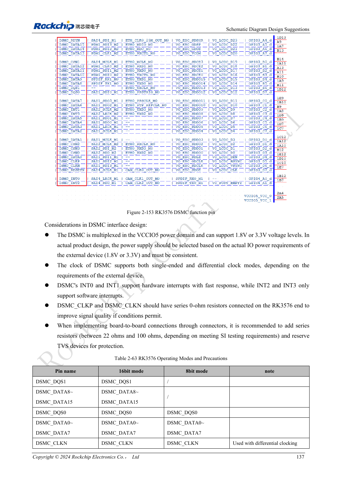

<!-- rk3576-hardware-v11-rest-20261109 -->

# RK3576-FlexBus und DSMC: FPGA, PSRAM und Parallelrouting

Grundlage sind die chinesische und englische Ausgabe des RK3576 Hardware Design Guide V1.1 (2024-05-28) für SoC-Platinen. CM5-Träger müssen der Moduldefinition folgen; Sige5 kann als Software-/Peripheriebasis dienen. Eine universelle SDK-/BSP- oder Kernelversion wird nicht vorgegeben; jede Platine prüfen. Werte stammen aus der Quelle, nicht aus ArmSoM-Messungen.

**RK3576_Hardware_Design_Guide_V1.1_20240528_EN.pdf** · §2.3.11–12; DSMC/FlexBus PCB

## Busse zuerst unterscheiden

FlexBus0 sendet oder empfängt, FlexBus1 empfängt nur; 2/4/8/16bit bei referenzmäßig bis 100MHz. DSMC zielt auf DDR-PSRAM oder FPGA mit 8/16bit, vier Chip-Selects und bis 100MHz. Gleiche Breite bedeutet keine Austauschbarkeit; Protokoll, Abtastflanken und Software müssen passen.

## IO-Bereiche und Datenpackung

FlexBus nutzt hauptsächlich VCCIO5, zusätzliche Pins VCCIO2; Spannungen abstimmen. Sonderbreiten können breiter gespeichert werden: 3bit als 4bit, 5/6/7bit als 8bit. Pinzahl definiert nicht das Pufferlayout. DSMC nutzt VCCIO5; INT0/1 besitzen Hardwarepfade, INT2/3 Softwarebehandlung mit anderer Latenz.

## Abzweige nach Topologie prüfen

DSMC: L2/L3 unter 500mil, L4 unter 1inch, L5 unter 100mil; L1 plus jeweiliger Hauptzweig unter 5inch, T-Zweigdifferenz unter 100mil. Originaldefinitionen L1–L5 erhalten; Werte nicht auf andere Topologien übertragen. Feste Muster, Grenzlängen und Dauertransfer auf Bitreihenfolge, Flanken und Packfehler prüfen.

## Entwurfsparameter und Prüftabelle

| Punkt | Quellenreferenz |
| --- | --- |
| Takt | ≤100MHz |
| DSMC Z | 50Ω single / 100Ω differential ±10% |
| DSMC CLK-data | <120mil |
| FlexBus CLK-data | <180mil |
| Hauptpfadlänge | <5inch |

## Quellenabbildungen

Die Referenzseiten enthalten die zugehörigen Schalt- oder Zeitdiagramme; für volle Auflösung anklicken. Bezeichner und Werte gehören zum Referenzentwurf, nicht zum Schaltplan eines ArmSoM-Produkts.

Englisches Original · PDF 156 · 2-153

## Entwicklung mit ArmSoM

CM5 verringert die erneute Entwicklung des Rechenkerns auf eigenen Trägern; Sige5 dient als Ausgangspunkt für Software und Peripherie. Herausführung, Pins, Pegel und Image-Unterstützung anhand der Boarddokumentation prüfen.

- [ArmSoM CM5](https://www.armsom.org/cm5) · [CM5 Docs](https://docs.armsom.org/armsom-cm5)
- [ArmSoM Sige5](https://www.armsom.org/sige5) · [Sige5 Docs](https://docs.armsom.org/armsom-sige5)

## Weiterlesen

- [RK3576-Hardwaredesign: 30 Themen](/de/articles/rk3576-hardware-design-series/)
- [RK3576-Steuerschnittstellen: UART, I2C/I3C, SPI, CAN und PWM](/de/articles/rk3576-industrial-control-interfaces/)
- [RK3576-PCB-Lagen und Fanout: sechs/acht Lagen und gemischtes BGA-Raster](/de/articles/rk3576-pcb-stackup-fanout/)
