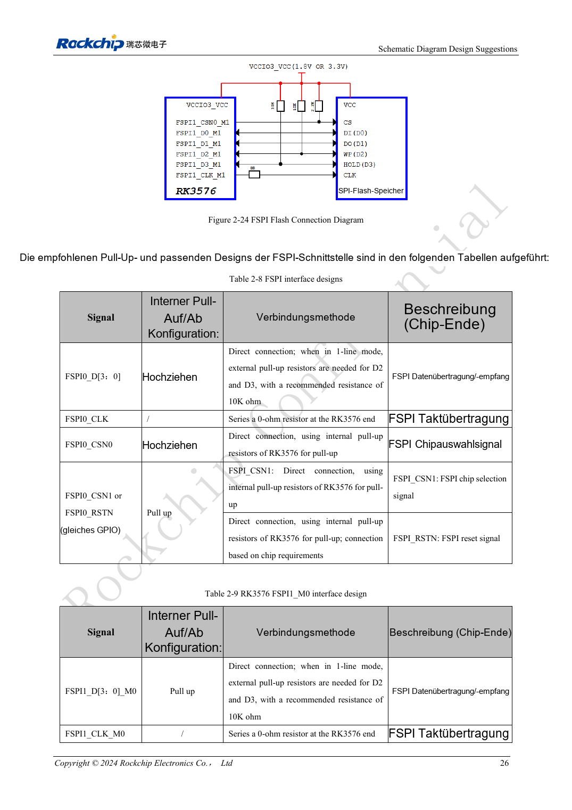
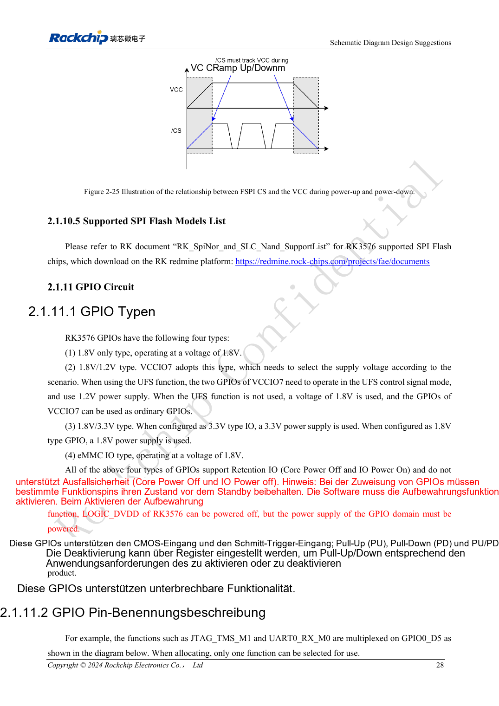

<!-- rk3576-hardware-v11-rest-20261109 -->

# RK3576-FSPI-Boot: NOR/NAND, Spannung und Chip-Select-Zustand

Grundlage sind die chinesische und englische Ausgabe des RK3576 Hardware Design Guide V1.1 (2024-05-28) für SoC-Platinen. CM5-Träger müssen der Moduldefinition folgen; Sige5 kann als Software-/Peripheriebasis dienen. Eine universelle SDK-/BSP- oder Kernelversion wird nicht vorgegeben; jede Platine prüfen. Werte stammen aus der Quelle, nicht aus ArmSoM-Messungen.

**RK3576_Hardware_Design_Guide_V1.1_20240528_EN.pdf** · §2.1.10; FSPI PCB

## Controller und vollständige Mux-Gruppe wählen

Zwei FSPI-Controller unterstützen NOR/NAND mit SDR über 1/2/4 Leitungen. FSPI0 teilt Pins mit eMMC; VCCIO0 erlaubt nur 1.8V. FSPI1_M0 liegt auf VCCIO1, M1 auf VCCIO3; 1.8V oder 3.3V gelten jeweils für den gesamten IO-Bereich. CLK, CS und Daten verschiedener Gruppen nicht mischen.

## Chip Select beim Einschalten absichern

D2/D3 benötigen im Einleitungsmodus externe 10kΩ-Pull-ups. FSPI1_M0 CSN ist zunächst niedrig und braucht einen externen Pull-up: Tabelle 2.2kΩ, Fließtext 2.2kΩ/4.7kΩ. Aktuelle Referenz-BOM und Timing prüfen. Flashversorgung und IO-Domäne abstimmen, CS mit der Versorgung hochziehen. Die Bootsuche ändert Pulls an GPIO1_B0 und GPIO1_C2; empfindliche Enable-Signale dort vermeiden.

## Routing und Wiederherstellung gemeinsam prüfen

0Ω auf CLK am SoC vorsehen. 50Ω, weniger als 200mil Takt-/Datendifferenz und unter 4inch Länge prüfen. Einen unabhängigen USB-Wiederherstellungszugang erhalten. Leeren Flash, beschädigtes Image, Stromunterbrechung beim Schreiben und Kaltstart testen; ein erfolgreicher Download reicht nicht.

## Entwurfsparameter und Prüftabelle

| Punkt | Quellenreferenz |
| --- | --- |
| FSPI0 | VCCIO0 = 1.8V |
| FSPI1_M0 / M1 | VCCIO1 / VCCIO3 |
| Z | 50Ω ±10% |
| CLK ↔ DATA | <200mil |
| Leiterlänge | <4inch |

## Quellenabbildungen

Die Referenzseiten enthalten die zugehörigen Schalt- oder Zeitdiagramme; für volle Auflösung anklicken. Bezeichner und Werte gehören zum Referenzentwurf, nicht zum Schaltplan eines ArmSoM-Produkts.

Englisches Original · PDF 45 · 2-24

Englisches Original · PDF 47 · 2-25

## Entwicklung mit ArmSoM

CM5 verringert die erneute Entwicklung des Rechenkerns auf eigenen Trägern; Sige5 dient als Ausgangspunkt für Software und Peripherie. Herausführung, Pins, Pegel und Image-Unterstützung anhand der Boarddokumentation prüfen.

- [ArmSoM CM5](https://www.armsom.org/cm5) · [CM5 Docs](https://docs.armsom.org/armsom-cm5)
- [ArmSoM Sige5](https://www.armsom.org/sige5) · [Sige5 Docs](https://docs.armsom.org/armsom-sige5)

## Weiterlesen

- [RK3576-Hardwaredesign: 30 Themen](/de/articles/rk3576-hardware-design-series/)
- [RK3576-UFS-Hardware: Speicherkompatibilität, Sequenz und Differenzleitungen](/de/articles/rk3576-ufs-hardware-design/)
- [RK3576-SD-Karten und SDIO-WLAN: Pegelwechsel, Versorgung und HF-Layout](/de/articles/rk3576-sdio-wifi-hardware/)
