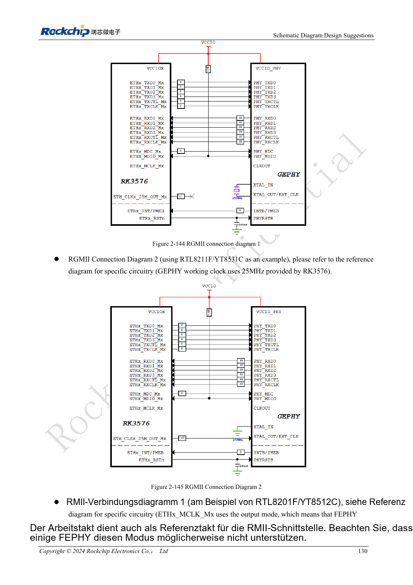
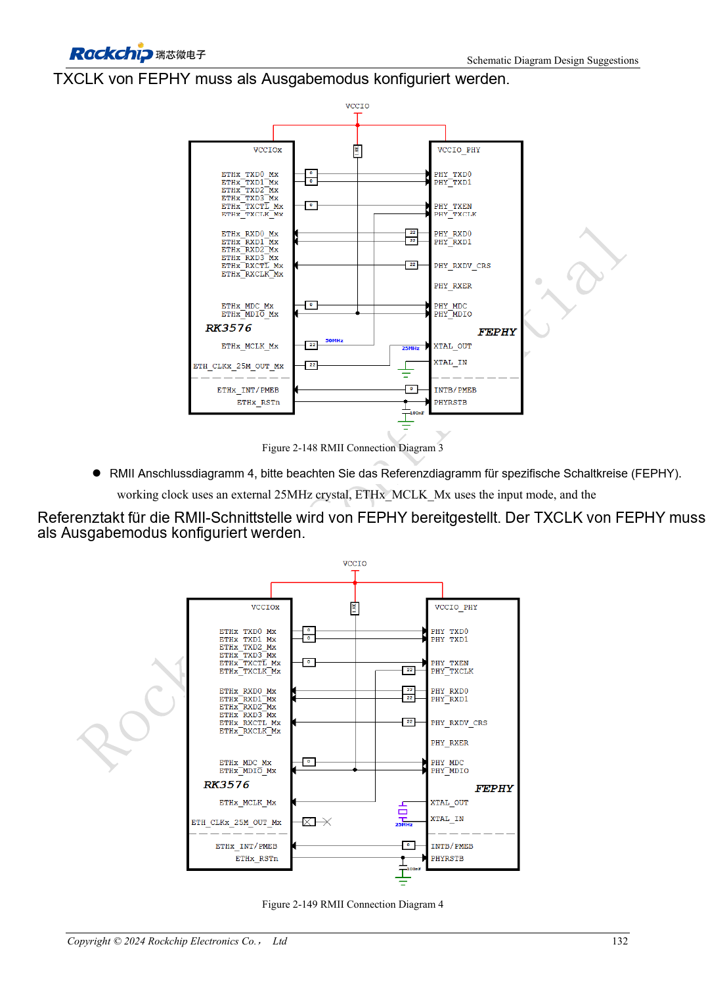

<!-- rk3576-hardware-v11-rest-20261109 -->

# RK3576-Ethernet-Hardware: RGMII-Verzögerung, PHY-Takt und Schutz

Grundlage sind die chinesische und englische Ausgabe des RK3576 Hardware Design Guide V1.1 (2024-05-28) für SoC-Platinen. CM5-Träger müssen der Moduldefinition folgen; Sige5 kann als Software-/Peripheriebasis dienen. Eine universelle SDK-/BSP- oder Kernelversion wird nicht vorgegeben; jede Platine prüfen. Werte stammen aus der Quelle, nicht aus ArmSoM-Messungen.

**RK3576_Hardware_Design_Guide_V1.1_20240528_EN.pdf** · §2.3.10

## Der MAC benötigt einen externen PHY

Zwei GMACs verbinden RGMII-10/100/1000Mbps- oder RMII-10/100Mbps-PHYs. GMAC0 M0/M1 nutzt VCCIO5/VCCIO4, GMAC1 M0/M1 VCCIO4/VCCIO3. Pro Port eine vollständige Gruppe wählen. 1.8V wird für SI bevorzugt, sofern der PHY es unterstützt.

## Taktrichtung und Verzögerung eindeutig festlegen

RMII-50MHz kann vom MAC oder PHY kommen, nicht gleichzeitig von beiden. Die RGMII-Referenz ordnet TX-Timing dem MAC und RX-Timing dem PHY zu; RTL8211F/FI aktiviert 2ns RXCLK-Delay. Nach PHY-Wechsel interne Delays und Device Tree auf doppelte Verzögerung prüfen. TX: 0Ω am SoC; RX: 22Ω am PHY; MDIO: 1.5–1.8kΩ Pull-up.

## Auch die Steckerseite zählt

RTL8211F/FI-Reset benötigt laut Quelle 3.3V und nahe 100nF; nicht aus 1.8V-RGMII ableiten. Mittelanzapfungen nach PHY-Hersteller, RJ45-Pinbelegung nach Rastnasenorientierung prüfen. Raten, Parallelbetrieb, lange Kabel, Neustart und Aufwachen samt Paketfehlern testen statt nur Link-LEDs.

## Entwurfsparameter und Prüftabelle

| Punkt | Quellenreferenz |
| --- | --- |
| RMII-Referenztakt | 50MHz |
| PHY-Quarzreferenz | 25MHz, ±20ppm |
| MDIO-Pull-up | 1.5–1.8kΩ |
| RX-Serienwiderstand | 22Ω at PHY |
| RTL8211F/FI-RX-Delay-Beispiel | 2ns |

## Quellenabbildungen

Die Referenzseiten enthalten die zugehörigen Schalt- oder Zeitdiagramme; für volle Auflösung anklicken. Bezeichner und Werte gehören zum Referenzentwurf, nicht zum Schaltplan eines ArmSoM-Produkts.

Englisches Original · PDF 149 · 2-144

Englisches Original · PDF 151 · 2-149

## Entwicklung mit ArmSoM

CM5 verringert die erneute Entwicklung des Rechenkerns auf eigenen Trägern; Sige5 dient als Ausgangspunkt für Software und Peripherie. Herausführung, Pins, Pegel und Image-Unterstützung anhand der Boarddokumentation prüfen.

- [ArmSoM CM5](https://www.armsom.org/cm5) · [CM5 Docs](https://docs.armsom.org/armsom-cm5)
- [ArmSoM Sige5](https://www.armsom.org/sige5) · [Sige5 Docs](https://docs.armsom.org/armsom-sige5)

## Weiterlesen

- [RK3576-Hardwaredesign: 30 Themen](/de/articles/rk3576-hardware-design-series/)
- [RK3576-Audiohardware: SAI, PDM, ASRC und Mikrofonlayout](/de/articles/rk3576-audio-hardware-design/)
- [RK3576-GPIO und SARADC: Spannungsdomänen, Rückspeisung und Tasten](/de/articles/rk3576-gpio-saradc-hardware/)
