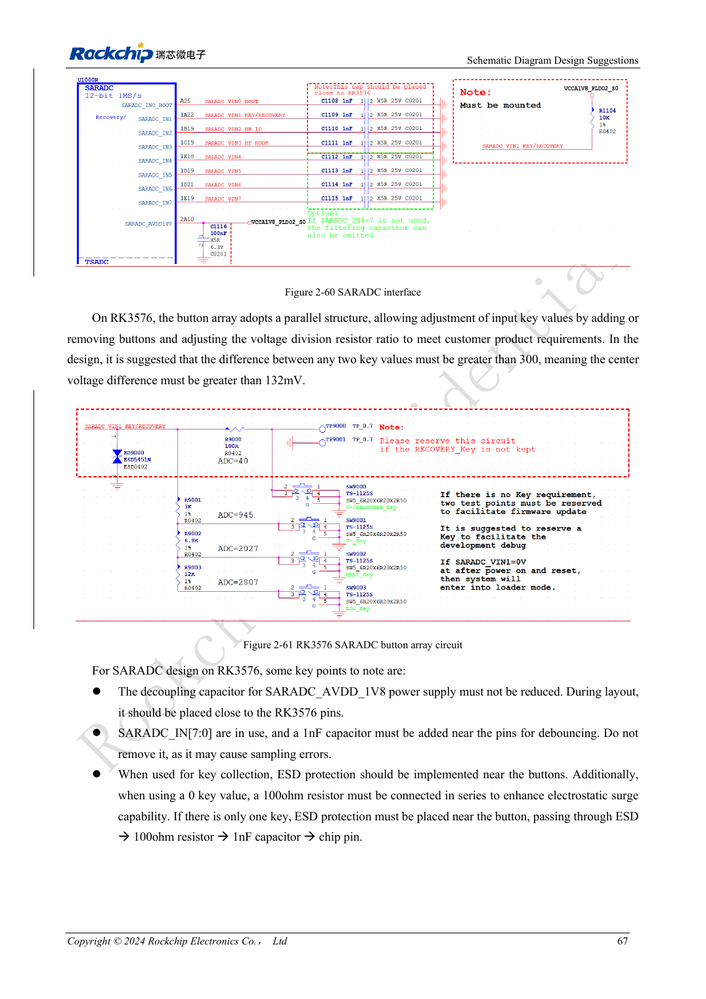

<!-- rk3576-hardware-v11-rest-20261109 -->

# RK3576-GPIO und SARADC: Spannungsdomänen, Rückspeisung und Tasten

Grundlage sind die chinesische und englische Ausgabe des RK3576 Hardware Design Guide V1.1 (2024-05-28) für SoC-Platinen. CM5-Träger müssen der Moduldefinition folgen; Sige5 kann als Software-/Peripheriebasis dienen. Eine universelle SDK-/BSP- oder Kernelversion wird nicht vorgegeben; jede Platine prüfen. Werte stammen aus der Quelle, nicht aus ArmSoM-Messungen.

**RK3576_Hardware_Design_Guide_V1.1_20240528_EN.pdf** · §2.1.11; §2.3.2

## GPIO-Spannung gilt für die gesamte Domäne

PMUIO0 und VCCIO0 sind fest 1.8V. VCCIO7 nutzt 1.2V für UFS, sonst laut Quelle 1.8V. PMUIO1 und VCCIO1–6 unterstützen 1.8/3.3V. Eine andere Pin-Funktion erzeugt keine separate Spannung im selben Bereich. _u/_d/_z stehen für Pull-up/Pull-down/hochohmig; Bootsuche und Schlafzustand mitprüfen.

## Rückspeisung im Aus- und Standbyzustand verhindern

Retention bei abgeschaltetem Kern und versorgtem IO wird unterstützt, fail-safe Eingänge bei komplett abgeschalteter Versorgung nicht. Versorgte Peripherie darf keinen High-Pegel in eine ausgeschaltete Domäne treiben. Pull-up-Versorgung, Einschaltreihenfolge und Isolation gemeinsam prüfen; Treiberstärke pro Pin nachschlagen.

## SARADC-Tasten und Bootfunktionen

SARADC bietet 12bit, bis 1MS/s und acht Eingänge für 0–1.8V. IN0 dient der Bootkonfiguration; IN1 braucht auch ohne Recovery-Taste 10kΩ mit 1%. Tastenabstände sollen über 300 Zählwerte oder 132mV liegen, Filter 1nF nahe am Chip. Referenzschutz: Stecker→ESD→100Ω→1nF→Chip. 3.3V nicht direkt einspeisen.

## Entwurfsparameter und Prüftabelle

| Punkt | Quellenreferenz |
| --- | --- |
| SARADC | 12bit; 0–1.8V |
| IN1-Pull-up | 10kΩ ±1% |
| Tastenpegelabstand | >300 counts / >132mV |
| Filterkondensator | 1nF |

## Quellenabbildungen

Die Referenzseiten enthalten die zugehörigen Schalt- oder Zeitdiagramme; für volle Auflösung anklicken. Bezeichner und Werte gehören zum Referenzentwurf, nicht zum Schaltplan eines ArmSoM-Produkts.

Englisches Original · PDF 86 · 2-61

## Entwicklung mit ArmSoM

CM5 verringert die erneute Entwicklung des Rechenkerns auf eigenen Trägern; Sige5 dient als Ausgangspunkt für Software und Peripherie. Herausführung, Pins, Pegel und Image-Unterstützung anhand der Boarddokumentation prüfen.

- [ArmSoM CM5](https://www.armsom.org/cm5) · [CM5 Docs](https://docs.armsom.org/armsom-cm5)
- [ArmSoM Sige5](https://www.armsom.org/sige5) · [Sige5 Docs](https://docs.armsom.org/armsom-sige5)

## Weiterlesen

- [RK3576-Hardwaredesign: 30 Themen](/de/articles/rk3576-hardware-design-series/)
- [RK3576-Ethernet-Hardware: RGMII-Verzögerung, PHY-Takt und Schutz](/de/articles/rk3576-gmac-hardware-design/)
- [RK3576-Steuerschnittstellen: UART, I2C/I3C, SPI, CAN und PWM](/de/articles/rk3576-industrial-control-interfaces/)
