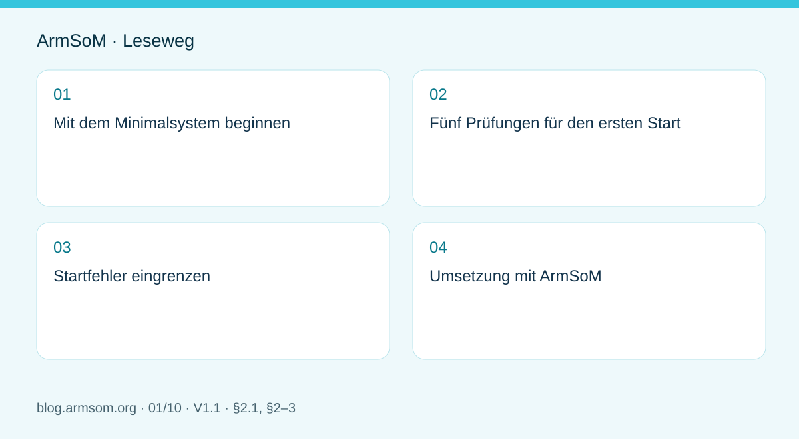
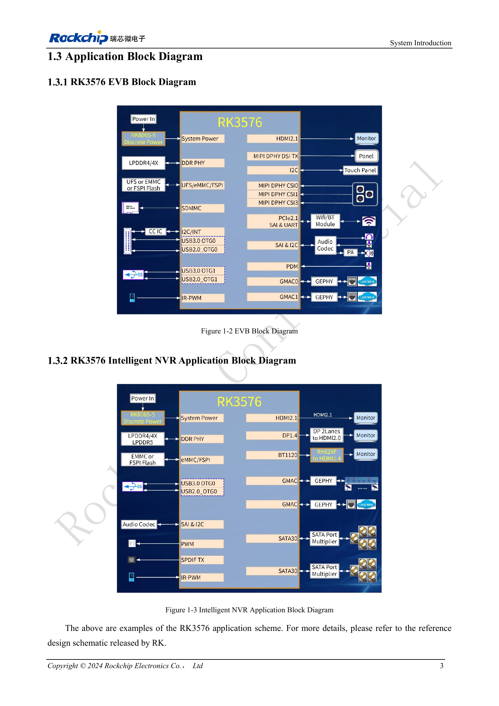

# RK3576 in Betrieb nehmen: Minimalsystem und erste Einschaltprüfung

## Geltungsbereich und Quellen

Dies ist ein thematischer Engineering-Leitfaden, keine seitenweise Übersetzung des gesamten PDF. Quellenbeispiele sind keine ArmSoM-Messungen. Spannungen, Pins, SDK/BSP und Kernel mit der tatsächlichen Platinenrevision abgleichen.

**Rockchip:** `RK3576_Hardware_Design_Guide_V1.1_20240528_CN.pdf` · V1.1 · §2.1, §2–3

## Mit dem Minimalsystem beginnen

Abschnitt 2.1 des RK3576 Hardware Design Guide V1.1 behandelt Takt, Reset, Boot, JTAG, UART und Speicher. Zunächst sollte eine Konfiguration wiederholt starten, ein serielles Protokoll liefern und eine Wiederherstellung erlauben. Kameras, Displays und schnelle Peripherie kommen einzeln hinzu, damit sich Fehler einer Änderung zuordnen lassen.

Bei einer eigenen SoC-Platine gehören DDR, Taktgeber und Spannungsregler zum Minimalsystem. Beim CM5 sind dagegen Modulanschlüsse und Trägerplatinenunterlagen maßgeblich: Interne Versorgungsschienen des Chips sind keine Moduleingänge. Sige5 eignet sich als Anwendungsreferenz, bestätigt aber nicht das elektrische Design einer anderen Platine.

## Fünf Prüfungen für den ersten Start

| Bereich | Vor dem Einschalten | Aufzuzeichnende Ergebnisse |
| --- | --- | --- |
| Versorgung | BOM, Spannung, Polarität, Kurzschlüsse, Strombegrenzung | Eingangsstrom, Versorgungsschienen, Einschaltvorgänge |
| Takt | Quarz, Lastnetzwerk und Leiterführung | Frequenz und Signalform mit geeigneter Messtechnik |
| Reset | Spannungsdomäne, Pull-Widerstände, Resetquellen | Zeitbezug zwischen stabiler Versorgung und Resetfreigabe |
| Boot | Medium, Konfigurationswiderstände, Loader, Revision | Vollständiges Protokoll bis zum Kernel |
| Debug | UART, Wiederherstellungsweg, Messpunkte | Wiederholbare Kaltstarts und Wiederherstellung |

§2.1.1 beschreibt den Haupttakt mit einem externen 24MHz-Quarz. Daraus folgt keine Pflicht, diese Schaltung auf einer CM5-Trägerplatine zu wiederholen. Auch Reset- und UART-Pegel müssen zu den tatsächlichen Spannungsdomänen passen.

## Startfehler eingrenzen

Bei einem stillen UART zuerst Adapterpegel, Masse, TX/RX, Baudrate, Versorgung und Reset prüfen. Läuft der Loader, aber nicht der Kernel, sind DDR-Initialisierung, Speicher, Image und Device Tree zu prüfen. Nach dem Linux-Start werden Peripherieversorgung, Pinmultiplexing, Takte und Treiber getrennt untersucht.

Pro Versuch nur eine Variable ändern. Schaltplan- und Modulrevision, Image-Prüfsumme und Protokolle festhalten. Auf einen erfolgreichen Start folgen wiederholte Kaltstarts, Wiederherstellung nach Spannungsverlust und Lasttests; ein einzelner Start ist keine Serienfreigabe.

## Umsetzung mit ArmSoM

Beim CM5 zunächst auf der zugehörigen IO-Platine eine Softwarebasis herstellen und erst danach auf die eigene Trägerplatine wechseln. Beim Sige5 Gerätemodelle, Kabel und Versorgung dokumentieren. Der Ablauf ersetzt weder die konkrete Designprüfung noch liefert er eine universelle Spannungstabelle.

## Abbildung aus der Quelle

Original aus dem englischen Dokument, gemeinsam für EN/RU/DE. Referenzdesign, kein ArmSoM-Platinenschaltplan.

`RK3576_Hardware_Design_Guide_V1.1_20240528_EN.pdf` · PDF p. 22.

## Produkte und Entwicklungsunterlagen

- **CM5** — [Produktseite](https://www.armsom.org/cm5) · [Dokumentation](https://docs.armsom.org/armsom-cm5)
- **Sige5** — [Produktseite](https://www.armsom.org/sige5) · [Dokumentation](https://docs.armsom.org/armsom-sige5)

## Weitere Beiträge der Reihe

- [ArmSoM CM5-Trägerplatine: Checkliste für Versorgung, Boot und Schnittstellen](/de/articles/019-cm5-carrier-production/)
- [RK3576-Hochgeschwindigkeitsschnittstellen: Schaltplan und PCB gemeinsam prüfen](/de/articles/rk3576-high-speed-interface-design/)
- [RK3588S-Hardwaredesign: vom Referenzschaltplan zur CM7s-Trägerplatine](/de/articles/rk3588s-cm7s-carrier-design/)
- [RK3588 für Edge-KI: Versorgung, Kühlung und Erweiterung gemeinsam planen](/de/articles/rk3588-edge-ai-hardware-design/)
- [RK3588-PCB-Prüfung: Lagenaufbau, Impedanz und Leiterführung](/de/articles/rk3588-high-speed-pcb-review/)
- [RK3506-HMI-Hardware: Entwicklung mit CM1 oder Forge1](/de/articles/rk3506-industrial-hmi-hardware/)
- [RK3308-Varianten: Hardwarekompatibilität für P2-Pro-Audioprojekte](/de/articles/rk3308-hardware-variant-compatibility/)
- [RK3588S und RK3588S2: Prüfungen vor einer Hardwareänderung](/de/articles/rk3588s-rk3588s2-hardware-differences/)
- [Vom Rockchip-Prototyp zur Serie: Prozessvorgaben und Prüfunterlagen](/de/articles/rockchip-hardware-production-checklist/)

<!-- rk3576-hardware-v11-deep-20261109 -->

## RK3576-Minimalsystem: vom Schaltplan zum reproduzierbaren Erststart

Ein Minimalsystem muss nach vollständigem Abschalten wiederholt starten, vollständige Protokolle liefern und eine Wiederherstellung erlauben. Prüfen Sie zuerst Versorgung, Takt, Reset, DDR, Bootmedium und Debugzugang; Displays, Kameras und schnelle Schnittstellen folgen danach. Die folgenden Vorgaben ergänzen den bisherigen Bring-up-Ablauf.

Grundlage sind die chinesische und englische Ausgabe des RK3576 Hardware Design Guide V1.1 (2024-05-28) für SoC-Platinen. CM5-Träger müssen der Moduldefinition folgen; Sige5 kann als Software-/Peripheriebasis dienen. Eine universelle SDK-/BSP- oder Kernelversion wird nicht vorgegeben; jede Platine prüfen. Werte stammen aus der Quelle, nicht aus ArmSoM-Messungen.

**RK3576_Hardware_Design_Guide_V1.1_20240528_EN.pdf** · §2.1–2.2

## SoC-Platine und Modulträger unterscheiden

Eine eigene RK3576-Platine benötigt ein Konzept für interne Spannungen, DDR und PMIC. Für einen CM5-Träger gelten die Eingangsspannung, Steckverbinder und Signaldefinitionen des Moduls. Interne SoC-Spannungen dürfen nicht auf vermeintlich passende Modulpins gelegt werden. Sige5 dient als Softwarevergleich, nicht als elektrische Prüfung einer anderen PCB.

## Die fehlerhafte Startphase bestimmen

Ohne UART-Ausgabe zuerst Masse, Pegel, TX/RX, die Vorgabe 1500000bps, 24MHz und RESET_L prüfen. Bei DDR-Initialisierungsfehlern im Loader Speicherbaustein, Layoutvorlage und DDR-Firmware abgleichen. Nach dem Kernelstart folgen Device Tree, Versorgung, Takte und Pin-Multiplexing. Jeweils nur eine Variable ändern und auch Fehlerprotokolle aufbewahren.

## Prüfungen reproduzierbar dokumentieren

PCB-/BOM-Revision, Image-Prüfsumme, Loader-/DDR-Firmware, SDK/BSP, Kernel, Netzteil und Peripherie dokumentieren. Versorgungs- und Resetkurven mit gleichen Bezugspunkten speichern; Kaltstart, Software-Neustart, Stromunterbrechung und Wiederherstellung prüfen. Diese Tests wurden hier nicht an ArmSoM-Hardware durchgeführt; eine allgemeingültige Wiederholungszahl wird nicht vorgegeben.

## Entwurfsparameter und Prüftabelle

| Punkt | Wert/Netz | Prüfhinweis |
| --- | --- | --- |
| Haupttakt | 24MHz | Quarz und Last prüfen; Beispielkapazitäten sind nicht allgemeingültig |
| Resetfreigabe | ≥1ms | Nach Stabilisierung der letzten Spannung; nicht die Impulsbreite |
| Wiederherstellung | USB2_OTG0_DP/DM + VBUSDET | Auch bei einem reinen Hostprodukt vorsehen |
| DDR-Adresse/Daten | DQ/CA | Nicht beliebig tauschen; Vorlage und Speicherdefinition beachten |

## Referenzschaltungen und Abbildungen

Die Referenzseiten enthalten die zugehörigen Schalt- oder Zeitdiagramme; für volle Auflösung anklicken. Bezeichner und Werte gehören zum Referenzentwurf, nicht zum Schaltplan eines ArmSoM-Produkts.

Englisches Original · PDF 22 · 1-2 / 1-3

## ArmSoM-Produkte und Entwicklungsweg

CM5 integriert Rechenleistung in einen eigenen Träger; Sige5 eignet sich zur ersten Linux-/Peripherieerprobung. Eine SoC-Funktion ist nicht zwangsläufig auf beiden Produkten herausgeführt. Vor Kauf oder Layout Steckverbinder, Boardrevision und Image prüfen.

- [ArmSoM CM5](https://www.armsom.org/cm5) · [CM5 Docs](https://docs.armsom.org/armsom-cm5)
- [ArmSoM Sige5](https://www.armsom.org/sige5) · [Sige5 Docs](https://docs.armsom.org/armsom-sige5)

## Lesereihenfolge

- [RK3576-Hardwaredesign: vom Minimalsystem zu DDR und USB](/de/articles/rk3576-hardware-design-series/)
- [RK3576-Taktentwurf: 24MHz-Quarz, 32kHz-Standby und Peripherietakte](/de/articles/rk3576-clock-circuit-design/)
- [RK3576-Reset: NPOR, RK806S-5, Watchdog und Übertemperaturschutz](/de/articles/rk3576-reset-watchdog-design/)
- [RK3576-Boot und Debugging: Konfiguration, Maskrom, UART und JTAG](/de/articles/rk3576-boot-debug-design/)
- [RK3576-Spannungsdomänen: CPU, GPU, NPU, LOGIC und Entkopplung](/de/articles/rk3576-power-domain-design/)
- [RK3576 und RK806S-5: PMIC-Auswahl, Steuerpins und Rückkopplung](/de/articles/rk3576-rk806s5-pmic-design/)
- [RK3576-Power-Sequencing und Standby: Reset, Haltespannungen und Aufwecken](/de/articles/rk3576-power-sequencing-standby/)
- [RK3576-DDR-Schaltung und Versorgung: LPDDR4, LPDDR4X und LPDDR5](/de/articles/rk3576-ddr-circuit-power/)
- [RK3576-DDR-Layout: Impedanz, Längen, Rückstrompfade und PDN](/de/articles/rk3576-ddr-pcb-routing/)
- [RK3576-USB/Type-C-Ergänzung: Multiplexing, Wiederherstellung und Schutz](/de/articles/168-rockchip-rk3576-usb/)
