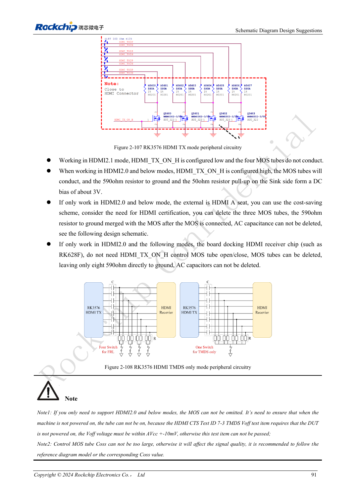
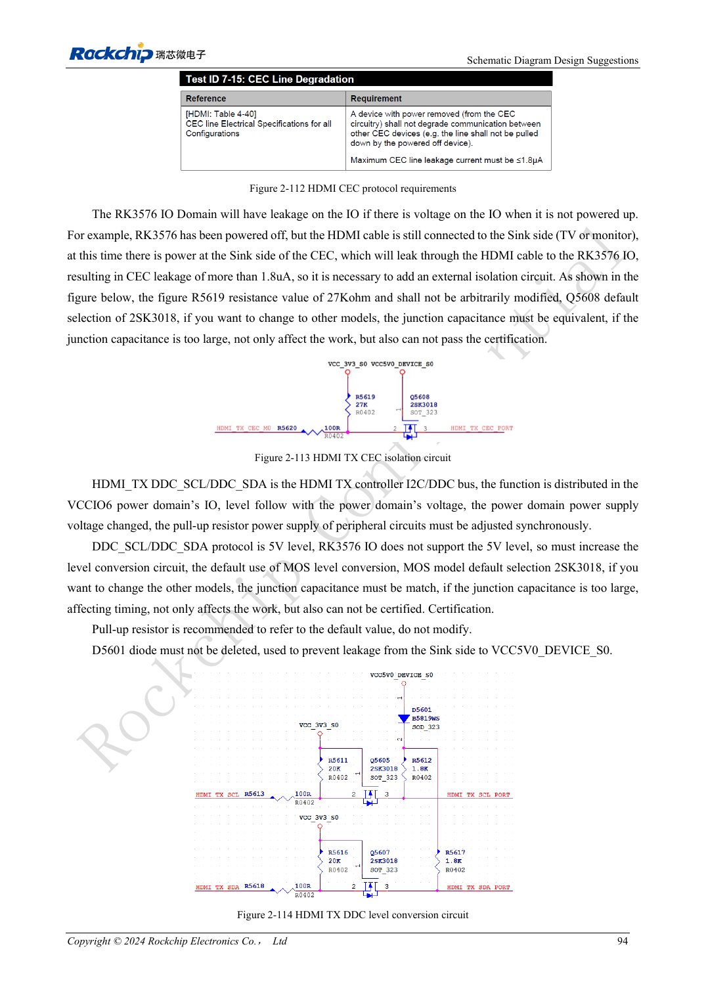

<!-- rk3576-hardware-v11-rest-20261109 -->

# RK3576-HDMI-Hardware: FRL/TMDS, DDC-Pegel und Schutz

Grundlage sind die chinesische und englische Ausgabe des RK3576 Hardware Design Guide V1.1 (2024-05-28) für SoC-Platinen. CM5-Träger müssen der Moduldefinition folgen; Sige5 kann als Software-/Peripheriebasis dienen. Eine universelle SDK-/BSP- oder Kernelversion wird nicht vorgegeben; jede Platine prüfen. Werte stammen aus der Quelle, nicht aus ArmSoM-Messungen.

**RK3576_Hardware_Design_Guide_V1.1_20240528_EN.pdf** · §2.3.8.1; HDMI PCB

## Gemeinsamer PHY und Modi

HDMI und eDP teilen einen PHY; beide Modi nicht gleichzeitig auf demselben PHY einplanen. HDMI 2.1 verwendet FRL, ältere Kompatibilitätsmodi TMDS. HDMI/EDP_TX_REXT mit 8.2kΩ und 1% nahe am SoC nach Masse führen. 220nF-Koppelkondensatoren, bevorzugt 0201, einsetzen; Direktbeschaltung anderer HDMI-Chips nicht übernehmen.

## TMDS-Bias und DDC-Schutz

HDMI_TX_ON_H ist bei FRL niedrig, bei TMDS hoch und steuert das MOS-/590Ω-Netzwerk. Externer Type-A und interne Empfänger unterscheiden sich; die RK628F-Vereinfachung gilt nicht pauschal für externe Buchsen. DDC führt 5V, SoC-IO ist nicht 5V-tolerant. Pegelwandlung und Rückstromschutz erhalten; CEC-/HPD-Domänen und Leckstrom prüfen.

## Den gesamten Kanal prüfen

Referenzversorgung am Stecker: 4.8–5.3V mit 1μF. ESD-Kapazität der schnellen Signale höchstens 0.2pF, sonst laut Quelle 1pF. Masse erhalten, Stubs kurz halten, Referenzfreistellung unter 590Ω-Pads beachten. Hot-Plug, verschiedene Kabel/Displays, Moduswechsel und Aufwachen prüfen.

## Entwurfsparameter und Prüftabelle

| Punkt | Quellenreferenz |
| --- | --- |
| Zdiff | 100Ω ±10% |
| Paarinterne Differenz | <6mil |
| Differenz zwischen Paaren | <480mil |
| Leiterlänge | <4inch |
| AC | 220nF ±20% |
| Freier Abstand | ≥7W |

## Quellenabbildungen

Die Referenzseiten enthalten die zugehörigen Schalt- oder Zeitdiagramme; für volle Auflösung anklicken. Bezeichner und Werte gehören zum Referenzentwurf, nicht zum Schaltplan eines ArmSoM-Produkts.

Englisches Original · PDF 110 · 2-107

Englisches Original · PDF 113 · 2-113

## Entwicklung mit ArmSoM

CM5 verringert die erneute Entwicklung des Rechenkerns auf eigenen Trägern; Sige5 dient als Ausgangspunkt für Software und Peripherie. Herausführung, Pins, Pegel und Image-Unterstützung anhand der Boarddokumentation prüfen.

- [ArmSoM CM5](https://www.armsom.org/cm5) · [CM5 Docs](https://docs.armsom.org/armsom-cm5)
- [ArmSoM Sige5](https://www.armsom.org/sige5) · [Sige5 Docs](https://docs.armsom.org/armsom-sige5)

## Weiterlesen

- [RK3576-Hardwaredesign: 30 Themen](/de/articles/rk3576-hardware-design-series/)
- [RK3576-Displayhardware: MIPI, RGB, Hintergrundbeleuchtung und Touch](/de/articles/rk3576-display-panel-hardware/)
- [RK3576-DP/eDP: PHY-Zuordnung, AUX und abweichende Koppelwerte](/de/articles/rk3576-dp-edp-hardware-design/)
