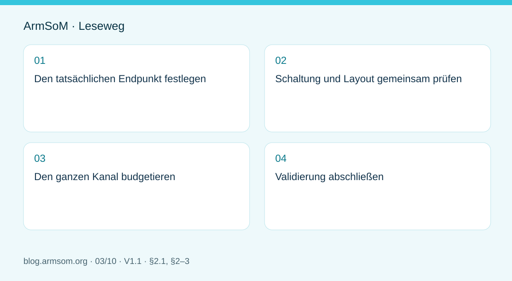
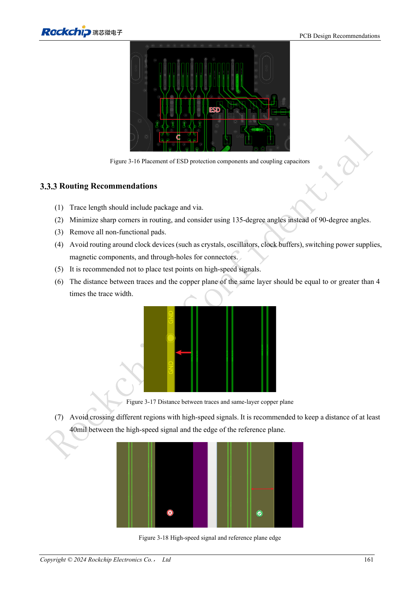
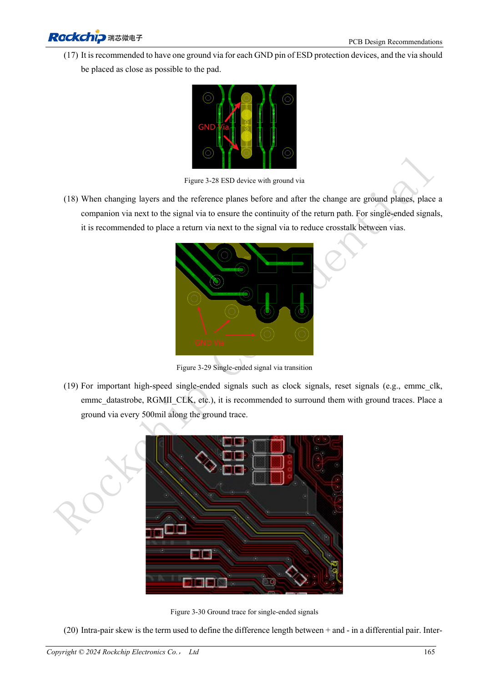

# RK3576-Hochgeschwindigkeitsschnittstellen: Schaltplan und PCB gemeinsam prüfen

## Geltungsbereich und Quellen

Dies ist ein thematischer Engineering-Leitfaden, keine seitenweise Übersetzung des gesamten PDF. Quellenbeispiele sind keine ArmSoM-Messungen. Spannungen, Pins, SDK/BSP und Kernel mit der tatsächlichen Platinenrevision abgleichen.

**Rockchip:** `RK3576_Hardware_Design_Guide_V1.1_20240528_CN.pdf` · V1.1 · §2.1, §2–3

## Den tatsächlichen Endpunkt festlegen

Die Quelle behandelt Schnittstellenschaltungen in §2.3, Signale ab 8GT/s in §3.4 und modulspezifische PCB-Regeln in §3.5. Ausgangspunkt sind Peripherie, Betriebsart, Stecker und Kabel. Nicht jede im Chipdiagramm gezeigte Ressource ist am Modul herausgeführt oder gleichzeitig nutzbar.

Für Kamera, Display, Speicher und Netzwerk PHY-Mehrfachnutzung, Steuerbusse, Versorgung und Softwareabhängigkeiten erfassen. Die Zuteilung mit der CM5-Pinbelegung beziehungsweise der konkreten Sige5-Revision abgleichen.

## Schaltung und Layout gemeinsam prüfen

| Bereich | Schaltplan | PCB |
| --- | --- | --- |
| Differenzieller Kanal | Richtung, Kopplung, Schutz | Impedanz, Referenzebenen, Vias, Padübergänge |
| Steuerung | Reset, Enable, Busse, Pegel | Abstand und erreichbare Messpunkte |
| Stecker | Artikelnummer, Pins, Schirm | Footprint, Rückstromweg, Orientierung |
| Versorgung | Spitzenstrom, Sequenzierung | Entkopplung, Stromschleifen, Wärmepfad |

Der Leitfaden behandelt BGA-Pads, Glasgewebe, differenzielle Vias, Koppelkondensatoren, ESD-Bauteile und Steckerpads. Lokale Aussparungen der Referenzfläche dienen bestimmten parasitären Effekten; sie erlauben keine beliebigen Unterbrechungen der Masse unter schnellen Signalen.

## Den ganzen Kanal budgetieren

Modulleiterbahnen, Stecker, Trägerplatine, Kabel und Peripherieplatine einbeziehen. Längenabgleich ist nur eine Vorgabe: Via-Stubs, Referenzwechsel und Schutzkapazitäten beeinflussen ebenfalls die Reserve. Zahlenwerte müssen zur Betriebsart und zum berechneten Lagenaufbau des Herstellers passen.

## Validierung abschließen

Jede Schnittstelle zunächst mit der Zielrate testen, anschließend Nachbarkanäle und reale Parallelbelastung zuschalten. Bei kombinierten Fehlern auch Versorgungstransienten, Wärme, Bandbreite und Treiber untersuchen. Kabel, Geräte, BSP und Revisionen dokumentieren. Eine reduzierte Rate hilft bei der Fehlersuche, erfüllt aber nicht die ursprüngliche Anforderung. Beim Übergang vom CM5- oder Sige5-Prototyp zum eigenen Produkt den tatsächlichen Kanal erneut prüfen.

## Abbildung aus der Quelle

Original aus dem englischen Dokument, gemeinsam für EN/RU/DE. Referenzdesign, kein ArmSoM-Platinenschaltplan.

`RK3576_Hardware_Design_Guide_V1.1_20240528_EN.pdf` · PDF p. 22.

## Produkte und Entwicklungsunterlagen

- **CM5** — [Produktseite](https://www.armsom.org/cm5) · [Dokumentation](https://docs.armsom.org/armsom-cm5)
- **Sige5** — [Produktseite](https://www.armsom.org/sige5) · [Dokumentation](https://docs.armsom.org/armsom-sige5)

## Weitere Beiträge der Reihe

- [RK3576 in Betrieb nehmen: Minimalsystem und erste Einschaltprüfung](/de/articles/rk3576-hardware-bringup/)
- [ArmSoM CM5-Trägerplatine: Checkliste für Versorgung, Boot und Schnittstellen](/de/articles/019-cm5-carrier-production/)
- [RK3588S-Hardwaredesign: vom Referenzschaltplan zur CM7s-Trägerplatine](/de/articles/rk3588s-cm7s-carrier-design/)
- [RK3588 für Edge-KI: Versorgung, Kühlung und Erweiterung gemeinsam planen](/de/articles/rk3588-edge-ai-hardware-design/)
- [RK3588-PCB-Prüfung: Lagenaufbau, Impedanz und Leiterführung](/de/articles/rk3588-high-speed-pcb-review/)
- [RK3506-HMI-Hardware: Entwicklung mit CM1 oder Forge1](/de/articles/rk3506-industrial-hmi-hardware/)
- [RK3308-Varianten: Hardwarekompatibilität für P2-Pro-Audioprojekte](/de/articles/rk3308-hardware-variant-compatibility/)
- [RK3588S und RK3588S2: Prüfungen vor einer Hardwareänderung](/de/articles/rk3588s-rk3588s2-hardware-differences/)
- [Vom Rockchip-Prototyp zur Serie: Prozessvorgaben und Prüfunterlagen](/de/articles/rockchip-hardware-production-checklist/)

<!-- rk3576-hardware-v11-rest-20261109 -->

## RK3576-Hochgeschwindigkeitsschnittstellen: Impedanz, Rückwege und Stubs

Grundlage sind die chinesische und englische Ausgabe des RK3576 Hardware Design Guide V1.1 (2024-05-28) für SoC-Platinen. CM5-Träger müssen der Moduldefinition folgen; Sige5 kann als Software-/Peripheriebasis dienen. Eine universelle SDK-/BSP- oder Kernelversion wird nicht vorgegeben; jede Platine prüfen. Werte stammen aus der Quelle, nicht aus ArmSoM-Messungen.

**RK3576_Hardware_Design_Guide_V1.1_20240528_EN.pdf** · §3.3–3.4

## Differenzpaare haben unterschiedliche Regeln

Referenzwerte: PCIe-Daten 85Ω, REFCLK 100Ω, eDP 90Ω, dediziertes DP 100Ω beziehungsweise USB-geteiltes DP 95Ω. Regeln je Netzklasse statt pauschal 100Ω setzen. Länge umfasst Vias und Gehäuse. Paarinternes Matching und Matching verschiedener Paare unterscheiden. W ist Leiterbreite, Abstand der freie Randabstand.

## Durchgehender Rückweg vor hübschen Mäandern

Keine Referenzflächenlücken queren; allgemein mindestens 40mil Abstand zum Flächenrand halten. Massevias bei Lagenwechseln ergänzen. Testpunkte, Stecker und Pads erzeugen Stubs oder Sprünge. Lokale Freistellung unter großen Pads nach Referenz und Simulation, nicht Masse unter dem ganzen Paar entfernen. Via-Stubs über 12mil laut Leitfaden auf SI-Auswirkung prüfen.

## Schaltung und Layout gemeinsam prüfen

Dämpfung nach tatsächlicher Signalquelle statt bloß TX/RX-Bezeichnung platzieren. ESD am Eintritt mit kurzem Ableitweg. SoC, Gehäuse, PCB, Schutz, Stecker, Kabel und Empfänger als Kanal dokumentieren; Impedanz berechnen, bei Bedarf simulieren und Muster prüfen. Dieser Teil ergänzt den vorhandenen Artikel ohne dessen Inhalt zu entfernen.

## Entwurfsparameter und Prüftabelle

| Punkt | Quellenreferenz |
| --- | --- |
| Referenzflächenrand-Abstand | ≥40mil |
| Via-Stub-Prüfschwelle | >12mil |
| Referenzabstand Taktwiderstand | ≤400mil |
| Data / REFCLK PCIe | 85Ω / 100Ω |

## Quellenabbildungen

Die Referenzseiten enthalten die zugehörigen Schalt- oder Zeitdiagramme; für volle Auflösung anklicken. Bezeichner und Werte gehören zum Referenzentwurf, nicht zum Schaltplan eines ArmSoM-Produkts.

Englisches Original · PDF 180 · 3-18

Englisches Original · PDF 184 · 3-29

## Entwicklung mit ArmSoM

CM5 verringert die erneute Entwicklung des Rechenkerns auf eigenen Trägern; Sige5 dient als Ausgangspunkt für Software und Peripherie. Herausführung, Pins, Pegel und Image-Unterstützung anhand der Boarddokumentation prüfen.

- [ArmSoM CM5](https://www.armsom.org/cm5) · [CM5 Docs](https://docs.armsom.org/armsom-cm5)
- [ArmSoM Sige5](https://www.armsom.org/sige5) · [Sige5 Docs](https://docs.armsom.org/armsom-sige5)

## Weiterlesen

- [RK3576-Hardwaredesign: 30 Themen](/de/articles/rk3576-hardware-design-series/)
- [RK3576-PCB-Lagen und Fanout: sechs/acht Lagen und gemischtes BGA-Raster](/de/articles/rk3576-pcb-stackup-fanout/)
- [RK3576-Versorgungs-PCB und PDN: RK806S-5, Feedback und Stromschleifen](/de/articles/rk3576-power-pcb-pdn-design/)
