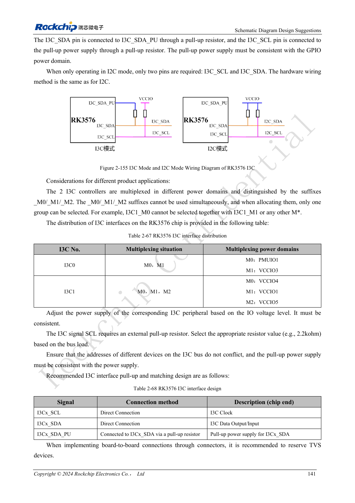
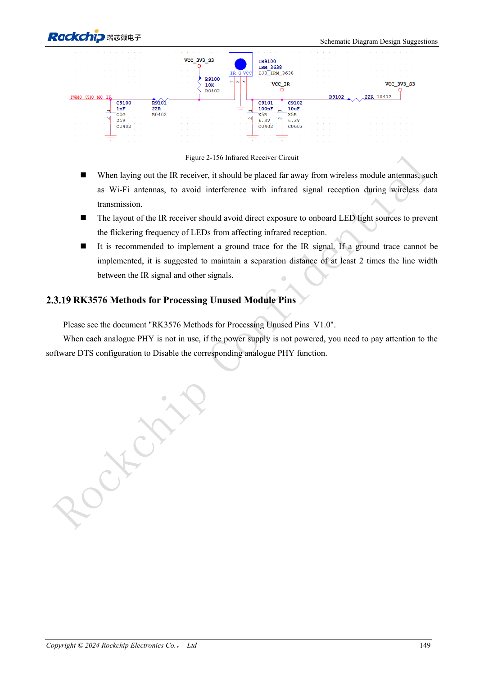

<!-- rk3576-hardware-v11-rest-20261109 -->

# RK3576-Steuerschnittstellen: UART, I2C/I3C, SPI, CAN und PWM

Grundlage sind die chinesische und englische Ausgabe des RK3576 Hardware Design Guide V1.1 (2024-05-28) für SoC-Platinen. CM5-Träger müssen der Moduldefinition folgen; Sige5 kann als Software-/Peripheriebasis dienen. Eine universelle SDK-/BSP- oder Kernelversion wird nicht vorgegeben; jede Platine prüfen. Werte stammen aus der Quelle, nicht aus ArmSoM-Messungen.

**RK3576_Hardware_Design_Guide_V1.1_20240528_EN.pdf** · §2.3.13–2.3.18

## Mux und physikalische Ebene vor Portzahl prüfen

Genannt werden zwölf UARTs, fünf allgemeine SPI-, zwei CAN-FD- und zwei I3C-Controller. UART0_M0 ist Debugstandard; UART0 hat keine Flusskontrolle, RTS/CTS anderer Gruppen hängt vom Mux ab. UART ist nicht RS232/RS485, CAN-TX/RX nicht CAN_H/CAN_L. Passende externe Transceiver und Pegel verwenden.

## I3C- und I2C-Pull-ups unterscheiden

Gemischtes I3C nutzt SCL, SDA und SDA_PU; SDA wird nach SDA_PU statt blind an eine feste Spannung gezogen. Reines I2C verwendet normale Zweidraht-Pull-ups. 2.2kΩ der Referenz anhand Buskapazität und Anstieg prüfen. I2C1 gehört zum PMIC; nicht beliebig umwidmen. SPI-Takt, Daten und Auswahlpins konsistent multiplexen.

## Steuerung beim Start und Schlaf prüfen

CAN TX nutzt referenzmäßig extern 4.7kΩ Pull-up. Es gibt 16 PWM-Kanäle, IR-Aufwachen bei abgeschaltetem LOGIC jedoch nur über PWM0_CH0/1. Anfangspegel, Rückspeisung und Wiederanlauf prüfen. Feldkabel, Transceiver-Abschluss und Schutz gehören zur industriellen Validierung; Controllerfunktion belegt keine Systemstörfestigkeit.

## Entwurfsparameter und Prüftabelle

| Punkt | Quellenreferenz |
| --- | --- |
| UART / SPI | 12 / 5 |
| I3C | 2; 12.5Mbit/s |
| I2C-Referenz | 400kbit/s; 2.2kΩ |
| CAN-TX-Pull-up | 4.7kΩ |
| PWM | 2 + 6 + 8 channels |

## Quellenabbildungen

Die Referenzseiten enthalten die zugehörigen Schalt- oder Zeitdiagramme; für volle Auflösung anklicken. Bezeichner und Werte gehören zum Referenzentwurf, nicht zum Schaltplan eines ArmSoM-Produkts.

Englisches Original · PDF 160 · 2-155

Englisches Original · PDF 168 · 2-156

## Entwicklung mit ArmSoM

CM5 verringert die erneute Entwicklung des Rechenkerns auf eigenen Trägern; Sige5 dient als Ausgangspunkt für Software und Peripherie. Herausführung, Pins, Pegel und Image-Unterstützung anhand der Boarddokumentation prüfen.

- [ArmSoM CM5](https://www.armsom.org/cm5) · [CM5 Docs](https://docs.armsom.org/armsom-cm5)
- [ArmSoM Sige5](https://www.armsom.org/sige5) · [Sige5 Docs](https://docs.armsom.org/armsom-sige5)

## Weiterlesen

- [RK3576-Hardwaredesign: 30 Themen](/de/articles/rk3576-hardware-design-series/)
- [RK3576-GPIO und SARADC: Spannungsdomänen, Rückspeisung und Tasten](/de/articles/rk3576-gpio-saradc-hardware/)
- [RK3576-FlexBus und DSMC: FPGA, PSRAM und Parallelrouting](/de/articles/rk3576-flexbus-dsmc-hardware/)
