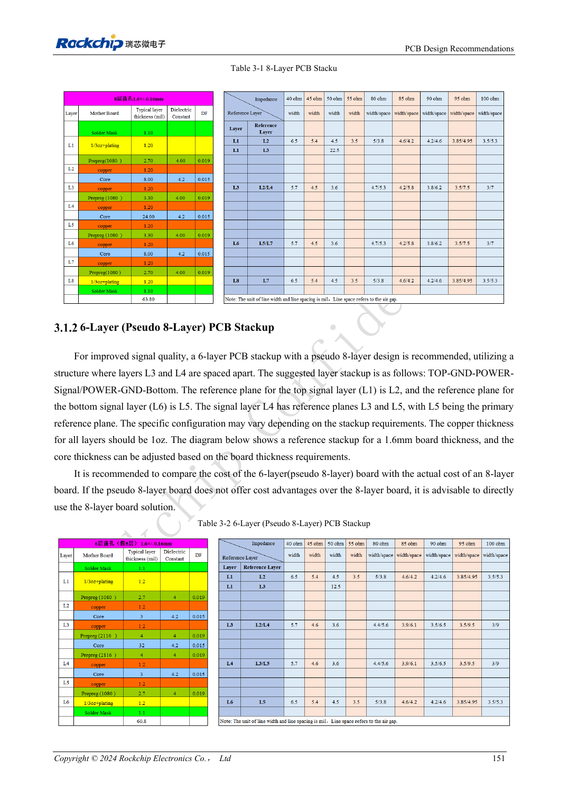
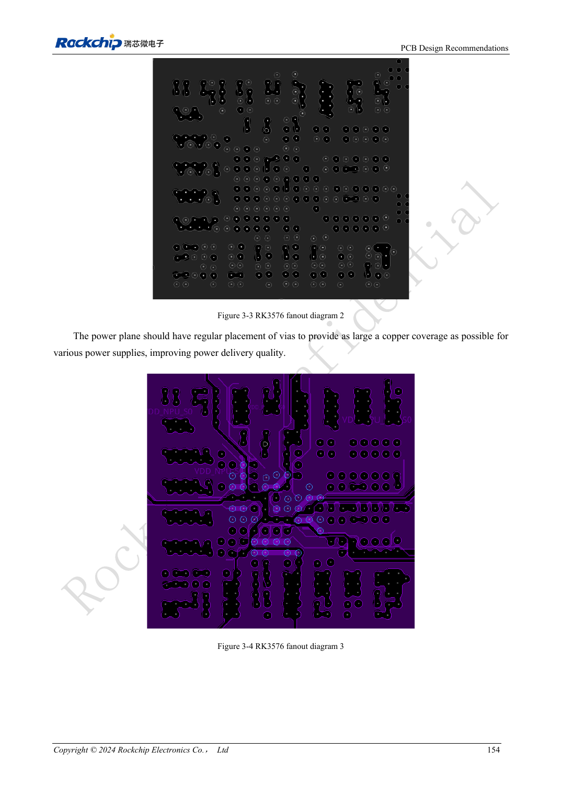

<!-- rk3576-hardware-v11-rest-20261109 -->

# RK3576-PCB-Lagen und Fanout: sechs/acht Lagen und gemischtes BGA-Raster

Grundlage sind die chinesische und englische Ausgabe des RK3576 Hardware Design Guide V1.1 (2024-05-28) für SoC-Platinen. CM5-Träger müssen der Moduldefinition folgen; Sige5 kann als Software-/Peripheriebasis dienen. Eine universelle SDK-/BSP- oder Kernelversion wird nicht vorgegeben; jede Platine prüfen. Werte stammen aus der Quelle, nicht aus ArmSoM-Messungen.

**RK3576_Hardware_Design_Guide_V1.1_20240528_EN.pdf** · §3.1–3.2

## Der Aufbau muss alle Impedanzen erfüllen

Der Leitfaden zeigt sechs Lagen, Pseudoacht auf sechs Lagen und acht Lagen, keine universelle Platinendicke. Dielektrikum, Kupfer und Verteilung symmetrisch halten; durchgehende Masse neben Bauteil- und Versorgungslagen bevorzugen. Fertigungsmaterial und Dicke verändern Breiten/Abstände: Impedanzen innen/außen neu berechnen statt Screenshots kopieren.

## Gemischtes Raster braucht lokalen Fanout

RK3576 hat 698 Balls mit 0.55/0.60/0.65mm Raster. Die äußeren zwei Reihen und Teile der dritten können lokal mit mindestens 3.5mil entflechten, danach rasch zur Impedanzbreite wechseln. Innenvias regelmäßig mit Kanälen alle 2–4 Reihen für Masse und Versorgung anordnen. Minimale Fanoutbreite gilt nicht für die ganze schnelle Leitung.

## Fertigungs- und elektrische Prüfung verbinden

Achtlagenreferenz: TOP-GND-POWER-POWER/SIGNAL-GND-SIGNAL-GND-BOTTOM; 1.6mm und durchgehend 1oz gelten für dieses Beispiel. Sechslagenkosten und Rückwegqualität vergleichen statt nur Lagenzahl minimieren. Bohrungen, Lötsteg, Kupfer und Impedanz vor Freigabe mit Fertiger abstimmen; Engstellen der Versorgungsflächen prüfen.

## Entwurfsparameter und Prüftabelle

| Punkt | Quellenreferenz |
| --- | --- |
| BGA | 698 balls |
| Ballraster | 0.55 / 0.60 / 0.65mm |
| Lokale Fanoutbreite | ≥3.5mil |
| Referenzlagenzahl | 6 / 8 layers |
| Referenzkupfer | 1oz |

## Quellenabbildungen

Die Referenzseiten enthalten die zugehörigen Schalt- oder Zeitdiagramme; für volle Auflösung anklicken. Bezeichner und Werte gehören zum Referenzentwurf, nicht zum Schaltplan eines ArmSoM-Produkts.

Englisches Original · PDF 170 · Table 3-1

Englisches Original · PDF 173 · 3-3 / 3-4

## Entwicklung mit ArmSoM

CM5 verringert die erneute Entwicklung des Rechenkerns auf eigenen Trägern; Sige5 dient als Ausgangspunkt für Software und Peripherie. Herausführung, Pins, Pegel und Image-Unterstützung anhand der Boarddokumentation prüfen.

- [ArmSoM CM5](https://www.armsom.org/cm5) · [CM5 Docs](https://docs.armsom.org/armsom-cm5)
- [ArmSoM Sige5](https://www.armsom.org/sige5) · [Sige5 Docs](https://docs.armsom.org/armsom-sige5)

## Weiterlesen

- [RK3576-Hardwaredesign: 30 Themen](/de/articles/rk3576-hardware-design-series/)
- [RK3576-FlexBus und DSMC: FPGA, PSRAM und Parallelrouting](/de/articles/rk3576-flexbus-dsmc-hardware/)
- [RK3576-Hochgeschwindigkeitsschnittstellen: Impedanz, Rückwege und Stubs](/de/articles/rk3576-high-speed-interface-design/)
