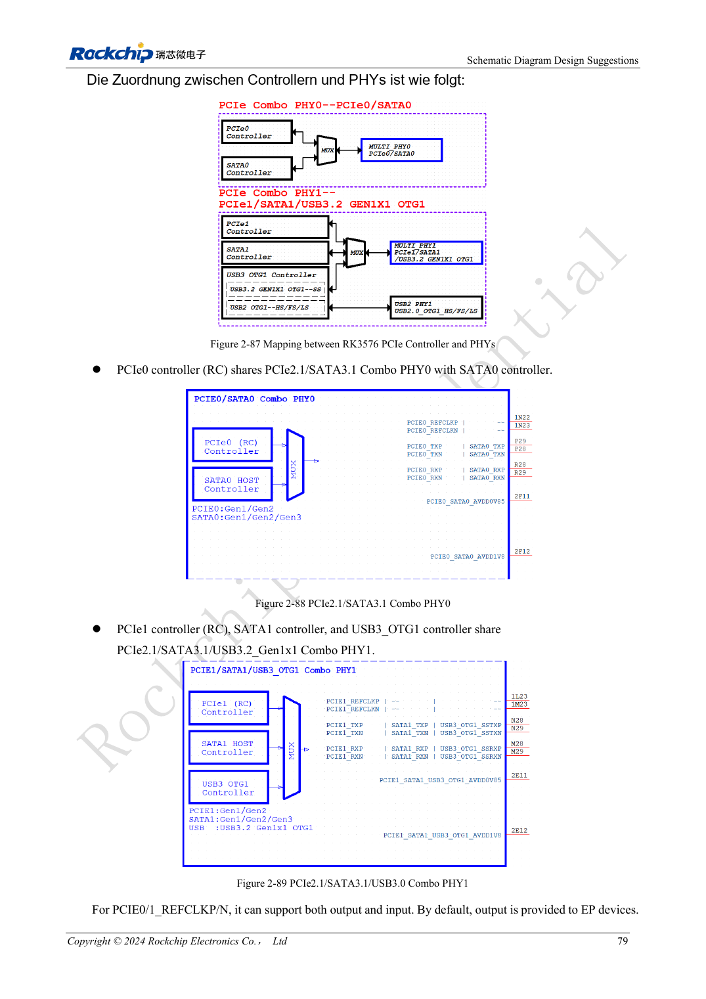
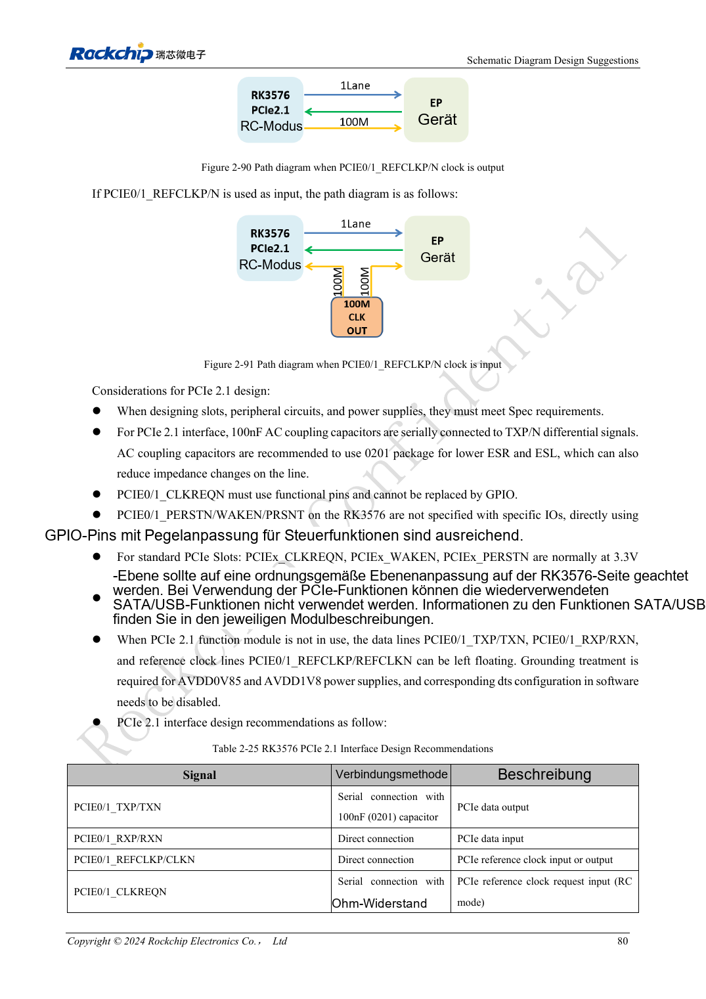

<!-- rk3576-hardware-v11-rest-20261109 -->

# RK3576-PCIe: Root Complex, gemeinsam genutzte PHYs und Endgeräteversorgung

Grundlage sind die chinesische und englische Ausgabe des RK3576 Hardware Design Guide V1.1 (2024-05-28) für SoC-Platinen. CM5-Träger müssen der Moduldefinition folgen; Sige5 kann als Software-/Peripheriebasis dienen. Eine universelle SDK-/BSP- oder Kernelversion wird nicht vorgegeben; jede Platine prüfen. Werte stammen aus der Quelle, nicht aus ArmSoM-Messungen.

**RK3576_Hardware_Design_Guide_V1.1_20240528_EN.pdf** · §2.3.6; PCIe PCB

## Schnittstellen zuerst zuordnen

RK3576 bietet zwei PCIe-2.1-x1-Root-Complexes ohne Endpoint-Modus. PCIe0 teilt Combo PHY0 mit SATA0; PCIe1 teilt Combo PHY1 mit SATA1 und USB3 OTG1. Funktion vor Steckverbinder-, Takt- und Device-Tree-Planung festlegen. Geteilte Funktionen nicht als gleichzeitig verfügbare Ports zählen.

## Steuerpins und Koppelkondensatoren

TX mit 100nF, RX direkt und REFCLK nach Referenz samt Richtungsprüfung verbinden. CLKREQN braucht die dedizierte Funktion statt eines normalen GPIO. PERSTN, WAKEN und PRSNT können geeignete GPIOs nutzen. Standardslot-Steuerpegel sind 3.3V; SoC-Domäne prüfen. Vorgaben für ungenutzte PHY-Versorgung nur anwenden, wenn der ganze PHY unbenutzt bleibt.

## Enumeration ist erst der Anfang

Datenpaare benötigen 85Ω, Referenztakte 100Ω; keine gemeinsame Impedanzregel verwenden. Versorgung, Resetfreigabe, Takt und Aufwachen vor Dauer-DMA prüfen. Ausgehandelte Breite, Rate und Fehler dokumentieren. Einmalige Enumeration belegt keine langfristige Speicher- oder Netzwerkstabilität.

## Entwurfsparameter und Prüftabelle

| Punkt | Quellenreferenz |
| --- | --- |
| Data Zdiff | 85Ω ±10% |
| REFCLK Zdiff | 100Ω ±10% |
| Datenpaardifferenz | <6mil |
| REFCLK-Paardifferenz | <12mil |
| Leiterlänge | <6inch |
| TX AC | 100nF ±20% |

## Quellenabbildungen

Die Referenzseiten enthalten die zugehörigen Schalt- oder Zeitdiagramme; für volle Auflösung anklicken. Bezeichner und Werte gehören zum Referenzentwurf, nicht zum Schaltplan eines ArmSoM-Produkts.

Englisches Original · PDF 98 · 2-87

Englisches Original · PDF 99 · 2-90

## Entwicklung mit ArmSoM

CM5 verringert die erneute Entwicklung des Rechenkerns auf eigenen Trägern; Sige5 dient als Ausgangspunkt für Software und Peripherie. Herausführung, Pins, Pegel und Image-Unterstützung anhand der Boarddokumentation prüfen.

- [ArmSoM CM5](https://www.armsom.org/cm5) · [CM5 Docs](https://docs.armsom.org/armsom-cm5)
- [ArmSoM Sige5](https://www.armsom.org/sige5) · [Sige5 Docs](https://docs.armsom.org/armsom-sige5)

## Weiterlesen

- [RK3576-Hardwaredesign: 30 Themen](/de/articles/rk3576-hardware-design-series/)
- [RK3576-SD-Karten und SDIO-WLAN: Pegelwechsel, Versorgung und HF-Layout](/de/articles/rk3576-sdio-wifi-hardware/)
- [RK3576-SATA-Hardware: PHY-Aufteilung, Kopplung und Laufwerksversorgung](/de/articles/rk3576-sata-hardware-design/)
