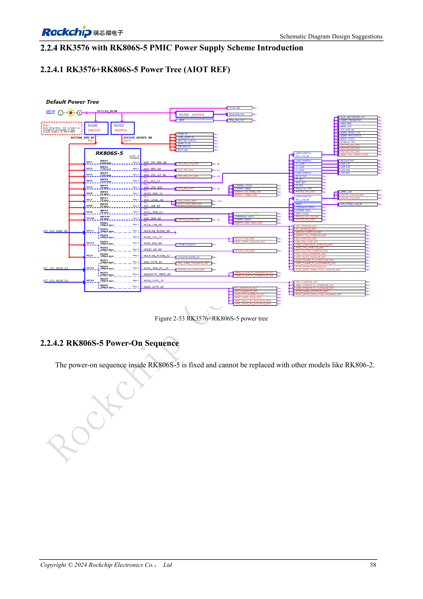

<!-- rk3576-hardware-v11-deep-20261109 -->

# RK3576-Spannungsdomänen: CPU, GPU, NPU, LOGIC und Entkopplung

Spannung, Lasttransienten, Entkopplungsposition und Standby gemeinsam prüfen. Die Werte stammen aus Referenzdesign und Herstellerbeispielen; sie sind weder CM5-Eingangsdaten noch ArmSoM-Messungen.

Grundlage sind die chinesische und englische Ausgabe des RK3576 Hardware Design Guide V1.1 (2024-05-28) für SoC-Platinen. CM5-Träger müssen der Moduldefinition folgen; Sige5 kann als Software-/Peripheriebasis dienen. Eine universelle SDK-/BSP- oder Kernelversion wird nicht vorgegeben; jede Platine prüfen. Werte stammen aus der Quelle, nicht aus ArmSoM-Messungen.

**RK3576_Hardware_Design_Guide_V1.1_20240528_EN.pdf** · §2.2.1–2.2.4

## Domänen nicht allein anhand der Anwendung abschalten

NPU-Versorgung ist beim Erststart auch ohne KI-Last erforderlich; GPU-Abschaltung erlaubt die Quelle unter Bedingungen. Das Bootmedium bestimmt notwendige IO-Spannungen: eMMC/FSPI0 nutzen VCCIO0, SDMMC0/FSPI1_M0 VCCIO1, FSPI1_M1 VCCIO3; UFS benötigt zusätzlich VCCIO7, Oszillator und PHY. PMUIO0/1 sind erforderlich. Weitere Domänen nur unter Beachtung von Sequenz, Aufwecken und Peripherie abschalten.

## Kondensatoren müssen die Last versorgen

Für große CPU-Kerne insgesamt mehr als 130μF, für kleine mehr als 88μF vorsehen. Die wesentliche GPU-Entkopplung überschreitet 66μF, NPU 90μF und LOGIC insgesamt 88μF. PMIC-Ausgangskapazität und Entkopplung am SoC unterscheiden; nicht sämtliche Kapazität am Regler platzieren. DC-Bias, Schleifen, Transienten und Messmethode berücksichtigen. LOGIC_MEM teilt normalerweise LOGIC; getrennte Versorgung erfordert zusätzlich DVFS-Prüfung.

## Modulspitzen nicht zur Boardleistung addieren

Tabelle 2-19 erfasst getrennte Extrembelastungen bei 25°C auf einer Platine ohne Kühlkörper nach 15 Minuten stabilem Betrieb. Die Einträge beschreiben keine gleichzeitige Gesamtlast. Für Netzteil und Kühlung die tatsächliche parallele Last messen und Spitzenstrom, Dauerstrom sowie Eingangsleistung unterscheiden.

## Entwurfsparameter und Prüftabelle

| Punkt | Wert/Netz | Prüfhinweis |
| --- | --- | --- |
| Große CPU | BUCK1; >4A; >130μF | Referenz-Startspannung 0.85V |
| Kleine CPU | BUCK3; >2A; >88μF | Gesamte Entkopplung |
| Grafik | BUCK5; 3A; >66μF | Hauptentkopplung am SoC |
| NPU | BUCK2; >4A; >90μF | Startversorgung auch ohne KI vorsehen |
| Logik | BUCK7; >2A; >88μF | Gemeinsame LOGIC_MEM-Versorgung konsistent halten |

## Referenzschaltungen und Abbildungen

Die Referenzseiten enthalten die zugehörigen Schalt- oder Zeitdiagramme; für volle Auflösung anklicken. Bezeichner und Werte gehören zum Referenzentwurf, nicht zum Schaltplan eines ArmSoM-Produkts.

Englisches Original · PDF 77 · 2-53

## ArmSoM-Produkte und Entwicklungsweg

CM5 integriert Rechenleistung in einen eigenen Träger; Sige5 eignet sich zur ersten Linux-/Peripherieerprobung. Eine SoC-Funktion ist nicht zwangsläufig auf beiden Produkten herausgeführt. Vor Kauf oder Layout Steckverbinder, Boardrevision und Image prüfen.

- [ArmSoM CM5](https://www.armsom.org/cm5) · [CM5 Docs](https://docs.armsom.org/armsom-cm5)
- [ArmSoM Sige5](https://www.armsom.org/sige5) · [Sige5 Docs](https://docs.armsom.org/armsom-sige5)

## Lesereihenfolge

- [RK3576-Hardwaredesign: vom Minimalsystem zu DDR und USB](/de/articles/rk3576-hardware-design-series/)
- [RK3576-Minimalsystem: vom Schaltplan zum reproduzierbaren Erststart](/de/articles/rk3576-hardware-bringup/)
- [RK3576-Taktentwurf: 24MHz-Quarz, 32kHz-Standby und Peripherietakte](/de/articles/rk3576-clock-circuit-design/)
- [RK3576-Reset: NPOR, RK806S-5, Watchdog und Übertemperaturschutz](/de/articles/rk3576-reset-watchdog-design/)
- [RK3576-Boot und Debugging: Konfiguration, Maskrom, UART und JTAG](/de/articles/rk3576-boot-debug-design/)
- [RK3576 und RK806S-5: PMIC-Auswahl, Steuerpins und Rückkopplung](/de/articles/rk3576-rk806s5-pmic-design/)
- [RK3576-Power-Sequencing und Standby: Reset, Haltespannungen und Aufwecken](/de/articles/rk3576-power-sequencing-standby/)
- [RK3576-DDR-Schaltung und Versorgung: LPDDR4, LPDDR4X und LPDDR5](/de/articles/rk3576-ddr-circuit-power/)
- [RK3576-DDR-Layout: Impedanz, Längen, Rückstrompfade und PDN](/de/articles/rk3576-ddr-pcb-routing/)
- [RK3576-USB/Type-C-Ergänzung: Multiplexing, Wiederherstellung und Schutz](/de/articles/168-rockchip-rk3576-usb/)
