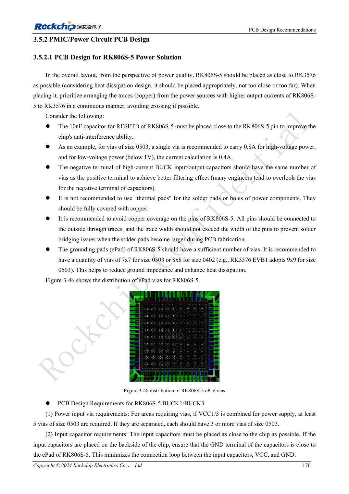
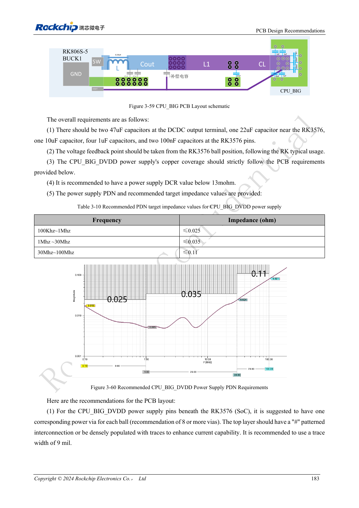

<!-- rk3576-hardware-v11-rest-20261109 -->

# RK3576-Versorgungs-PCB und PDN: RK806S-5, Feedback und Stromschleifen

Grundlage sind die chinesische und englische Ausgabe des RK3576 Hardware Design Guide V1.1 (2024-05-28) für SoC-Platinen. CM5-Träger müssen der Moduldefinition folgen; Sige5 kann als Software-/Peripheriebasis dienen. Eine universelle SDK-/BSP- oder Kernelversion wird nicht vorgegeben; jede Platine prüfen. Werte stammen aus der Quelle, nicht aus ArmSoM-Messungen.

**RK3576_Hardware_Design_Guide_V1.1_20240528_EN.pdf** · §3.5.2

## Eingangs- und Masseschleifen zuerst

RK806S-5 für direkte Hochstrom-BUCK-Pfade zum SoC platzieren. Eingangskondensatoren nahe am Chip und mit ausreichend Vias an beiden Polen; nur positive Vias genügen nicht. ePad-Referenz: mindestens 7×7 mit 0503 oder 8×8 mit 0402; RESETB 10nF am PMIC. Bohrungsaufbau und Stromtragfähigkeit fertigungsspezifisch prüfen.

## Feedbacktopologien nicht mischen

Lokales, konventionell entferntes und PCB-induktivitätsbasiertes Feedback verlangen unterschiedliche Kondensatorplätze und Kompensation. Letzteres verlagert den Hauptkondensator zur Last; bloßes Entfernen am Wandler ist unzulässig. CPU_BIG nutzt weiterhin konventionelles Remote-Feedback mit DCR unter 13mΩ, CPU_LIT unter 20mΩ. Jede Spannung nach eigener Vorlage prüfen.

## PDN mit Lastsprüngen prüfen

CPU_BIG-Referenzziele betragen je Frequenzband 0.025/0.035/0.11Ω, keine ArmSoM-Messwerte. Kupferengstellen, Via-Abfall, Kondensatorrückwege und Lastsprünge prüfen. Lastnah messen, Tastkopf, Bandbreite und Last dokumentieren; statische PMIC-Ausgangsspannung reicht nicht.

## Entwurfsparameter und Prüftabelle

| Punkt | Quellenreferenz |
| --- | --- |
| CPU_BIG DCR | <13mΩ |
| CPU_LIT DCR | <20mΩ |
| CPU_BIG 100kHz–1MHz | ≤0.025Ω |
| CPU_BIG 1–30MHz | ≤0.035Ω |
| CPU_BIG 30–100MHz | ≤0.11Ω |

## Quellenabbildungen

Die Referenzseiten enthalten die zugehörigen Schalt- oder Zeitdiagramme; für volle Auflösung anklicken. Bezeichner und Werte gehören zum Referenzentwurf, nicht zum Schaltplan eines ArmSoM-Produkts.

Englisches Original · PDF 195 · 3-48

Englisches Original · PDF 202 · 3-59

## Entwicklung mit ArmSoM

CM5 verringert die erneute Entwicklung des Rechenkerns auf eigenen Trägern; Sige5 dient als Ausgangspunkt für Software und Peripherie. Herausführung, Pins, Pegel und Image-Unterstützung anhand der Boarddokumentation prüfen.

- [ArmSoM CM5](https://www.armsom.org/cm5) · [CM5 Docs](https://docs.armsom.org/armsom-cm5)
- [ArmSoM Sige5](https://www.armsom.org/sige5) · [Sige5 Docs](https://docs.armsom.org/armsom-sige5)

## Weiterlesen

- [RK3576-Hardwaredesign: 30 Themen](/de/articles/rk3576-hardware-design-series/)
- [RK3576-Hochgeschwindigkeitsschnittstellen: Impedanz, Rückwege und Stubs](/de/articles/rk3576-high-speed-interface-design/)
- [RK3576-Thermik: Wärmewiderstand, PCB-Wärmeleitung und Dauerlast](/de/articles/rk3576-thermal-hardware-design/)
