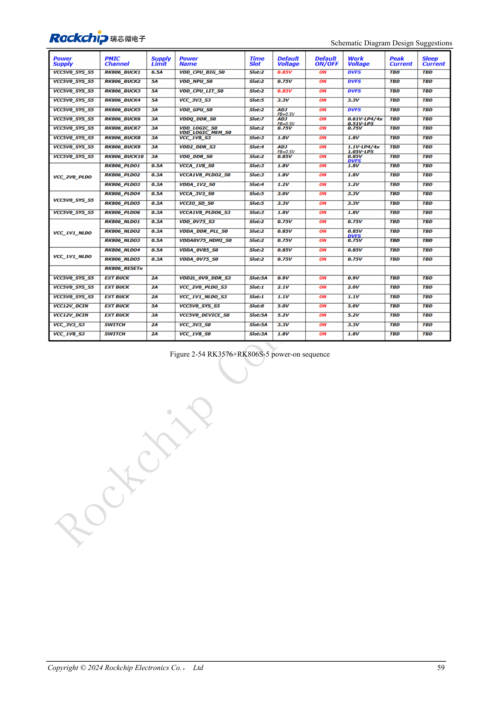
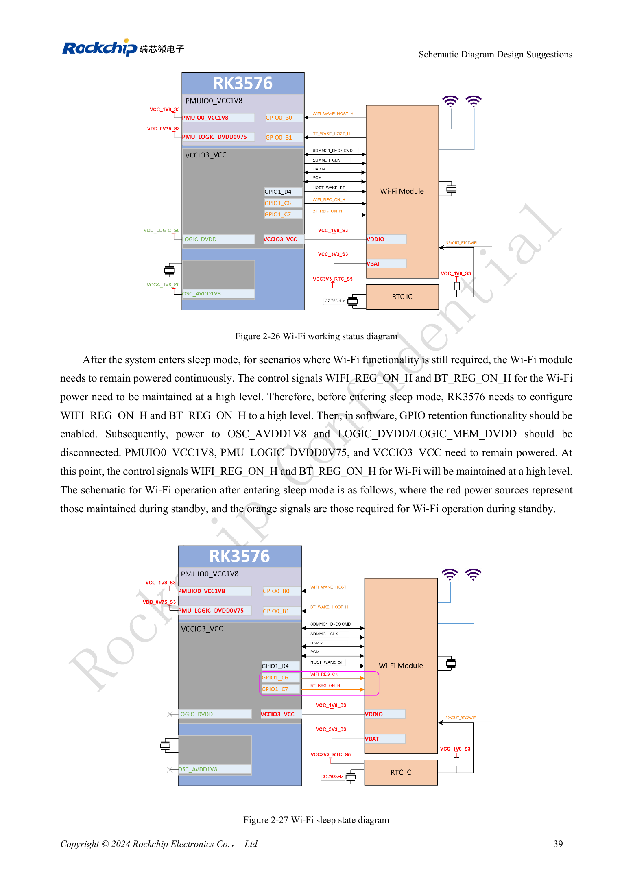

<!-- rk3576-hardware-v11-deep-20261109 -->

# RK3576-Power-Sequencing und Standby: Reset, Haltespannungen und Aufwecken

„Niedrige Spannung zuerst“ ersetzt keine PHY-spezifischen Vorgaben. Abhängigkeiten erfassen und Kaltstart, Abschalten sowie jede Standby-/Aufweckvariante separat prüfen.

Grundlage sind die chinesische und englische Ausgabe des RK3576 Hardware Design Guide V1.1 (2024-05-28) für SoC-Platinen. CM5-Träger müssen der Moduldefinition folgen; Sige5 kann als Software-/Peripheriebasis dienen. Eine universelle SDK-/BSP- oder Kernelversion wird nicht vorgegeben; jede Platine prüfen. Werte stammen aus der Quelle, nicht aus ArmSoM-Messungen.

**RK3576_Hardware_Design_Guide_V1.1_20240528_EN.pdf** · §2.2.1; §2.2.4

## Sequenzausnahmen und Resetfreigabe

DDRPHY folgt DVDD→CKE_VDDQ→VDDQ/CK_VDDQ; USB2 0.75→1.8→3.3V, UFS und USB3/DP 0.85→1.8V. MIPIDCPHY erfordert speziell Niederspannung→1.8→1.2V, also keine numerische Sortierung. RESET_L frühestens 1ms nach Stabilisierung der letzten Spannung freigeben. Die empfohlenen praktischen 5–200ms müssen zu externen Bausteinen passen.

## Haltespannungen hängen von der Aufweckquelle ab

Minimaler Standby erhält DDRPHY_CKE_VDDQ, PMU_LOGIC_DVDD0V75, PMUIO0_VCC1V8 und PMUIO1_VCC und nutzt vor allem PMUIO-Interrupts. USB-HID-Aufwecken benötigt zusätzlich Oszillator und USB2-PHY. Interrupts über VCCIO0–7 erfordern passende IO-, LOGIC- und LOGIC_MEM-Versorgungen. Die Minimalliste gilt nicht für jedes Produkt.

## GPIO-Haltung und Abschalttests

Im Wi-Fi-Beispiel zuerst WIFI_REG_ON_H/BT_REG_ON_H auf High setzen und GPIO-Retention aktivieren, dann relevante Hauptlogik-/Oszillatorspannungen abschalten, während Peripherie und IO versorgt bleiben. Dies bestätigt keine Umsetzung in beliebigen BSPs. Vor Abschalten RESET_L aktivieren. GPIO3.3V–PMUIO0_1.8V und USB3.3V–USB1.8V innerhalb der 2V-Grenzen halten. Rückspeisung durch weiter versorgte Peripherie prüfen.

## Entwurfsparameter und Prüftabelle

| Punkt | Wert/Netz | Prüfhinweis |
| --- | --- | --- |
| Letzte Spannung → Reset | ≥1ms | Praktischer Richtwert 5–200ms |
| Erster Abschaltschritt | RESET_L = LOW | Danach domänenspezifisch abschalten |
| PMIC-Sequenz | RK806S-5 | Feste Konfiguration; nicht RK806-2 |

## Referenzschaltungen und Abbildungen

Die Referenzseiten enthalten die zugehörigen Schalt- oder Zeitdiagramme; für volle Auflösung anklicken. Bezeichner und Werte gehören zum Referenzentwurf, nicht zum Schaltplan eines ArmSoM-Produkts.

Englisches Original · PDF 78 · 2-54

Englisches Original · PDF 58 · 2-26 / 2-27

## ArmSoM-Produkte und Entwicklungsweg

CM5 integriert Rechenleistung in einen eigenen Träger; Sige5 eignet sich zur ersten Linux-/Peripherieerprobung. Eine SoC-Funktion ist nicht zwangsläufig auf beiden Produkten herausgeführt. Vor Kauf oder Layout Steckverbinder, Boardrevision und Image prüfen.

- [ArmSoM CM5](https://www.armsom.org/cm5) · [CM5 Docs](https://docs.armsom.org/armsom-cm5)
- [ArmSoM Sige5](https://www.armsom.org/sige5) · [Sige5 Docs](https://docs.armsom.org/armsom-sige5)

## Lesereihenfolge

- [RK3576-Hardwaredesign: vom Minimalsystem zu DDR und USB](/de/articles/rk3576-hardware-design-series/)
- [RK3576-Minimalsystem: vom Schaltplan zum reproduzierbaren Erststart](/de/articles/rk3576-hardware-bringup/)
- [RK3576-Taktentwurf: 24MHz-Quarz, 32kHz-Standby und Peripherietakte](/de/articles/rk3576-clock-circuit-design/)
- [RK3576-Reset: NPOR, RK806S-5, Watchdog und Übertemperaturschutz](/de/articles/rk3576-reset-watchdog-design/)
- [RK3576-Boot und Debugging: Konfiguration, Maskrom, UART und JTAG](/de/articles/rk3576-boot-debug-design/)
- [RK3576-Spannungsdomänen: CPU, GPU, NPU, LOGIC und Entkopplung](/de/articles/rk3576-power-domain-design/)
- [RK3576 und RK806S-5: PMIC-Auswahl, Steuerpins und Rückkopplung](/de/articles/rk3576-rk806s5-pmic-design/)
- [RK3576-DDR-Schaltung und Versorgung: LPDDR4, LPDDR4X und LPDDR5](/de/articles/rk3576-ddr-circuit-power/)
- [RK3576-DDR-Layout: Impedanz, Längen, Rückstrompfade und PDN](/de/articles/rk3576-ddr-pcb-routing/)
- [RK3576-USB/Type-C-Ergänzung: Multiplexing, Wiederherstellung und Schutz](/de/articles/168-rockchip-rk3576-usb/)
