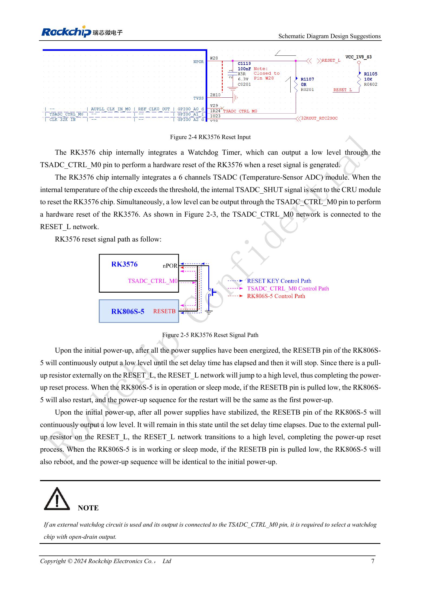

<!-- rk3576-hardware-v11-deep-20261109 -->

# RK3576-Reset: NPOR, RK806S-5, Watchdog und Übertemperaturschutz

Das Resetnetz verbindet SoC, PMIC, Watchdog und Temperaturüberwachung. Entscheidend sind Signalrichtung, Spannungsdomäne, Low-Dauer und Gesamtkapazität, nicht nur eine zusätzliche Resettaste.

Grundlage sind die chinesische und englische Ausgabe des RK3576 Hardware Design Guide V1.1 (2024-05-28) für SoC-Platinen. CM5-Träger müssen der Moduldefinition folgen; Sige5 kann als Software-/Peripheriebasis dienen. Eine universelle SDK-/BSP- oder Kernelversion wird nicht vorgegeben; jede Platine prüfen. Werte stammen aus der Quelle, nicht aus ArmSoM-Messungen.

**RK3576_Hardware_Design_Guide_V1.1_20240528_EN.pdf** · §2.1.2; §2.2.3

## Zeitvorgaben für NPOR

NPOR (Pin W28) ist Low-aktiv. Die Quelle fordert mindestens 100 Perioden bei 24MHz und nennt zugleich „mindestens 4μs“. Wegen 100/24MHz≈4.167μs bleibt die Forderung nach 100 Perioden maßgeblich; exakt 4.000μs reichen nicht. Die Zeit ≥1ms zwischen Stabilisierung der letzten Spannung und RESET_L-Freigabe ist eine separate Startanforderung.

## RESETB wechselt seine Rolle

Beim Einschalten hält RK806S-5 RESETB auf Low und gibt es nach gültiger Versorgung und Verzögerung frei; der externe Pull-up erzeugt High. Low an RESETB während Betrieb oder Schlaf startet den PMIC samt Einschaltfolge neu. RESET_L an PMUIO0_VCC1V8 hochziehen. Die Referenz nutzt 100nF, der PMIC erlaubt jedoch insgesamt höchstens 0.3μF am Netz; Kondensatoren nicht an jedem Zweig vervielfachen.

## Watchdog und Temperaturschutz

TSADC1 besitzt sechs Kanäle. Beim konfigurierten Grenzwert kann es CRU intern über TSADC_SHUT benachrichtigen und TSADC_CTRL_M0 auf Low ziehen. Ein daran angeschlossener externer Watchdog muss einen Open-Drain-Ausgang haben. Reset, Spannungsneustart und UART gemeinsam beobachten; Grenzwerte, Routing und Wiederherstellung im BSP prüfen. Ein ungeprüfter allgemeiner Temperaturgrenzwert wird nicht vorgegeben.

## Entwurfsparameter und Prüftabelle

| Punkt | Wert/Netz | Prüfhinweis |
| --- | --- | --- |
| Externer Reset | NPOR / W28 | Low-aktiv; mindestens 100×24MHz-Perioden |
| Pull-up-Versorgung | PMUIO0_VCC1V8 | Nicht beliebig an 3.3V anschließen |
| Gesamtkapazität | ≤0.3μF | SoC-, PMIC- und externe Resetzweige einbeziehen |

## Referenzschaltungen und Abbildungen

Die Referenzseiten enthalten die zugehörigen Schalt- oder Zeitdiagramme; für volle Auflösung anklicken. Bezeichner und Werte gehören zum Referenzentwurf, nicht zum Schaltplan eines ArmSoM-Produkts.

Englisches Original · PDF 26 · 2-4

## ArmSoM-Produkte und Entwicklungsweg

CM5 integriert Rechenleistung in einen eigenen Träger; Sige5 eignet sich zur ersten Linux-/Peripherieerprobung. Eine SoC-Funktion ist nicht zwangsläufig auf beiden Produkten herausgeführt. Vor Kauf oder Layout Steckverbinder, Boardrevision und Image prüfen.

- [ArmSoM CM5](https://www.armsom.org/cm5) · [CM5 Docs](https://docs.armsom.org/armsom-cm5)
- [ArmSoM Sige5](https://www.armsom.org/sige5) · [Sige5 Docs](https://docs.armsom.org/armsom-sige5)

## Lesereihenfolge

- [RK3576-Hardwaredesign: vom Minimalsystem zu DDR und USB](/de/articles/rk3576-hardware-design-series/)
- [RK3576-Minimalsystem: vom Schaltplan zum reproduzierbaren Erststart](/de/articles/rk3576-hardware-bringup/)
- [RK3576-Taktentwurf: 24MHz-Quarz, 32kHz-Standby und Peripherietakte](/de/articles/rk3576-clock-circuit-design/)
- [RK3576-Boot und Debugging: Konfiguration, Maskrom, UART und JTAG](/de/articles/rk3576-boot-debug-design/)
- [RK3576-Spannungsdomänen: CPU, GPU, NPU, LOGIC und Entkopplung](/de/articles/rk3576-power-domain-design/)
- [RK3576 und RK806S-5: PMIC-Auswahl, Steuerpins und Rückkopplung](/de/articles/rk3576-rk806s5-pmic-design/)
- [RK3576-Power-Sequencing und Standby: Reset, Haltespannungen und Aufwecken](/de/articles/rk3576-power-sequencing-standby/)
- [RK3576-DDR-Schaltung und Versorgung: LPDDR4, LPDDR4X und LPDDR5](/de/articles/rk3576-ddr-circuit-power/)
- [RK3576-DDR-Layout: Impedanz, Längen, Rückstrompfade und PDN](/de/articles/rk3576-ddr-pcb-routing/)
- [RK3576-USB/Type-C-Ergänzung: Multiplexing, Wiederherstellung und Schutz](/de/articles/168-rockchip-rk3576-usb/)
