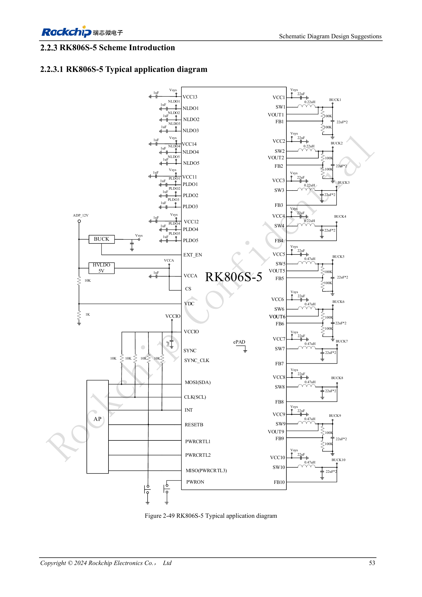
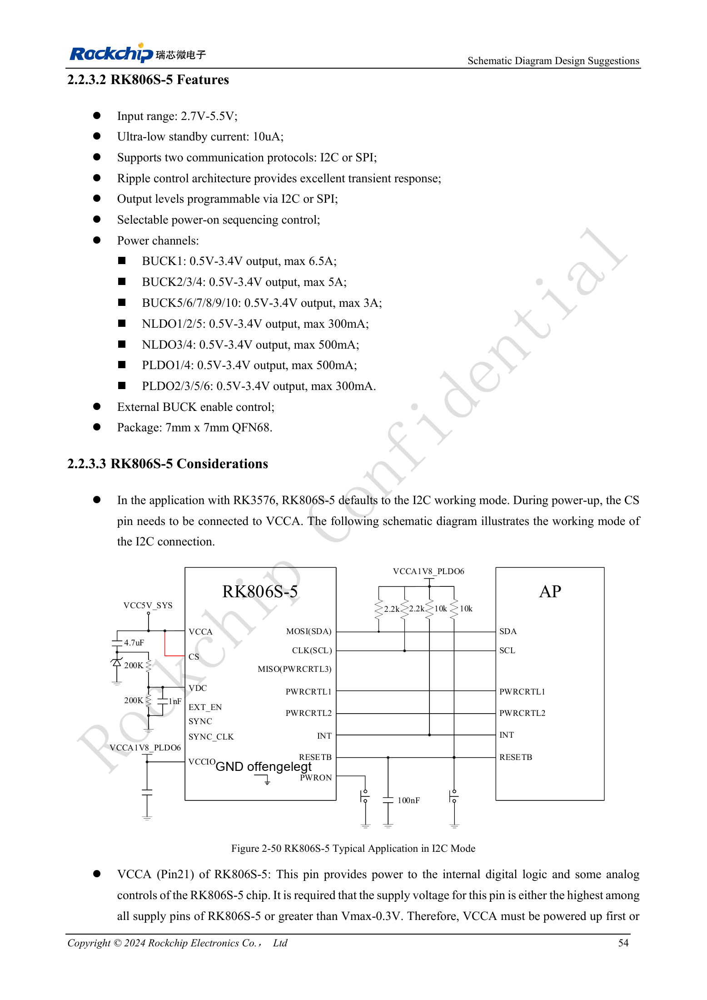

<!-- rk3576-hardware-v11-deep-20261109 -->

# RK3576 und RK806S-5: PMIC-Auswahl, Steuerpins und Rückkopplung

Gleiches Gehäuse bedeutet nicht gleiches Startverhalten. RK806S-5 besitzt eine feste Sequenz für RK3576 und ist nicht einfach durch RK806-2 ersetzbar. Zuerst genaue Variante, OTP und Referenzschaltung prüfen, dann externe Bauteile.

Grundlage sind die chinesische und englische Ausgabe des RK3576 Hardware Design Guide V1.1 (2024-05-28) für SoC-Platinen. CM5-Träger müssen der Moduldefinition folgen; Sige5 kann als Software-/Peripheriebasis dienen. Eine universelle SDK-/BSP- oder Kernelversion wird nicht vorgegeben; jede Platine prüfen. Werte stammen aus der Quelle, nicht aus ArmSoM-Messungen.

**RK3576_Hardware_Design_Guide_V1.1_20240528_EN.pdf** · §2.2.3–2.2.4

## Kommunikation und Eingänge

Die Referenz verwendet I2C mit CS an VCCA beim Start. VCCA (Pin21) muss die höchste Versorgung oder höher als Vmax−0.3V sein und vor oder zusammen mit den übrigen Eingängen ansteigen. PLDO6 versorgt die Kommunikations-IO und muss zur AP-Domäne passen. 2.7–5.5V Eingangsbereich ersetzt nicht die Startbedingungen: Bei VDC werden zusätzlich VCCA/VCC1/VCC2 über 3.0V gefordert.

## Ein-/Ausschalten und Reset gemeinsam entwerfen

Die VDC-Schwelle beträgt 0.8V; empfohlen sind über 1V und höchstens VCCA. Dauerhaftes High kann normales Abschalten verhindern; die RC-Autostartschaltung der Quelle prüfen. PWRON hat etwa 45kΩ internen Pull-up, standardmäßig 20ms Low zum Start und 6s für Zwangsabschaltung, einstellbar auf 6/8/10/12s. Nach EXT_EN müssen VCCA/VCC1/VCC2 binnen 100ms über 3V liegen. RESETB-Gesamtkapazität ≤0.3μF halten.

## Rückkopplung und Quellenwiderspruch

Die Wahl zwischen FB und VOUT hängt von BUCK und OTP ab; nicht alle Kanäle gleich umverdrahten. Das Teilerbeispiel lautet Vout=(R1/R2+1)×0.5V mit 10kΩ–1MΩ Widerständen. Abbildung 2-49 zeigt für BUCK1–4 0.22μH, der Text nennt 0.24μH. Beide Angaben bleiben dokumentiert; anhand aktueller Referenz-BOM, PMIC-Datenblatt und Hersteller klären. Bei COT sind Layout und Ripple gemeinsam zu prüfen.

## Entwurfsparameter und Prüftabelle

| Punkt | Wert/Netz | Prüfhinweis |
| --- | --- | --- |
| Eingang/Gehäuse | 2.7–5.5V; QFN68 7×7mm | Bausteindaten, nicht Boardeingang |
| BUCK-Nennwerte | 1:6.5A; 2–4:5A; 5–10:3A | Maximalwert ist nicht die zulässige Dauerauslegung |
| Referenzschnittstelle | I2C / CS→VCCA | OTP, AP-Pegel und Startkonfiguration abstimmen |

## Referenzschaltungen und Abbildungen

Die Referenzseiten enthalten die zugehörigen Schalt- oder Zeitdiagramme; für volle Auflösung anklicken. Bezeichner und Werte gehören zum Referenzentwurf, nicht zum Schaltplan eines ArmSoM-Produkts.

Englisches Original · PDF 72 · 2-49

Englisches Original · PDF 73 · 2-50

## ArmSoM-Produkte und Entwicklungsweg

CM5 integriert Rechenleistung in einen eigenen Träger; Sige5 eignet sich zur ersten Linux-/Peripherieerprobung. Eine SoC-Funktion ist nicht zwangsläufig auf beiden Produkten herausgeführt. Vor Kauf oder Layout Steckverbinder, Boardrevision und Image prüfen.

- [ArmSoM CM5](https://www.armsom.org/cm5) · [CM5 Docs](https://docs.armsom.org/armsom-cm5)
- [ArmSoM Sige5](https://www.armsom.org/sige5) · [Sige5 Docs](https://docs.armsom.org/armsom-sige5)

## Lesereihenfolge

- [RK3576-Hardwaredesign: vom Minimalsystem zu DDR und USB](/de/articles/rk3576-hardware-design-series/)
- [RK3576-Minimalsystem: vom Schaltplan zum reproduzierbaren Erststart](/de/articles/rk3576-hardware-bringup/)
- [RK3576-Taktentwurf: 24MHz-Quarz, 32kHz-Standby und Peripherietakte](/de/articles/rk3576-clock-circuit-design/)
- [RK3576-Reset: NPOR, RK806S-5, Watchdog und Übertemperaturschutz](/de/articles/rk3576-reset-watchdog-design/)
- [RK3576-Boot und Debugging: Konfiguration, Maskrom, UART und JTAG](/de/articles/rk3576-boot-debug-design/)
- [RK3576-Spannungsdomänen: CPU, GPU, NPU, LOGIC und Entkopplung](/de/articles/rk3576-power-domain-design/)
- [RK3576-Power-Sequencing und Standby: Reset, Haltespannungen und Aufwecken](/de/articles/rk3576-power-sequencing-standby/)
- [RK3576-DDR-Schaltung und Versorgung: LPDDR4, LPDDR4X und LPDDR5](/de/articles/rk3576-ddr-circuit-power/)
- [RK3576-DDR-Layout: Impedanz, Längen, Rückstrompfade und PDN](/de/articles/rk3576-ddr-pcb-routing/)
- [RK3576-USB/Type-C-Ergänzung: Multiplexing, Wiederherstellung und Schutz](/de/articles/168-rockchip-rk3576-usb/)
