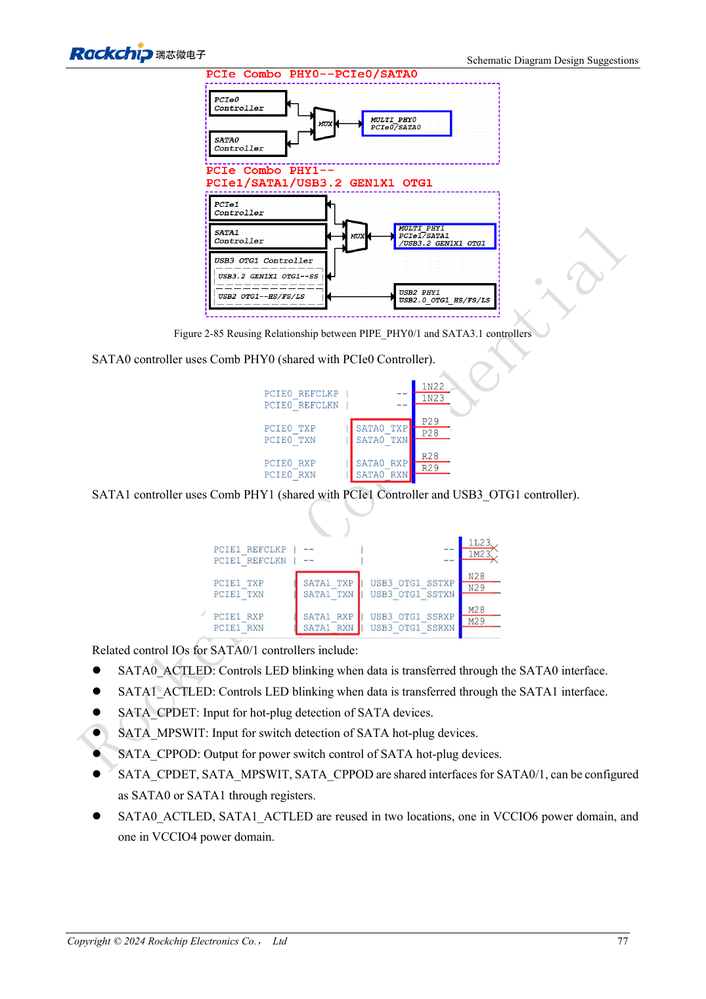
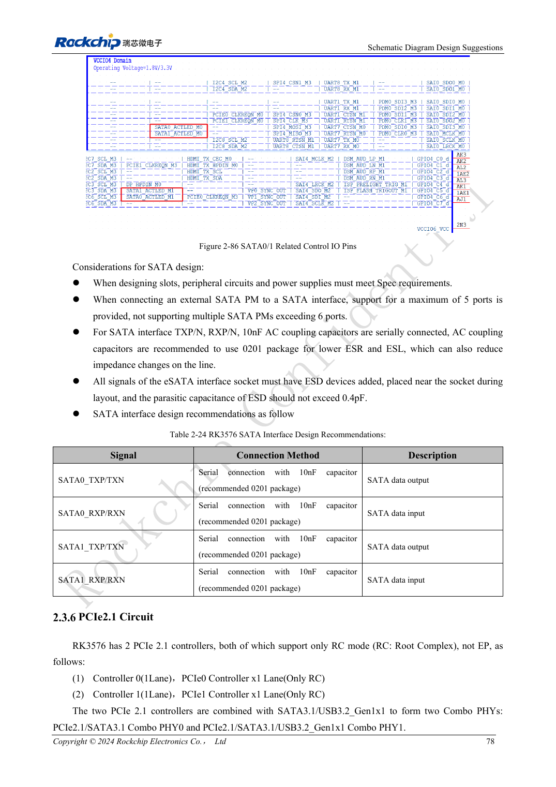

<!-- rk3576-hardware-v11-rest-20261109 -->

# RK3576-SATA-Hardware: PHY-Aufteilung, Kopplung und Laufwerksversorgung

Grundlage sind die chinesische und englische Ausgabe des RK3576 Hardware Design Guide V1.1 (2024-05-28) für SoC-Platinen. CM5-Träger müssen der Moduldefinition folgen; Sige5 kann als Software-/Peripheriebasis dienen. Eine universelle SDK-/BSP- oder Kernelversion wird nicht vorgegeben; jede Platine prüfen. Werte stammen aus der Quelle, nicht aus ArmSoM-Messungen.

**RK3576_Hardware_Design_Guide_V1.1_20240528_EN.pdf** · §2.3.5; SATA PCB

## Ein SATA-Controller ist kein vollständiger Laufwerksanschluss

Zwei SATA-3.1-Controller unterstützen 1.5/3/6Gbps. Der Leitfaden nennt Port-Multiplier für bis zu fünf Geräte; Software, Geräte und Bandbreite müssen passen. SATA0 teilt PHY0 mit PCIe0, SATA1 PHY1 mit PCIe1/USB3 OTG1. Laufwerksversorgung und Anlaufstrom sind getrennt von SATA-Signalen auszulegen.

## PCIe-RX-Beschaltung nicht übernehmen

Die SATA-Referenz setzt auf TX und RX jeweils 10nF, bevorzugt 0201. eSATA-Schutzkapazität höchstens 0.4pF. CPDET/MPSWIT/CPPOD sind auswählbare gemeinsame Ressourcen, keine zwei unabhängigen Steuersätze. ACTLED-Pegel und externe Treiber prüfen.

## Kabel und ungünstige Versorgung einbeziehen

100Ω differentiell bevorzugen. Bei ungeeignetem Stackup nennt die Quelle bedingt mindestens 90Ω±10%; gesamten Kabel-/Empfängerpfad bewerten. Masse erhalten, Vias begrenzen, Schutz am Stecker platzieren. Kaltstart, parallele Laufwerke, Dauerzugriffe und Wiederanlauf samt Anlauf-Spannungseinbruch testen.

## Entwurfsparameter und Prüftabelle

| Punkt | Quellenreferenz |
| --- | --- |
| Schnittstellenrate | 1.5 / 3 / 6Gbps |
| TX + RX AC | 10nF |
| Paarinterne Differenz | <6mil |
| Leiterlänge | <6inch |
| Freier Abstand | ≥4W |
| Empfohlene Viazahl | ≤2 |

## Quellenabbildungen

Die Referenzseiten enthalten die zugehörigen Schalt- oder Zeitdiagramme; für volle Auflösung anklicken. Bezeichner und Werte gehören zum Referenzentwurf, nicht zum Schaltplan eines ArmSoM-Produkts.

Englisches Original · PDF 96 · 2-85

Englisches Original · PDF 97 · 2-86

## Entwicklung mit ArmSoM

CM5 verringert die erneute Entwicklung des Rechenkerns auf eigenen Trägern; Sige5 dient als Ausgangspunkt für Software und Peripherie. Herausführung, Pins, Pegel und Image-Unterstützung anhand der Boarddokumentation prüfen.

- [ArmSoM CM5](https://www.armsom.org/cm5) · [CM5 Docs](https://docs.armsom.org/armsom-cm5)
- [ArmSoM Sige5](https://www.armsom.org/sige5) · [Sige5 Docs](https://docs.armsom.org/armsom-sige5)

## Weiterlesen

- [RK3576-Hardwaredesign: 30 Themen](/de/articles/rk3576-hardware-design-series/)
- [RK3576-PCIe: Root Complex, gemeinsam genutzte PHYs und Endgeräteversorgung](/de/articles/rk3576-pcie-hardware-design/)
- [RK3576-Kamerahardware: CSI-Gruppen, DCPHY-Modi und Versorgung](/de/articles/rk3576-camera-hardware-design/)
