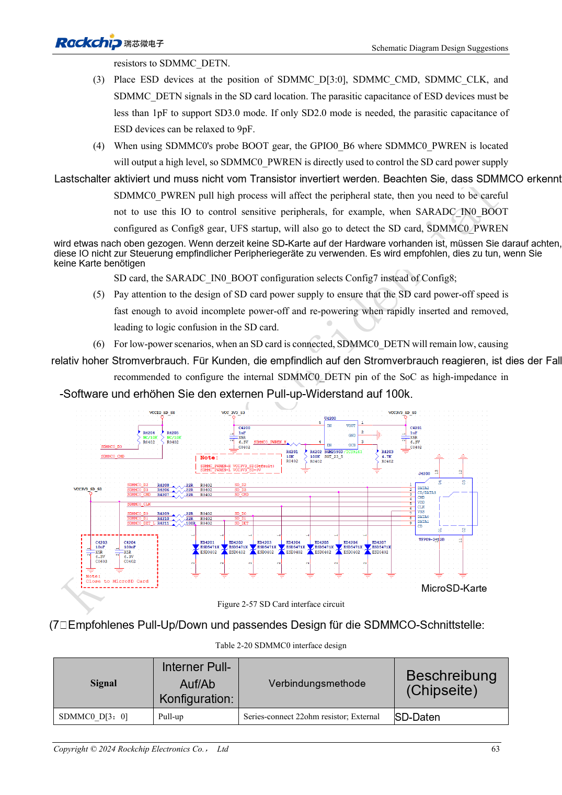
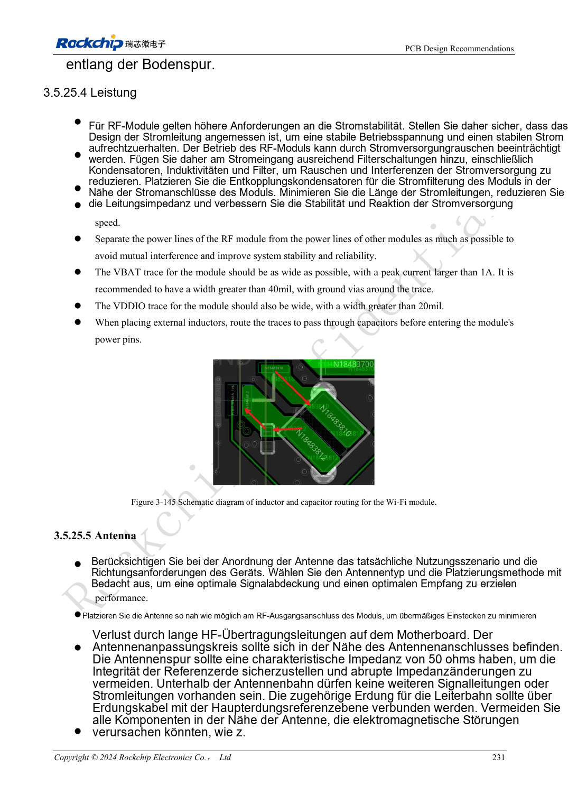

<!-- rk3576-hardware-v11-rest-20261109 -->

# RK3576-SD-Karten und SDIO-WLAN: Pegelwechsel, Versorgung und HF-Layout

Grundlage sind die chinesische und englische Ausgabe des RK3576 Hardware Design Guide V1.1 (2024-05-28) für SoC-Platinen. CM5-Träger müssen der Moduldefinition folgen; Sige5 kann als Software-/Peripheriebasis dienen. Eine universelle SDK-/BSP- oder Kernelversion wird nicht vorgegeben; jede Platine prüfen. Werte stammen aus der Quelle, nicht aus ArmSoM-Messungen.

**RK3576_Hardware_Design_Guide_V1.1_20240528_EN.pdf** · §2.3.1; SDMMC/SDIO PCB; §3.5.25

## Bootfähiges SDMMC0 und SDMMC1 unterscheiden

Beide Controller unterstützen vier Bit SDIO 3.0/MMC 4.51 und SDR104 bis 200MHz. SDMMC0 auf VCCIO1 kann booten; SDMMC1 auf VCCIO3 oder VCCIO4 ist kein gleichwertiger Bootport. Die Karte bleibt mit 3.3V versorgt. Nach SD-3.0-Aushandlung wechselt der IO-Pegel, nicht die Kartenversorgung auf 1.8V.

## Lastschalter und Kartenwechsel

Die Referenz nutzt 22Ω für D/CMD/CLK und 100Ω für DETN; SD-3.0-Schutzkapazität unter 1pF. Die Bootsuche setzt GPIO0_B6/PWREN hoch: nicht invertierenden Lastschalter und Entladepfad für erneutes Einstecken vorsehen. DETN kann im Schlaf hochohmig werden; eine dauerhaft versorgte externe Pull-up-Schaltung hängt vom Aufwachkonzept ab.

## WLAN braucht HF- und Spitzenstromprüfung

VDDIO, 32.768kHz-Pegel und UART-/PCM-Richtung abstimmen. Abstand zu DDR, HDMI und Leistungsinduktivitäten halten. HF mit 50Ω ohne Abzweige und mit Anpassnetzwerk führen; Antennenfreiraum nach Hersteller. Versorgung nach tatsächlichem Spitzenstrom auslegen. WLAN gemeinsam mit benachbarter schneller Peripherie betreiben und Durchsatz, Verluste, Abbrüche sowie Spannungseinbrüche erfassen.

## Entwurfsparameter und Prüftabelle

| Punkt | Quellenreferenz |
| --- | --- |
| SD Z | 50Ω ±10% |
| CLK ↔ DATA | <120mil |
| Leiterlänge | <4inch |
| RF Z | 50Ω ±10% |
| SD3 ESD | <1pF |

## Quellenabbildungen

Die Referenzseiten enthalten die zugehörigen Schalt- oder Zeitdiagramme; für volle Auflösung anklicken. Bezeichner und Werte gehören zum Referenzentwurf, nicht zum Schaltplan eines ArmSoM-Produkts.

Englisches Original · PDF 82 · 2-57

Englisches Original · PDF 250 · 3-145

## Entwicklung mit ArmSoM

CM5 verringert die erneute Entwicklung des Rechenkerns auf eigenen Trägern; Sige5 dient als Ausgangspunkt für Software und Peripherie. Herausführung, Pins, Pegel und Image-Unterstützung anhand der Boarddokumentation prüfen.

- [ArmSoM CM5](https://www.armsom.org/cm5) · [CM5 Docs](https://docs.armsom.org/armsom-cm5)
- [ArmSoM Sige5](https://www.armsom.org/sige5) · [Sige5 Docs](https://docs.armsom.org/armsom-sige5)

## Weiterlesen

- [RK3576-Hardwaredesign: 30 Themen](/de/articles/rk3576-hardware-design-series/)
- [RK3576-FSPI-Boot: NOR/NAND, Spannung und Chip-Select-Zustand](/de/articles/rk3576-fspi-boot-hardware/)
- [RK3576-PCIe: Root Complex, gemeinsam genutzte PHYs und Endgeräteversorgung](/de/articles/rk3576-pcie-hardware-design/)
