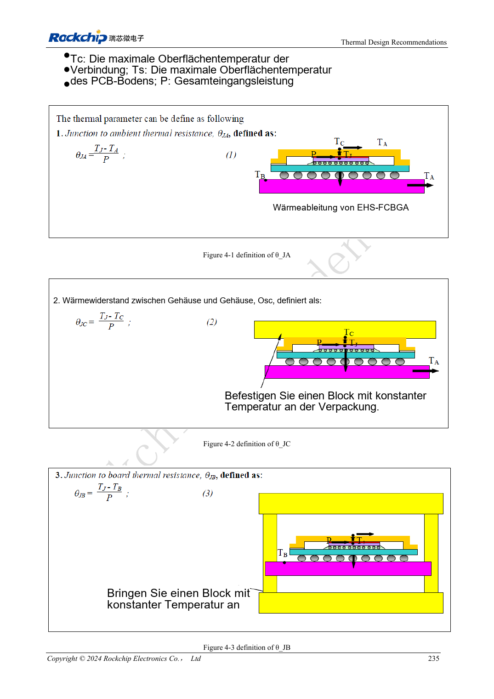

<!-- rk3576-hardware-v11-rest-20261109 -->

# RK3576-Thermik: Wärmewiderstand, PCB-Wärmeleitung und Dauerlast

Grundlage sind die chinesische und englische Ausgabe des RK3576 Hardware Design Guide V1.1 (2024-05-28) für SoC-Platinen. CM5-Träger müssen der Moduldefinition folgen; Sige5 kann als Software-/Peripheriebasis dienen. Eine universelle SDK-/BSP- oder Kernelversion wird nicht vorgegeben; jede Platine prüfen. Werte stammen aus der Quelle, nicht aus ArmSoM-Messungen.

**RK3576_Hardware_Design_Guide_V1.1_20240528_EN.pdf** · Chapter 4

## Wärmewiderstände haben Bedingungen

Die Quelle simuliert JEDEC-2S2P bei natürlicher Konvektion ohne Kühlkörper. Das entspricht nicht direkt CM5, Sige5 oder einem eigenen Gehäuse. θJA, θJB, θJC und ψJT beschreiben unterschiedliche Pfade beziehungsweise Bedingungen. θJC mal Systemleistung ergibt nicht die Temperaturdifferenz zwischen Sperrschicht und Umgebung.

## Thermik und Versorgung gemeinsam optimieren

Referenzabstand PMIC–SoC: 20–50mm als Abwägung von Kupferverlust und Wärmekopplung. Kupferflächen, thermische Vias und Kontaktmaterial gehören zum Wärmeweg. Modulträger müssen Mechanik, Bauteilhöhen und Befestigung beachten; keinen unzulässigen Druck auf Bauteile ausüben.

## Beharrungszustand und Drosselung erfassen

Endgehäuse, Einbaulage und Umgebung für CPU-, NPU-, Video- und realistische Kombilasten verwenden. Temperatur, Takt, Leistung und Durchsatz bis zur Stabilisierung protokollieren. Kurzzeitspitzen belegen keine Dauerleistung. Kernel-Thermoschutz nicht für Benchmarks deaktivieren. Hier werden keine neuen ArmSoM-Messungen behauptet.

## Entwurfsparameter und Prüftabelle

| Punkt | Quellenreferenz |
| --- | --- |
| θJA | 15.84°C/W |
| θJB | 6.96°C/W |
| θJC | 0.67°C/W |
| ψJT | 0.031°C/W |
| Referenzabstand PMIC–SoC | 20–50mm |

## Quellenabbildungen

Die Referenzseiten enthalten die zugehörigen Schalt- oder Zeitdiagramme; für volle Auflösung anklicken. Bezeichner und Werte gehören zum Referenzentwurf, nicht zum Schaltplan eines ArmSoM-Produkts.

Englisches Original · PDF 254 · 4-1

## Entwicklung mit ArmSoM

CM5 verringert die erneute Entwicklung des Rechenkerns auf eigenen Trägern; Sige5 dient als Ausgangspunkt für Software und Peripherie. Herausführung, Pins, Pegel und Image-Unterstützung anhand der Boarddokumentation prüfen.

- [ArmSoM CM5](https://www.armsom.org/cm5) · [CM5 Docs](https://docs.armsom.org/armsom-cm5)
- [ArmSoM Sige5](https://www.armsom.org/sige5) · [Sige5 Docs](https://docs.armsom.org/armsom-sige5)

## Weiterlesen

- [RK3576-Hardwaredesign: 30 Themen](/de/articles/rk3576-hardware-design-series/)
- [RK3576-Versorgungs-PCB und PDN: RK806S-5, Feedback und Stromschleifen](/de/articles/rk3576-power-pcb-pdn-design/)
- [RK3576-ESD und EMI: Ableitwege, Reset-Störfestigkeit und Fertigungsprüfung](/de/articles/rk3576-esd-emi-reliability-design/)
