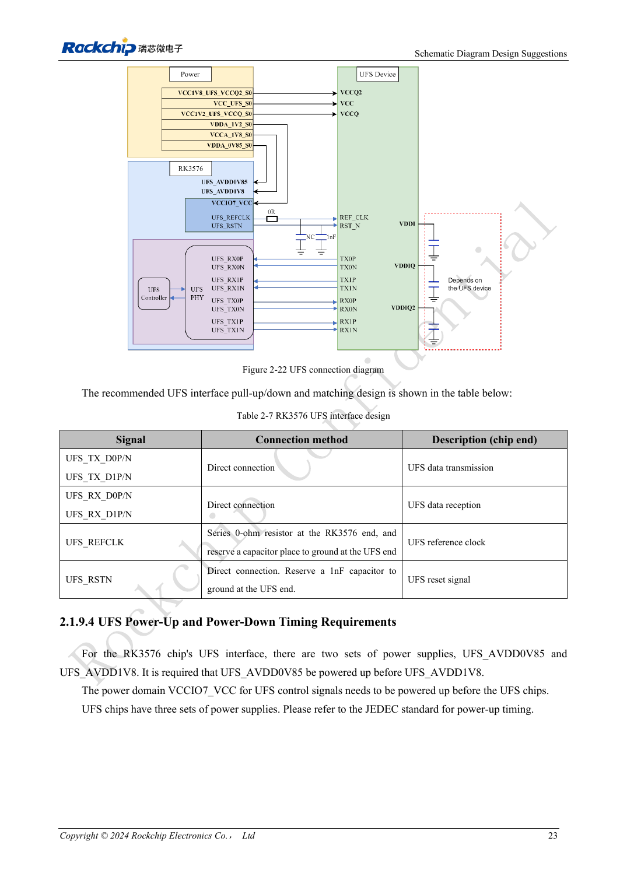
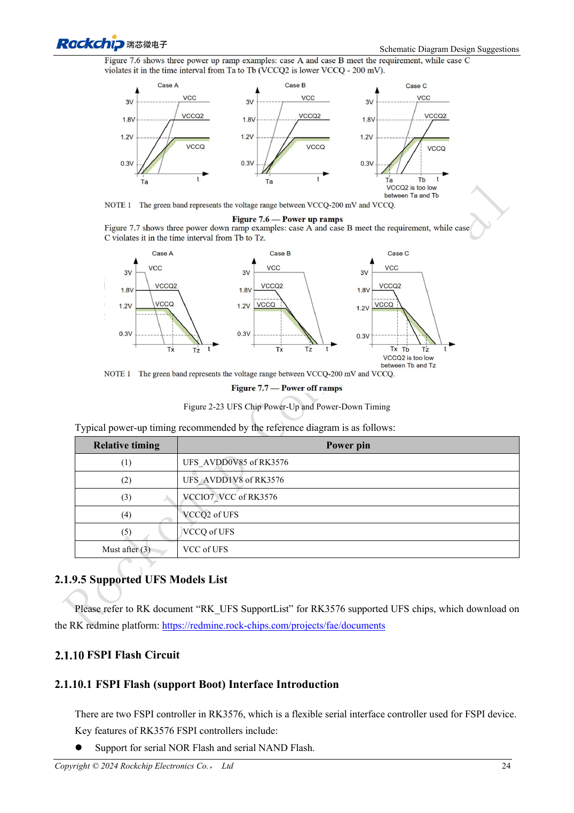

<!-- rk3576-hardware-v11-rest-20261109 -->

# RK3576-UFS-Hardware: Speicherkompatibilität, Sequenz und Differenzleitungen

Grundlage sind die chinesische und englische Ausgabe des RK3576 Hardware Design Guide V1.1 (2024-05-28) für SoC-Platinen. CM5-Träger müssen der Moduldefinition folgen; Sige5 kann als Software-/Peripheriebasis dienen. Eine universelle SDK-/BSP- oder Kernelversion wird nicht vorgegeben; jede Platine prüfen. Werte stammen aus der Quelle, nicht aus ArmSoM-Messungen.

**RK3576_Hardware_Design_Guide_V1.1_20240528_EN.pdf** · §2.1.9; UFS PCB

## Bausteinversion und Betriebsmodus unterscheiden

Der RK3576-Controller entspricht UFS 2.0 mit zwei Lanes bis jeweils 5.8Gbps. Der Leitfaden nennt UFS-2.0/2.1/2.2/3.0/3.1-Bausteine und schließt UFS 4.0 aus. Ein neuerer Speicher erhöht nicht die Hostgeschwindigkeit auf UFS 3.x. Die Lane-Rate ist kein Dateidurchsatz.

## Versorgungen für den konkreten Speicher prüfen

RSTN und REFCLK arbeiten mit 1.2V; VCCIO7 ebenfalls bei UFS. VCCQ/VCCQ2/VCC: 1.2/1.8/3.3V bei UFS 2.0, NC/1.8/3.3V bei 2.1/2.2 und 1.2/NC/2.5 oder 3.3V bei 3.0/3.1. Maßgeblich bleibt das Bauteildatenblatt. Die Referenz sequenziert AVDD0V85→AVDD1V8→VCCIO7→VCCQ2→VCCQ; Speicher-VCC folgt VCCIO7. Nicht vorhandene Rails nicht blind aus dem Beispiel übernehmen.

## Differenzpfad und Wiederanlauf testen

TX/RX direkt verbinden. REFCLK erhält 0Ω am SoC und einen optionalen Kondensator am Speicher; RSTN direkt mit Platz für 1nF. Durchgehende Masse und REFCLK-Rückweg prüfen; Referenzabstand zum Massevia höchstens 25mil. Stromzyklen, Aufwachen und Dauerzugriffe testen. Vor einem Treiberwechsel zunächst die Versorgungssequenz untersuchen.

## Entwurfsparameter und Prüftabelle

| Punkt | Quellenreferenz |
| --- | --- |
| Zdiff | 100Ω ±10% |
| Paarinterne Differenz | <6mil |
| Differenz zwischen Paaren | <100mil |
| Leiterlänge | <4inch |
| Freier Abstand | ≥4W; other ≥5W |
| Empfohlene Viazahl | ≤2 |

## Quellenabbildungen

Die Referenzseiten enthalten die zugehörigen Schalt- oder Zeitdiagramme; für volle Auflösung anklicken. Bezeichner und Werte gehören zum Referenzentwurf, nicht zum Schaltplan eines ArmSoM-Produkts.

Englisches Original · PDF 42 · 2-22

Englisches Original · PDF 43 · 2-23

## Entwicklung mit ArmSoM

CM5 verringert die erneute Entwicklung des Rechenkerns auf eigenen Trägern; Sige5 dient als Ausgangspunkt für Software und Peripherie. Herausführung, Pins, Pegel und Image-Unterstützung anhand der Boarddokumentation prüfen.

- [ArmSoM CM5](https://www.armsom.org/cm5) · [CM5 Docs](https://docs.armsom.org/armsom-cm5)
- [ArmSoM Sige5](https://www.armsom.org/sige5) · [Sige5 Docs](https://docs.armsom.org/armsom-sige5)

## Weiterlesen

- [RK3576-Hardwaredesign: 30 Themen](/de/articles/rk3576-hardware-design-series/)
- [RK3576-eMMC-Hardware: Versorgung, Pull-ups und HS400-Routing](/de/articles/rk3576-emmc-hardware-design/)
- [RK3576-FSPI-Boot: NOR/NAND, Spannung und Chip-Select-Zustand](/de/articles/rk3576-fspi-boot-hardware/)
