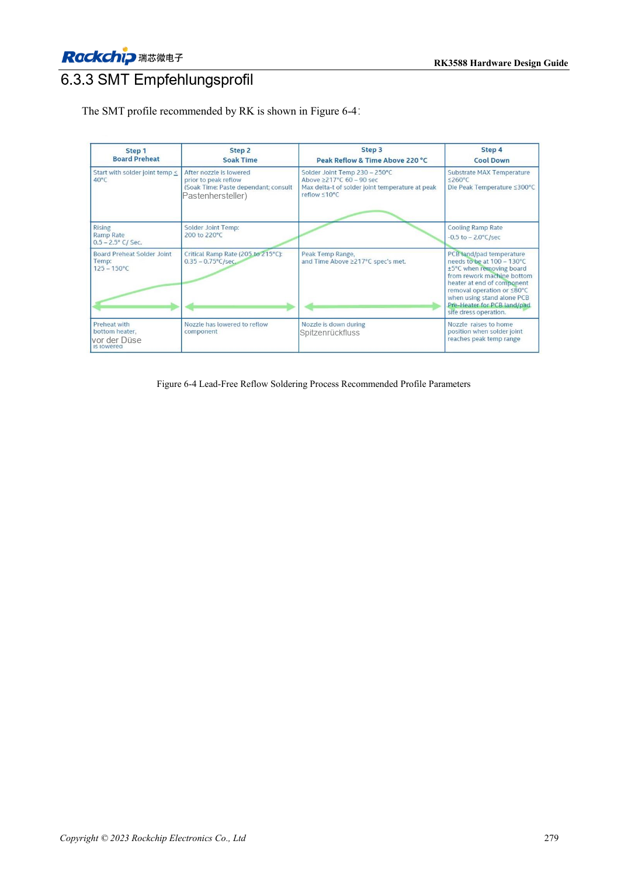
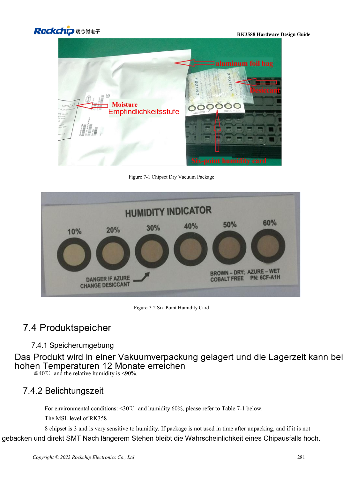

<!-- rk3588-hardware-v13-20261109 -->

# RK3588-Montage und Lagerung: Reflow, MSL3 und Backprotokoll

Grundlage sind die chinesische und englische Ausgabe des RK3588 Hardware Design Guide V1.3 (2023-02-13) für SoC-Platinen und Träger. AIM7- und LM7-Träger müssen den Moduldefinitionen folgen; Sige7 dient zur Software- und Peripherieprüfung. SoC-Funktionen sind keine Boardanschlussliste. SDK/BSP, Kernel, Boardrevision und Firmware prüfen. Werte sind Quellenreferenzen, keine ArmSoM-Messungen.

**RK3588 Hardware Design Guide V1.3 (2023-02-13), EN** · §6–7

## Prozesswerte gehören zum Gehäuse

Das Reflowprofil gilt für den RK3588-Chip, nicht pauschal für bestückte ArmSoM-Module. Pastenreferenz: Lagerung 2–10°C, 3–4 Stunden Temperierung mit Protokoll. Legierung, Flussmittel, PCB-Wärmemasse und Bauteilgrenzen mit Fertigung abstimmen. LM7-LGA benötigt sein Modulprofil.

## Kumulative Feuchteexposition erfassen

RK3588 ist MSL3 mit 168 Stunden Offenzeit bei ≤30°C/60%RH. Feuchtekarte, Öffnungszeit und Lagerung protokollieren; erneutes Versiegeln setzt die Zeit nicht automatisch zurück. Tabelle 7-2 unterscheidet Überschreitung über/bis 72 Stunden und Backtemperatur bei Gehäuse ≤1.4mm. 300°C in der MSL1-Zeile sind fragwürdig und keine hier verwendete Fertigungsbedingung.

## Entwurfsparameter und Prüftabelle

| Punkt | Quellenreferenz |
| --- | --- |
| MSL3-Offenzeit | 168h bei ≤30°C /60%RH |
| Trocknung 125°C +10/-0°C (Überschreitung >72h / ≤72h) | 9h /7h |
| Trocknung 90°C +8/-0°C (Überschreitung >72h / ≤72h) | 33h /23h |
| Trocknung 40°C +5/-0°C (Überschreitung >72h / ≤72h) | 13 Tage /9 Tage |
| Gehäusegrenze der Trocknungstabelle | Dicke ≤1.4mm |

## Quellenabbildungen

Die Referenzseiten enthalten die zugehörigen Schalt- oder Zeitdiagramme; für volle Auflösung anklicken. Bezeichner und Werte gehören zum Referenzentwurf, nicht zum Schaltplan eines ArmSoM-Produkts.

Englisches Original · PDF 301 · 6-4

Englisches Original · PDF 303 · 7-2

## Entwicklung mit ArmSoM

AIM7 unterstützt Compute-Modul-Träger, LM7 die LGA-Modulintegration und Sige7 frühe Software-/Peripherieerprobung. Vor dem Trägerdesign klären, welche Versorgung, DDR- und Bootschaltungen bereits integriert sind. SoC-Referenzschaltungen nicht unnötig duplizieren. Anschlüsse, herausgeführte Schnittstellen, Pegel und Systemunterstützung anhand der Produktunterlagen prüfen.

- [ArmSoM AIM7](https://www.armsom.org/aim7) · [AIM7 Docs](https://docs.armsom.org/armsom-aim7)
- [ArmSoM Sige7](https://www.armsom.org/sige7) · [Sige7 Docs](https://docs.armsom.org/armsom-sige7)
- [ArmSoM LM7](https://www.armsom.org/lm7) · [LM7 Docs](https://docs.armsom.org/armsom-lm7)

## Weiterlesen

- [RK3588-Hardwaredesign: 30 Themen](/de/articles/rk3588-hardware-design-series/)
- [RK3588-ESD und EMI: Schnittstellenschutz und Rückwege](/de/articles/rk3588-esd-emi-hardware-design/)
