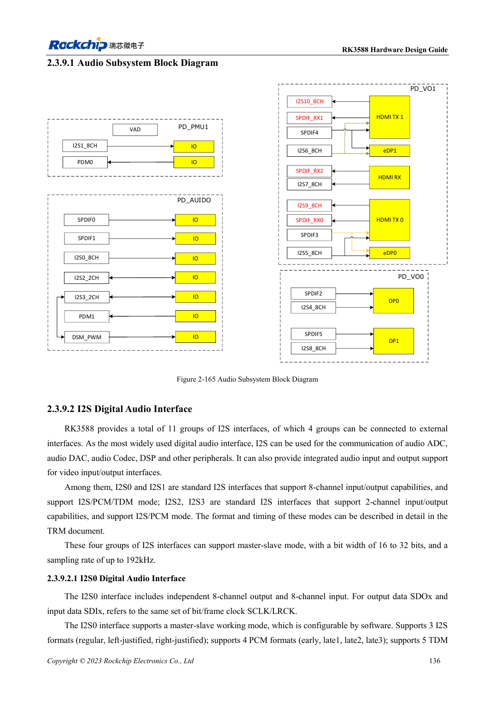
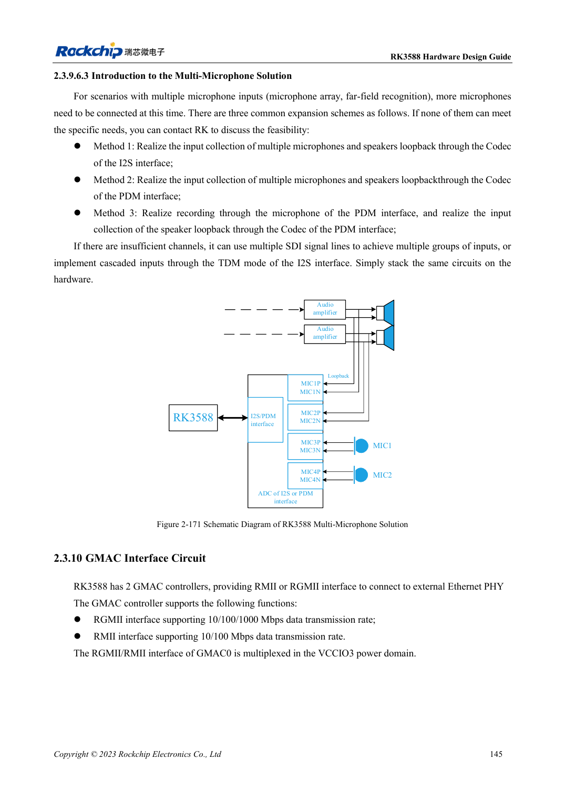

<!-- rk3588-hardware-v13-20261109 -->

# RK3588-Audiohardware: I2S, PDM und Mikrofonarrays

Grundlage sind die chinesische und englische Ausgabe des RK3588 Hardware Design Guide V1.3 (2023-02-13) für SoC-Platinen und Träger. AIM7- und LM7-Träger müssen den Moduldefinitionen folgen; Sige7 dient zur Software- und Peripherieprüfung. SoC-Funktionen sind keine Boardanschlussliste. SDK/BSP, Kernel, Boardrevision und Firmware prüfen. Werte sind Quellenreferenzen, keine ArmSoM-Messungen.

**RK3588 Hardware Design Guide V1.3 (2023-02-13), EN** · §2.3.9; §3.4.20

## Interne und externe Schnittstellen trennen

Nur vier von elf I2S sind extern, andere dienen Video. I2S0/1 unterstützen acht Kanäle und I2S/PCM/TDM, I2S2/3 zwei Kanäle I2S/PCM. Interne Zahlen sind keine Trägerportzahlen. Nach Codec/ADC/DAC Master/Slave, MCLK, SCLK/LRCK, Wortbreite und Abtastrate festlegen.

## Takte und Analogpfade gemeinsam prüfen

Takte mehrerer I2S/PDM-Geräte als Daisy-Chain ohne lange Äste führen. Empfohlen sind 22Ω am SoC und getrennte Masseabschirmung der Takte. Mikrofone und Verstärker von DDR, Display, HF und Induktivitäten fernhalten. Arrays mit Wiedergabereferenz brauchen Synchronisations- und Softwarezuordnungsprüfung.

## Entwurfsparameter und Prüftabelle

| Punkt | Quellenreferenz |
| --- | --- |
| Externe I2S | 4 Gruppen |
| I2S0/1; I2S2/3 | 8 Kanäle; 2 Kanäle |
| Quellenbreite/Abtastrate | 16–32bit / bis 192kHz |
| Takt-Serienreferenz | 22Ω |

## Quellenabbildungen

Die Referenzseiten enthalten die zugehörigen Schalt- oder Zeitdiagramme; für volle Auflösung anklicken. Bezeichner und Werte gehören zum Referenzentwurf, nicht zum Schaltplan eines ArmSoM-Produkts.

Englisches Original · PDF 158 · 2-165

Englisches Original · PDF 167 · 2-171

## Entwicklung mit ArmSoM

AIM7 unterstützt Compute-Modul-Träger, LM7 die LGA-Modulintegration und Sige7 frühe Software-/Peripherieerprobung. Vor dem Trägerdesign klären, welche Versorgung, DDR- und Bootschaltungen bereits integriert sind. SoC-Referenzschaltungen nicht unnötig duplizieren. Anschlüsse, herausgeführte Schnittstellen, Pegel und Systemunterstützung anhand der Produktunterlagen prüfen.

- [ArmSoM AIM7](https://www.armsom.org/aim7) · [AIM7 Docs](https://docs.armsom.org/armsom-aim7)
- [ArmSoM Sige7](https://www.armsom.org/sige7) · [Sige7 Docs](https://docs.armsom.org/armsom-sige7)
- [ArmSoM LM7](https://www.armsom.org/lm7) · [LM7 Docs](https://docs.armsom.org/armsom-lm7)

## Weiterlesen

- [RK3588-Hardwaredesign: 30 Themen](/de/articles/rk3588-hardware-design-series/)
- [RK3588-DP und eDP: PHYs, AUX und Kopplung](/de/articles/rk3588-dp-edp-hardware-design/)
- [RK3588-Ethernet: GMAC, PHY und Taktrichtung](/de/articles/rk3588-gmac-hardware-design/)
