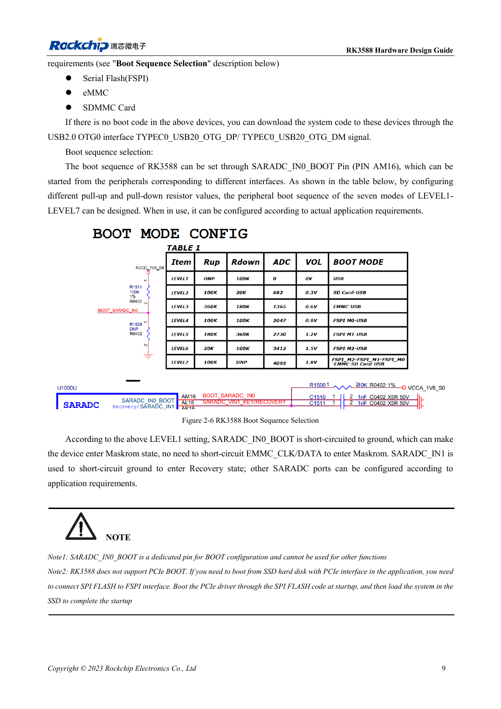
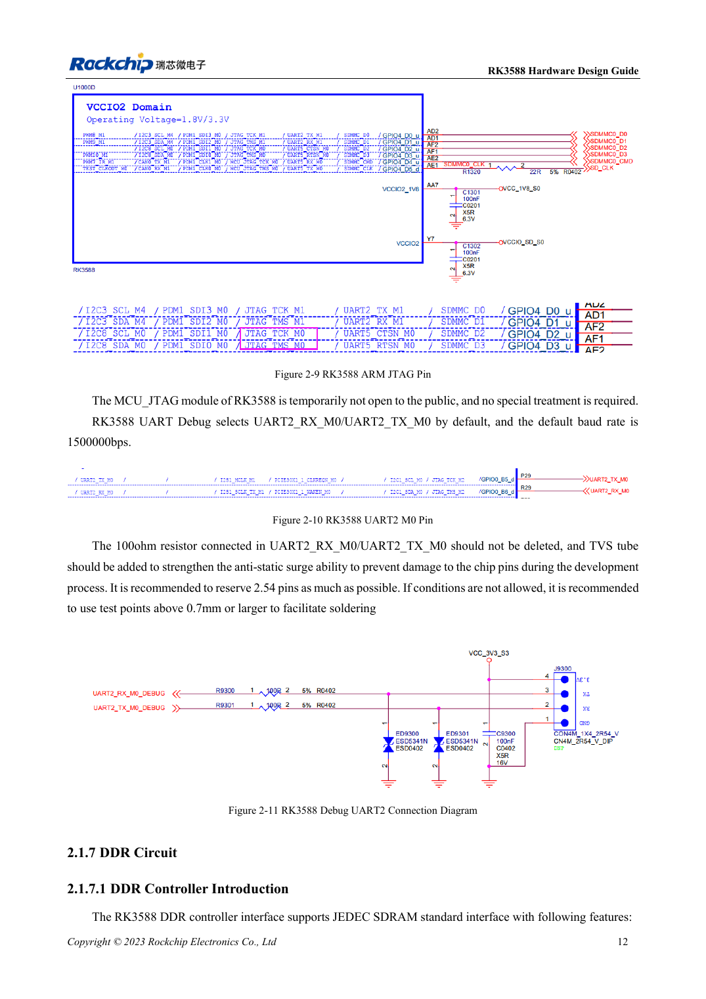

<!-- rk3588-hardware-v13-20261109 -->

# RK3588-Boot und Recovery: Maskrom, JTAG und UART

Grundlage sind die chinesische und englische Ausgabe des RK3588 Hardware Design Guide V1.3 (2023-02-13) für SoC-Platinen und Träger. AIM7- und LM7-Träger müssen den Moduldefinitionen folgen; Sige7 dient zur Software- und Peripherieprüfung. SoC-Funktionen sind keine Boardanschlussliste. SDK/BSP, Kernel, Boardrevision und Firmware prüfen. Werte sind Quellenreferenzen, keine ArmSoM-Messungen.

**RK3588 Hardware Design Guide V1.3 (2023-02-13), EN** · §2.1.4–2.1.6; §2.3.2

## Recovery-Pfad erhalten

SARADC_IN0_BOOT an AM16 dient nur der Startauswahl; LEVEL1 wählt Maskrom. USB2.0 OTG0 für Downloads erhalten. Das ROM startet nicht direkt von PCIe-SSD: FSPI-Code initialisiert PCIe und lädt anschließend das SSD-System. Ein OS auf NVMe bedeutet keinen nativen NVMe-ROM-Boot.

## Debug und Pull-ups erhalten

SDMMC_DET vor Resetende stabilisieren: Low für SDMMC, High für ARM JTAG. Logs standardmäßig über UART2_M0 mit 1500000bps; 100Ω in RX/TX und TVS erhalten. 10kΩ an SARADC_IN1 vermeiden einen undefinierten Recovery-Eingang. Bei Modulen Steckerpins und Pegel prüfen, nicht SoC-Ballpositionen übernehmen.

## Entwurfsparameter und Prüftabelle

| Punkt | Quellenreferenz |
| --- | --- |
| Boot-Pin | SARADC_IN0_BOOT / AM16 |
| Debugging | UART2_M0 / 1500000bps |
| SDMMC_DET | 0: SDMMC; 1: ARM JTAG |
| Recovery-Pull-up | SARADC_IN1: 10kΩ |

## Quellenabbildungen

Die Referenzseiten enthalten die zugehörigen Schalt- oder Zeitdiagramme; für volle Auflösung anklicken. Bezeichner und Werte gehören zum Referenzentwurf, nicht zum Schaltplan eines ArmSoM-Produkts.

Englisches Original · PDF 31 · 2-6

Englisches Original · PDF 34 · 2-10

## Entwicklung mit ArmSoM

AIM7 unterstützt Compute-Modul-Träger, LM7 die LGA-Modulintegration und Sige7 frühe Software-/Peripherieerprobung. Vor dem Trägerdesign klären, welche Versorgung, DDR- und Bootschaltungen bereits integriert sind. SoC-Referenzschaltungen nicht unnötig duplizieren. Anschlüsse, herausgeführte Schnittstellen, Pegel und Systemunterstützung anhand der Produktunterlagen prüfen.

- [ArmSoM AIM7](https://www.armsom.org/aim7) · [AIM7 Docs](https://docs.armsom.org/armsom-aim7)
- [ArmSoM Sige7](https://www.armsom.org/sige7) · [Sige7 Docs](https://docs.armsom.org/armsom-sige7)
- [ArmSoM LM7](https://www.armsom.org/lm7) · [LM7 Docs](https://docs.armsom.org/armsom-lm7)

## Weiterlesen

- [RK3588-Hardwaredesign: 30 Themen](/de/articles/rk3588-hardware-design-series/)
- [RK3588-Reset, Watchdog und Temperaturschutz](/de/articles/rk3588-reset-watchdog-hardware/)
- [RK3588-Versorgung: Startanforderungen und ungenutzte PHYs](/de/articles/rk3588-power-rail-planning/)
