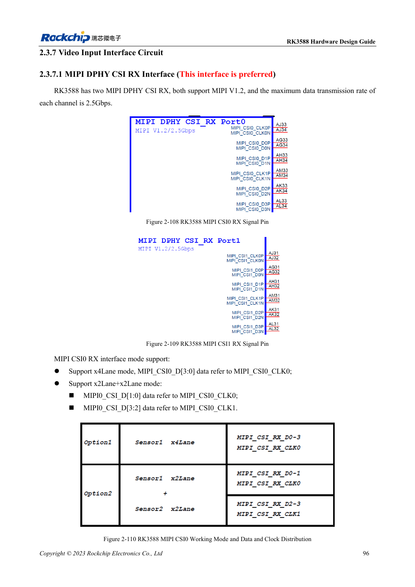
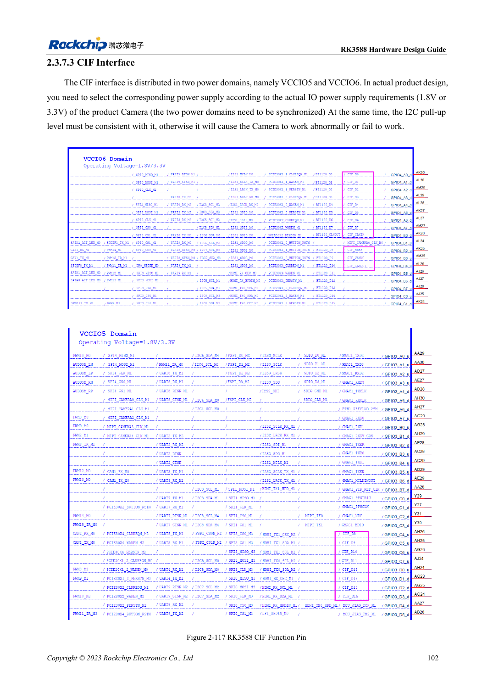

<!-- rk3588-hardware-v13-20261109 -->

# RK3588-Kameras: CSI, D/C-PHY und CIF planen

Grundlage sind die chinesische und englische Ausgabe des RK3588 Hardware Design Guide V1.3 (2023-02-13) für SoC-Platinen und Träger. AIM7- und LM7-Träger müssen den Moduldefinitionen folgen; Sige7 dient zur Software- und Peripherieprüfung. SoC-Funktionen sind keine Boardanschlussliste. SDK/BSP, Kernel, Boardrevision und Firmware prüfen. Werte sind Quellenreferenzen, keine ArmSoM-Messungen.

**RK3588 Hardware Design Guide V1.3 (2023-02-13), EN** · §2.3.7.1–2.3.7.3; §3.4.12; §3.4.24

## Nach Sensor und PHY zuordnen

Bevorzugt werden dedizierte MIPI-DPHY-CSI-RX. Beide Schnittstellen unterstützen vier Lanes oder zwei Zweiergruppen mit passenden Takten. D/C-Combo-PHYs haben weitere Modusgrenzen; freie Pins erlauben keine beliebigen Kombinationen. Format, Rate, Versorgung, Reset, MCLK und I2C vor der Steckerwahl prüfen.

## CIF-Pegel und Systemprüfung

CIF liegt in VCCIO5/VCCIO6; beide Versorgungen samt I2C-Pull-ups müssen zum Sensor passen. MIPI-Verdrahtung belegt keine BSP-Unterstützung: Treiber, Device Tree und ISP-Konfiguration bleiben nötig. Erst einen Stream, dann Mehrfachbetrieb, Dauerlast, Bildverluste, Taktstabilität und Temperatur prüfen.

## Entwurfsparameter und Prüftabelle

| Punkt | Quellenreferenz |
| --- | --- |
| Rate des dedizierten DPHY RX | 2.5Gbps/lane |
| DPHY-Zielimpedanz | 100Ω ±10%; Alternative 95Ω ±10% |
| DPHY-Paar-/Takt-Daten-Differenz | <6mil / <12mil |

## Quellenabbildungen

Die Referenzseiten enthalten die zugehörigen Schalt- oder Zeitdiagramme; für volle Auflösung anklicken. Bezeichner und Werte gehören zum Referenzentwurf, nicht zum Schaltplan eines ArmSoM-Produkts.

Englisches Original · PDF 118 · 2-110

Englisches Original · PDF 124 · 2-117

## Entwicklung mit ArmSoM

AIM7 unterstützt Compute-Modul-Träger, LM7 die LGA-Modulintegration und Sige7 frühe Software-/Peripherieerprobung. Vor dem Trägerdesign klären, welche Versorgung, DDR- und Bootschaltungen bereits integriert sind. SoC-Referenzschaltungen nicht unnötig duplizieren. Anschlüsse, herausgeführte Schnittstellen, Pegel und Systemunterstützung anhand der Produktunterlagen prüfen.

- [ArmSoM AIM7](https://www.armsom.org/aim7) · [AIM7 Docs](https://docs.armsom.org/armsom-aim7)
- [ArmSoM Sige7](https://www.armsom.org/sige7) · [Sige7 Docs](https://docs.armsom.org/armsom-sige7)
- [ArmSoM LM7](https://www.armsom.org/lm7) · [LM7 Docs](https://docs.armsom.org/armsom-lm7)

## Weiterlesen

- [RK3588-Hardwaredesign: 30 Themen](/de/articles/rk3588-hardware-design-series/)
- [RK3588-PCIe: Lanes, Referenztakte und Versorgung](/de/articles/rk3588-pcie-hardware-design/)
- [RK3588-HDMI-RX: Capture-Eingang, CEC und DDC](/de/articles/rk3588-hdmi-rx-hardware-design/)
