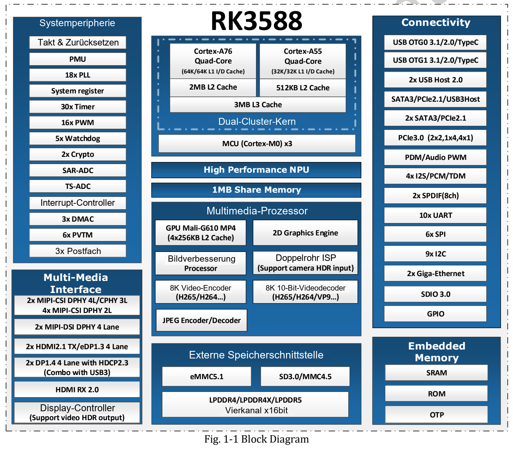

RK3588 verbindet Rechenleistung, Bildverarbeitung, Video und schnelle Peripherie. ArmSoM bietet Sige7 für direkte Anwendungsprototypen, AIM7 für steckbare Module und LM7 für LGA-Integration. Entscheidend ist zunächst der Datenweg vom Eingang über die Verarbeitung bis zur Ausgabe.

## Rechenarchitektur und Aufgaben

| Einheit | Datasheet V1.4 | Aufgabe |
|---|---|---|
| CPU | 4× Cortex-A76 + 4× Cortex-A55, 3MB gemeinsamer L3 | Anwendungslogik, Dienste, Vor- und Nachverarbeitung |
| GPU | Mali-G610 MP4, OpenGL ES 3.2, OpenCL 2.2, Vulkan 1.2 | Grafik und vom Treiber unterstützte Berechnungen |
| NPU | Drei Kerne, einzeln, zu zweit oder gemeinsam; bis 6 TOPS | Unterstützte, konvertierte neuronale Netze |
| Speicher | Vier 16-bit-Kanäle, LPDDR4/4X/5, bis 32GB Adressraum | Modelle, Multitasking, Bildpuffer |
| Erweiterung | PCIe 3.0 und PCIe 2.x/SATA/USB-Kombischnittstellen | Speicher, Peripherie, Erfassung |

Die Grafik-API-Versionen stammen aus dieser Dokumentrevision; ihre Verfügbarkeit hängt von Betriebssystem und Treiber ab. 6 TOPS sind weder Modellbilder/s noch Sprachmodell-Tokens/s. Präzision, Eingabeform, Operatoren, Runtime und Messbedingungen gehören zum Vergleich. Eine Sparsity-Fußnote eines anderen Chips darf nicht auf dieses Dokument übertragen werden.

## Nicht jeder Codec erreicht 8K60

| Codec und Richtung | Grenze in V1.4 |
|---|---|
| H.265, VP9, AVS2 dekodieren | 8K60 |
| H.264 dekodieren | 8K30 |
| AV1 dekodieren | 4K60 |
| H.264/H.265 kodieren | 8K30 |

Diese Werte gelten für bestimmte Codec-Konfigurationen, nicht automatisch für gleichzeitig laufende Streams. Dekodierung, Skalierung, Inferenz, Anzeige und Speicherung einzeln prüfen; Kopien, Bandbreite und Dauertemperatur beobachten.

## ISP-Auflösung benötigt einen Betriebsmodus

V1.4 nennt Dual-ISP-Modi mit 48M (8064×6048@15) und 32M (6528×4898@30) sowie einen Single-ISP-Modus mit 16M (4672×3504@30). Angaben wie 48MP, 32MP und zweimal 16MP beschreiben nicht dieselben Bedingungen. Kameras benötigen außerdem Sensortreiber, Tuning, Optik und Synchronisation.

Ein Prüfprototyp kann Kamera → ISP → RGA-Vorverarbeitung → NPU → CPU-Entscheidung → Anzeige/Meldung verwenden. Beleuchtung und Aufnahmebedingungen vor der Modelloptimierung stabilisieren. Dies ist ein Architekturvorschlag, kein ArmSoM-Prüfbenchmark.

## RK3588 oder RK3588S: Erweiterungen prüfen

Die zentralen Rechenaufgaben ähneln sich. PCIe 3.0 und HDMI-Eingang des RK3588 dürfen jedoch nicht in RK3588S-Produktspezifikationen übernommen werden. Für SSDs, Videoerfassung und Schnittstellenkombinationen sind SoC, Schaltplan und herausgeführte Anschlüsse maßgeblich. Multiplexfunktionen sind nicht zwangsläufig gleichzeitig verfügbar.

## ArmSoM-Plattform auswählen

- **Sige7:** Bildschirm, Netzwerk und Speicher direkt für Softwaretests anschließen.
- **AIM7:** passendes Trägerboard für ein steckbares Modul prüfen.
- **LM7:** Modul in ein Produkt mit eigener Mechanik, Anschlüssen und Fertigung integrieren.

Hardwareversion und Systemimage bleiben entscheidend. Anwendungscode und Modellerfahrung lassen sich teilweise übertragen; Device Tree, Versorgung, Kameras und Kühlung müssen weiterhin angepasst werden. Die Vorschläge enthalten keine gemessenen Leistungs-, Verbrauchs- oder Kundeneinsatzversprechen.

## Artikelserie und Produkte

- [AIM7 als Jetson-Nano/Orin-Alternative: Hardwareprüfung und RKNN-Migration](/de/articles/aim7-jetson-nano-orin-alternative/)
- [Sige7 und LM7: sechs RK3588-Anwendungen vom Prototyp zum Produkt](/de/articles/sige7-lm7-rk3588-applications/)
- [RK3588 Datasheet V1.4: Download, Blockdiagramm, Gehäuse und Elektrik](/de/articles/rk3588-datasheet-v14/)
- [ArmSoM AIM7](https://docs.armsom.org/armsom-aim7) · [Sige7](https://docs.armsom.org/armsom-sige7) · [LM7](https://docs.armsom.org/armsom-lm7)

## Quellen

- [Rockchip RK3588](https://www.rock-chips.com/a/en/products/RK35_Series/2022/0926/1660.html)
- [ArmSoM AIM7](https://docs.armsom.org/armsom-aim7)
- [ArmSoM Sige7](https://docs.armsom.org/armsom-sige7)
- [ArmSoM LM7](https://docs.armsom.org/armsom-lm7)
- [NVIDIA Jetson modules](https://developer.nvidia.com/embedded/jetson-modules)
- [RKNN-Toolkit2](https://github.com/airockchip/rknn-toolkit2)
