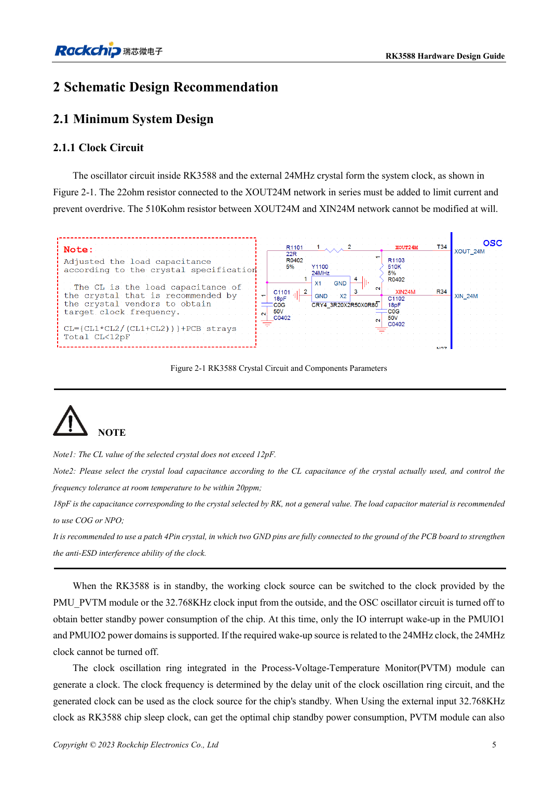
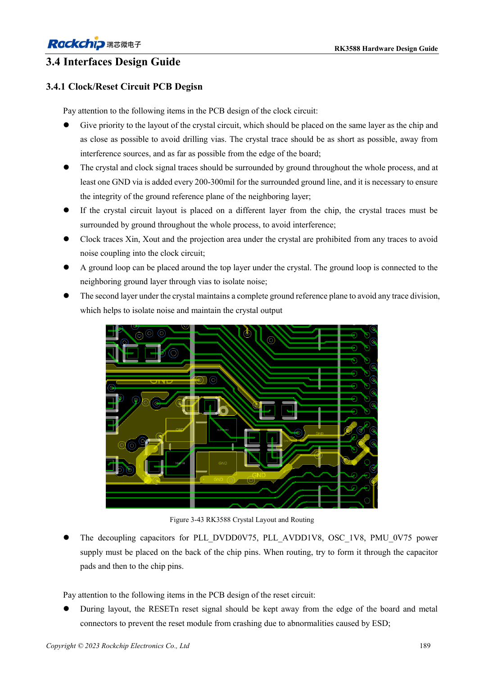

<!-- rk3588-hardware-v13-20261109 -->

# RK3588-Takte: 24MHz, 32kHz und Layout

Grundlage sind die chinesische und englische Ausgabe des RK3588 Hardware Design Guide V1.3 (2023-02-13) für SoC-Platinen und Träger. AIM7- und LM7-Träger müssen den Moduldefinitionen folgen; Sige7 dient zur Software- und Peripherieprüfung. SoC-Funktionen sind keine Boardanschlussliste. SDK/BSP, Kernel, Boardrevision und Firmware prüfen. Werte sind Quellenreferenzen, keine ArmSoM-Messungen.

**RK3588 Hardware Design Guide V1.3 (2023-02-13), EN** · §2.1.1; §3.4.1

## Last zum Quarz passend wählen

22Ω an XOUT24M begrenzen die Anregung; 510kΩ zwischen XOUT24M und XIN24M nicht beliebig ändern. Quarz-CL ≤12pF. Die gezeigten 18pF gelten für den Referenzquarz; reale Last aus CL und Parasiten bestimmen, vorzugsweise C0G/NP0 und Vierpad-Quarz. Auch Tastkopfkapazität beeinflusst die Schwingung.

## Aufwecken und PCB gemeinsam prüfen

Vor dem Abschalten von 24MHz die Aufweckabhängigkeiten prüfen. Der Sparpfad nutzt PMU_PVTM oder externe 32.768kHz und passende PMUIO1/2-IOs. Quarz möglichst nah und gleichseitig zum SoC platzieren; fremde Leiter unter Quarz/XIN/XOUT vermeiden, Nachbargrundfläche erhalten und Abschirmmasse alle 200–300mil verbinden.

## Entwurfsparameter und Prüftabelle

| Punkt | Quellenreferenz |
| --- | --- |
| 24MHz-Toleranz | ≤20ppm |
| 32.768kHz-Toleranz | ±30ppm |
| 32kHz-Tastgrad | 45–55% |
| 32kHz-Amplitude | 0.7×VDD … VDD; VDD=PMUIO1 |

## Quellenabbildungen

Die Referenzseiten enthalten die zugehörigen Schalt- oder Zeitdiagramme; für volle Auflösung anklicken. Bezeichner und Werte gehören zum Referenzentwurf, nicht zum Schaltplan eines ArmSoM-Produkts.

Englisches Original · PDF 27 · 2-1

Englisches Original · PDF 211 · 3-43

## Entwicklung mit ArmSoM

AIM7 unterstützt Compute-Modul-Träger, LM7 die LGA-Modulintegration und Sige7 frühe Software-/Peripherieerprobung. Vor dem Trägerdesign klären, welche Versorgung, DDR- und Bootschaltungen bereits integriert sind. SoC-Referenzschaltungen nicht unnötig duplizieren. Anschlüsse, herausgeführte Schnittstellen, Pegel und Systemunterstützung anhand der Produktunterlagen prüfen.

- [ArmSoM AIM7](https://www.armsom.org/aim7) · [AIM7 Docs](https://docs.armsom.org/armsom-aim7)
- [ArmSoM Sige7](https://www.armsom.org/sige7) · [Sige7 Docs](https://docs.armsom.org/armsom-sige7)
- [ArmSoM LM7](https://www.armsom.org/lm7) · [LM7 Docs](https://docs.armsom.org/armsom-lm7)

## Weiterlesen

- [RK3588-Hardwaredesign: 30 Themen](/de/articles/rk3588-hardware-design-series/)
- [RK3588-Edge-AI-Hardware: von der Last zur Prüfung](/de/articles/rk3588-edge-ai-hardware-design/)
- [RK3588-Reset, Watchdog und Temperaturschutz](/de/articles/rk3588-reset-watchdog-hardware/)
