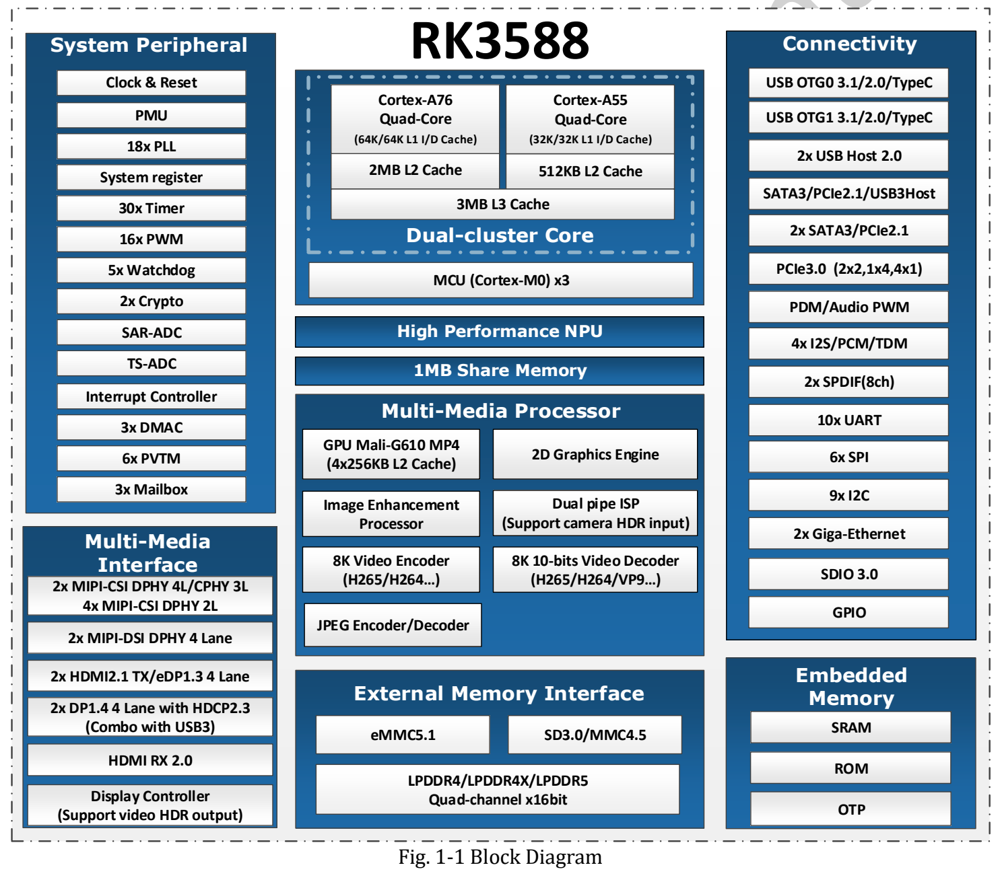
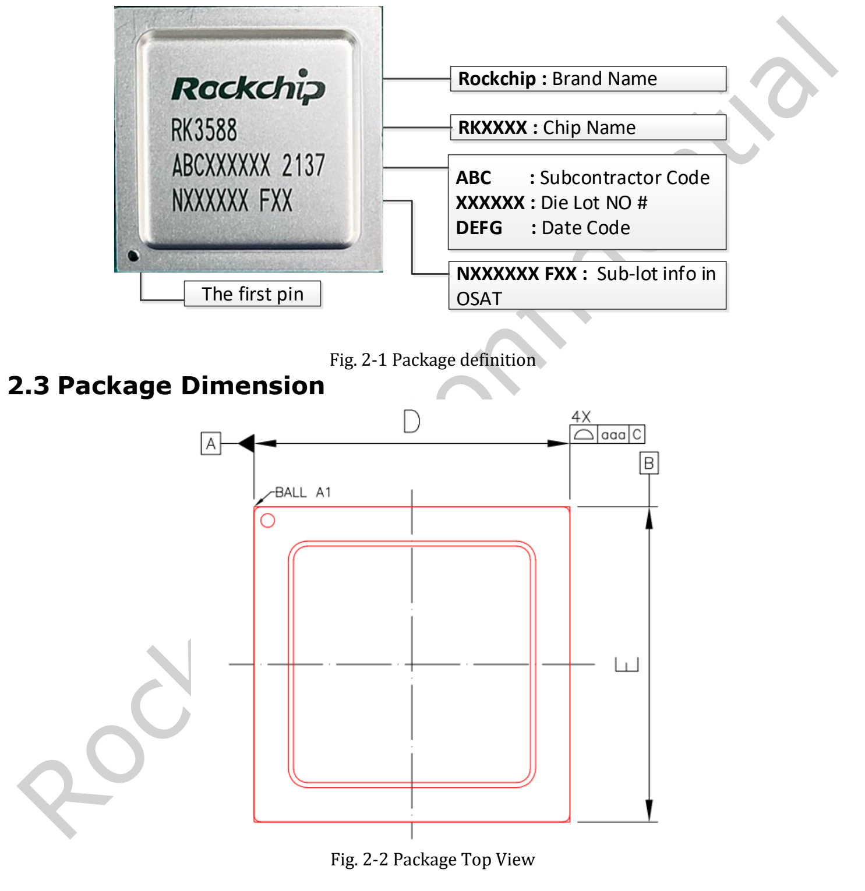
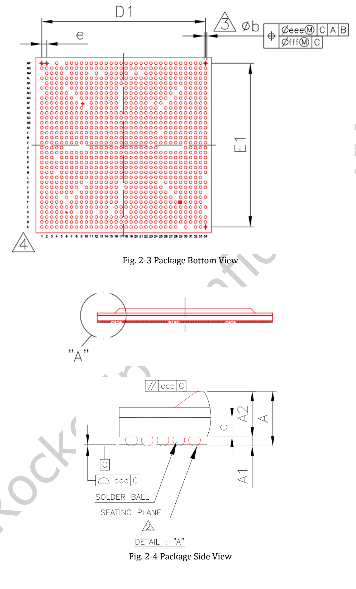
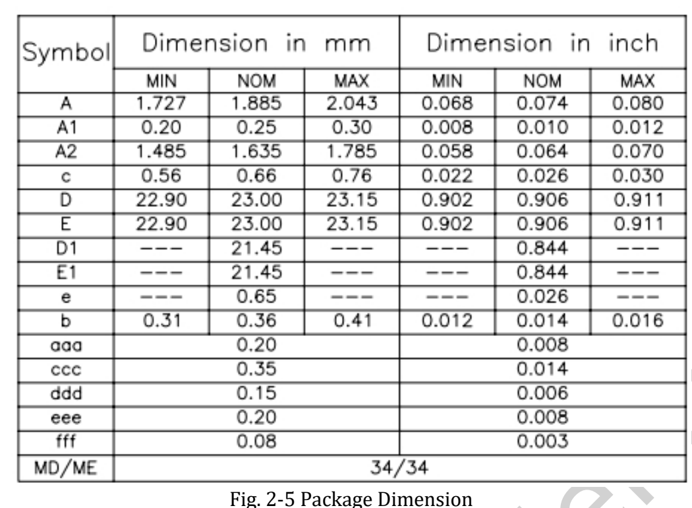

**RK3588 Datasheet V1.4 vom 2022-05-24 umfasst 34 Seiten** über Funktionen, Gehäuse, Pins, Elektrik und Wärme. Dieser Artikel ist ein Lese- und Entwurfsleitfaden, keine zeilenweise Übersetzung. Das vollständige Original bleibt verfügbar.

[Original-PDF herunterladen](/assets/rk3588/Rockchip-RK3588-Datasheet-V1.4-20220524.pdf)

## Dokumentübersicht

| Seiten | Inhalt | Zweck |
|---|---|---|
| 6–16 | CPU, Speicher, NPU, Video, Display, Schnittstellen | Architektur und Funktionsprüfung |
| 16 | Blockdiagramm | Blöcke und Multiplexing |
| 17–19 | Markierung, Abmessungen, MSL, Ballmaterial | Gehäuse und Fertigung |
| 19–27 | Pin-Tabelle | SoC-Signale und Versorgungsdomänen |
| 28 | Absolute Ratings | Grenzwerte, keine Arbeitspunkte |
| 29–33 | Empfohlene Bedingungen, Schnittstellenwerte | Versorgungs- und Signaldesign |
| 34 | Wärmemanagement | Referenz unter angegebenen Bedingungen |

## Architektur und Berechnung

Vier A76 und vier A55 teilen 3MB L3; jeder A76 hat 512KB L2, jeder A55 128KB L2. Vier 16-bit-Kanäle unterstützen LPDDR4/4X/5 bis 32GB Adressraum. Die NPU mit drei Kernen erreicht laut Spezifikation bis 6 TOPS; INT4/INT8/INT16, FP16, BF16 und TF32 sind aufgeführt. Das garantiert nicht jede Operatorkombination in jeder Toolversion.

## Video, ISP und offene Quellstellen

Detailliert aufgeführt sind H.265/VP9/AVS2 8K60, H.264 8K30 und AV1 4K60 beim Dekodieren sowie H.264/H.265 8K30 beim Kodieren. ISP-Modi umfassen Dual-ISP 48M@15 und 32M@30 sowie Single-ISP 16M@30; vollständige Auflösung und Betriebsmodus berücksichtigen.

Der Abschnitt JPEG Decoder auf Seite 9 endet mit „Embedded four encoder units“. Die Abweichung zur Überschrift wird nicht stillschweigend zu vier Decodern korrigiert und muss vor einer entsprechenden Designentscheidung geklärt werden. Öffentliche Seiten und PDF unterscheiden sich außerdem bei Grafik-API-, ISP- und DP-Angaben. Maßgeblich ist hier die benannte Revision, nicht die Behauptung einer neuesten Fassung.

## Gehäuse und Abmessungen

FCBGA1088L: 23×23mm, nominal 0.36mm Balldurchmesser, 0.65mm Raster, MSL3, SnAgCu. V1.4 aktualisiert unter anderem Gehäusemaße und Blockdiagramm. Das PCB-Footprint benötigt vollständige Toleranzen und offizielle Designdateien.

## Elektrik und Wärme

Seite 30 nennt maximal 2.2–2.4GHz CPU, 1000MHz GPU/NPU und 0–80°C Umgebung. Dies sind Angaben dieser Revision, keine Garantie dauerhaft maximaler Frequenzen auf jedem Board.

Seite 34 verlangt eine Sperrschichttemperatur unter 125°C und nennt θJA=8.7, θJB=3.5, θJC=0.12°C/W. Die Simulationsreferenz verwendet eine 10-lagige 114×101mm-Platine bei 25°C Umgebung und verlangt physische Validierung. Werte nicht direkt auf beliebige Gehäuse, Kühlkörper oder LM7/AIM7 übertragen. Sperrschicht- und Umgebungstemperatur sind verschieden.

## ArmSoM-Integration

Bei Sige7 mit Boardversorgung und Kühlung beginnen. AIM7 benötigt die Modulsteckerprüfung, LM7 das LGA-Modul-Footprint und dessen Versorgungsvorgaben. SoC-Balls sind keine Modulsteckerpins. Elektrische Werte wurden hier nicht nachgemessen; Original-PDF und Bildmarkierungen bleiben erhalten.

## Artikelserie und Produkte

- [RK3588 erklärt: acht CPU-Kerne, 6-TOPS-NPU und schnelle Erweiterung](/de/articles/rk3588-chip-guide/)
- [AIM7 als Jetson-Nano/Orin-Alternative: Hardwareprüfung und RKNN-Migration](/de/articles/aim7-jetson-nano-orin-alternative/)
- [Sige7 und LM7: sechs RK3588-Anwendungen vom Prototyp zum Produkt](/de/articles/sige7-lm7-rk3588-applications/)
- [ArmSoM AIM7](https://docs.armsom.org/armsom-aim7) · [Sige7](https://docs.armsom.org/armsom-sige7) · [LM7](https://docs.armsom.org/armsom-lm7)

## Quellen

- [Rockchip RK3588](https://www.rock-chips.com/a/en/products/RK35_Series/2022/0926/1660.html)
- [ArmSoM AIM7](https://docs.armsom.org/armsom-aim7)
- [ArmSoM Sige7](https://docs.armsom.org/armsom-sige7)
- [ArmSoM LM7](https://docs.armsom.org/armsom-lm7)
- [NVIDIA Jetson modules](https://developer.nvidia.com/embedded/jetson-modules)
- [RKNN-Toolkit2](https://github.com/airockchip/rknn-toolkit2)
