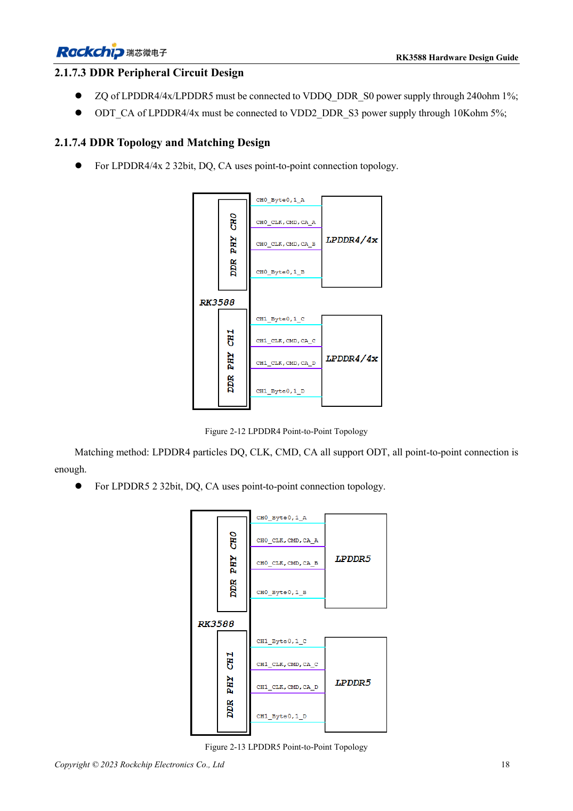
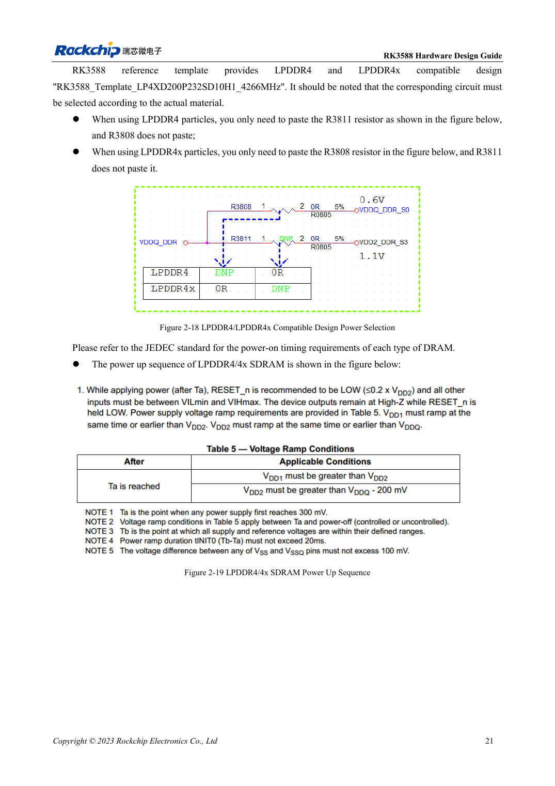

<!-- rk3588-hardware-v13-20261109 -->

# RK3588-DDR-Schaltung: LPDDR4/4X/5 und Kapazität

Grundlage sind die chinesische und englische Ausgabe des RK3588 Hardware Design Guide V1.3 (2023-02-13) für SoC-Platinen und Träger. AIM7- und LM7-Träger müssen den Moduldefinitionen folgen; Sige7 dient zur Software- und Peripherieprüfung. SoC-Funktionen sind keine Boardanschlussliste. SDK/BSP, Kernel, Boardrevision und Firmware prüfen. Werte sind Quellenreferenzen, keine ArmSoM-Messungen.

**RK3588 Hardware Design Guide V1.3 (2023-02-13), EN** · §2.1.7

## Kapazität und Vorlage gemeinsam wählen

V1.3 beschreibt vier 16-Bit-Kanäle, insgesamt 64 Bit, bis 8GB pro Kanal und 32GB gesamt. Die 32-Bit-CH0/CH1 dürfen keine unterschiedlichen Kapazitäten wie 4GB+2GB nutzen. Das gilt für diese Anleitung, nicht automatisch für Varianten oder spätere BSPs. Speicherteil, Gehäuse, Firmware und Vorlage gemeinsam bestätigen.

## Spannung und Mapping sind kein Namenswechsel

Zwei 32-Bit-Bausteine nutzen Punkt-zu-Punkt-DQ/CA. Die Vorlage bestückt für LPDDR4 R3811 ohne R3808, für LPDDR4X umgekehrt. Bezeichner gelten nur für die Vorlage; andere Schaltplannetze prüfen. LPDDR5 braucht eigene WCK-, Mapping- und Versorgungsvorgaben. AIM7/LM7 integrieren DDR; Trägerarbeit betrifft Eingang, Schnittstellen und Kühlung.

## Entwurfsparameter und Prüftabelle

| Punkt | Quellenreferenz |
| --- | --- |
| V1.3-Bus | 4×16bit =64bit |
| V1.3-Adressierung | 8GB/Kanal; 32GB gesamt |
| CH0 / CH1 | Gleiche Kapazität |

## Quellenabbildungen

Die Referenzseiten enthalten die zugehörigen Schalt- oder Zeitdiagramme; für volle Auflösung anklicken. Bezeichner und Werte gehören zum Referenzentwurf, nicht zum Schaltplan eines ArmSoM-Produkts.

Englisches Original · PDF 40 · 2-12

Englisches Original · PDF 43 · 2-18

## Entwicklung mit ArmSoM

AIM7 unterstützt Compute-Modul-Träger, LM7 die LGA-Modulintegration und Sige7 frühe Software-/Peripherieerprobung. Vor dem Trägerdesign klären, welche Versorgung, DDR- und Bootschaltungen bereits integriert sind. SoC-Referenzschaltungen nicht unnötig duplizieren. Anschlüsse, herausgeführte Schnittstellen, Pegel und Systemunterstützung anhand der Produktunterlagen prüfen.

- [ArmSoM AIM7](https://www.armsom.org/aim7) · [AIM7 Docs](https://docs.armsom.org/armsom-aim7)
- [ArmSoM Sige7](https://www.armsom.org/sige7) · [Sige7 Docs](https://docs.armsom.org/armsom-sige7)
- [ArmSoM LM7](https://www.armsom.org/lm7) · [LM7 Docs](https://docs.armsom.org/armsom-lm7)

## Weiterlesen

- [RK3588-Hardwaredesign: 30 Themen](/de/articles/rk3588-hardware-design-series/)
- [RK3588 und RK806: Einzel- und Doppel-PMIC](/de/articles/rk3588-rk806-pmic-design/)
- [RK3588-DDR-Routing: Längen- und Laufzeitabgleich](/de/articles/rk3588-ddr-pcb-routing/)
