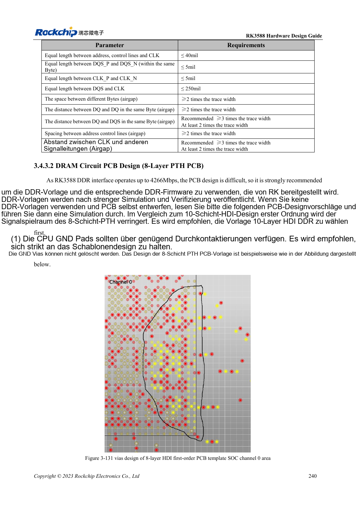
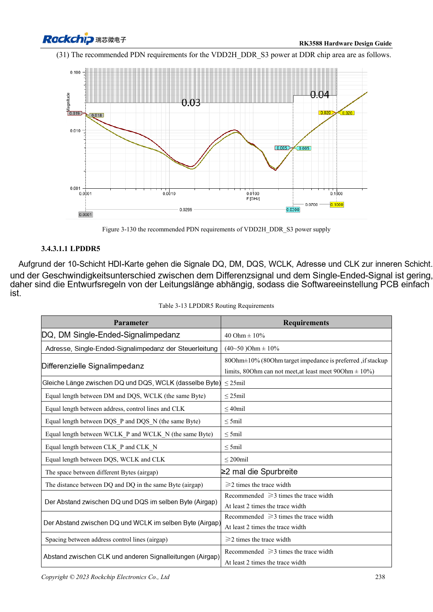

<!-- rk3588-hardware-v13-20261109 -->

# RK3588-DDR-Routing: Längen- und Laufzeitabgleich

Grundlage sind die chinesische und englische Ausgabe des RK3588 Hardware Design Guide V1.3 (2023-02-13) für SoC-Platinen und Träger. AIM7- und LM7-Träger müssen den Moduldefinitionen folgen; Sige7 dient zur Software- und Peripherieprüfung. SoC-Funktionen sind keine Boardanschlussliste. SDK/BSP, Kernel, Boardrevision und Firmware prüfen. Werte sind Quellenreferenzen, keine ArmSoM-Messungen.

**RK3588 Hardware Design Guide V1.3 (2023-02-13), EN** · §3.4.3

## Regeln passend zum Aufbau

10-Lagen-HDI wird bevorzugt und für LPDDR5 verwendet. Innenlagen nach Länge abgleichen; 8-Lagen-PTH für LPDDR4/4X braucht Laufzeitabgleich wegen unterschiedlicher Lagen, Vias und Gehäuse. 16ps sind nicht 16mil; Umrechnung ist materialabhängig. Vorlage, Speicher und DDR-Firmware gemeinsam dokumentieren.

## Bytegruppen definieren

LPDDR5-Tabelle 3-13: DQ/DM zu DQS/WCLK im Byte ≤25mil, Adresse/Steuerung zu CLK ≤40mil, innerhalb eines Paars ≤5mil. Tabelle 3-16 für 8-Lagen-LPDDR4X nennt dagegen ≤16ps im Byte und ≤1ps im Paar. Traininglogs, Stress bei Zielfrequenz, Temperatur und Kaltstartwiederholungen prüfen; ein Start belegt keine Reserve.

## Entwurfsparameter und Prüftabelle

| Punkt | Quellenreferenz |
| --- | --- |
| LPDDR5-DQ/DM-Impedanz | 40Ω ±10% |
| LPDDR5-Adresse/Steuerung | 40–50Ω ±10% |
| LPDDR5-Differenzziel | 80Ω ±10%; Quellenalternative 90Ω ±10% |
| LPDDR4X-Byteabweichung, 8 Lagen | ≤16ps |

## Quellenabbildungen

Die Referenzseiten enthalten die zugehörigen Schalt- oder Zeitdiagramme; für volle Auflösung anklicken. Bezeichner und Werte gehören zum Referenzentwurf, nicht zum Schaltplan eines ArmSoM-Produkts.

Englisches Original · PDF 262 · 3-131

Englisches Original · PDF 260 · table:3-13

## Entwicklung mit ArmSoM

AIM7 unterstützt Compute-Modul-Träger, LM7 die LGA-Modulintegration und Sige7 frühe Software-/Peripherieerprobung. Vor dem Trägerdesign klären, welche Versorgung, DDR- und Bootschaltungen bereits integriert sind. SoC-Referenzschaltungen nicht unnötig duplizieren. Anschlüsse, herausgeführte Schnittstellen, Pegel und Systemunterstützung anhand der Produktunterlagen prüfen.

- [ArmSoM AIM7](https://www.armsom.org/aim7) · [AIM7 Docs](https://docs.armsom.org/armsom-aim7)
- [ArmSoM Sige7](https://www.armsom.org/sige7) · [Sige7 Docs](https://docs.armsom.org/armsom-sige7)
- [ArmSoM LM7](https://www.armsom.org/lm7) · [LM7 Docs](https://docs.armsom.org/armsom-lm7)

## Weiterlesen

- [RK3588-Hardwaredesign: 30 Themen](/de/articles/rk3588-hardware-design-series/)
- [RK3588-DDR-Schaltung: LPDDR4/4X/5 und Kapazität](/de/articles/rk3588-ddr-circuit-design/)
- [RK3588-eMMC: Takt, Pull-ups und Strobe](/de/articles/rk3588-emmc-hardware-design/)
