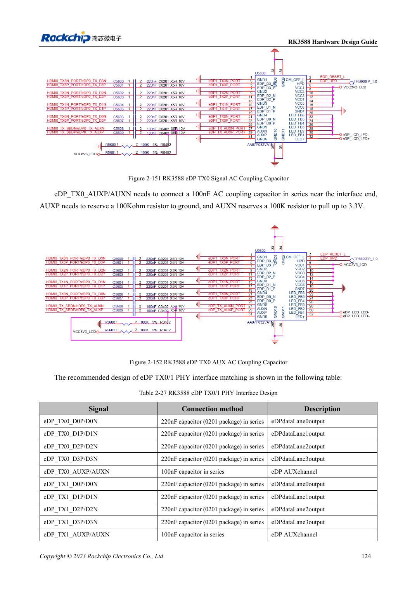
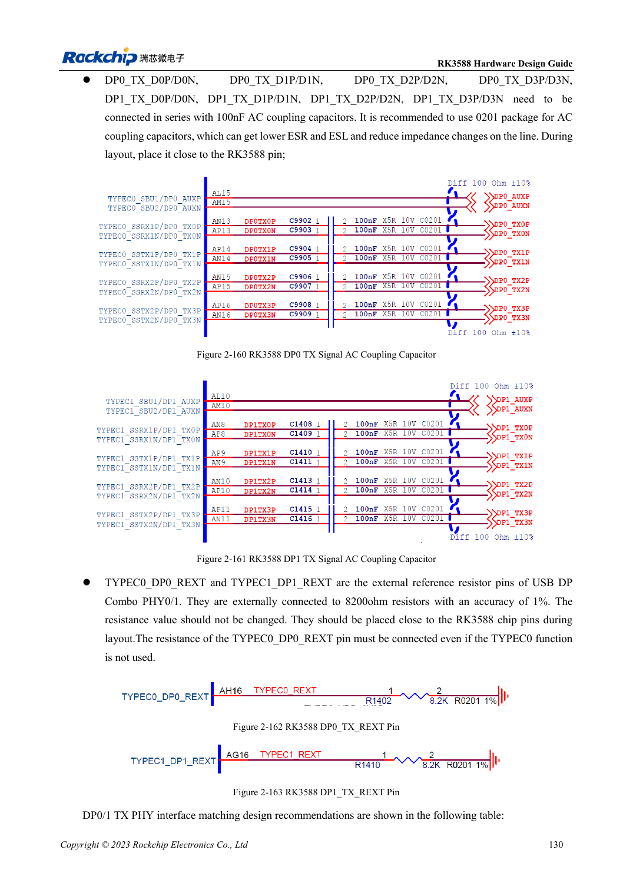

<!-- rk3588-hardware-v13-20261109 -->

# RK3588-DP und eDP: PHYs, AUX und Kopplung

Grundlage sind die chinesische und englische Ausgabe des RK3588 Hardware Design Guide V1.3 (2023-02-13) für SoC-Platinen und Träger. AIM7- und LM7-Träger müssen den Moduldefinitionen folgen; Sige7 dient zur Software- und Peripherieprüfung. SoC-Funktionen sind keine Boardanschlussliste. SDK/BSP, Kernel, Boardrevision und Firmware prüfen. Werte sind Quellenreferenzen, keine ArmSoM-Messungen.

**RK3588 Hardware Design Guide V1.3 (2023-02-13), EN** · §2.3.8.1; §2.3.8.3; §3.4.4; §3.4.13

## Ähnliche Namen sind keine identischen Schaltungen

DP0/1 teilen PHYs mit USB-Type-C, eDP mit HDMI-TX. DP-Hauptkanal nutzt 100nF, eDP 220nF, AUX 100nF. Impedanz, Kopplung und Pins nicht vertauschen. Kabel, Stecker, Display und BSP gehören zum Kanal.

## TYPEC0 hat auch ungenutzt Pflichtanschlüsse

Die drei TYPEC0_DP0-Versorgungen und REXT 8.2kΩ mit 1% laut Anleitung auch ohne TYPEC0-Nutzung erhalten. eDP-AUX nahe am Anschluss koppeln und Biasvorbereitung beibehalten. Die Überschrift nennt eDP1.4, der Text V1.3; maßgeblich sind konkrete elektrische Werte, keine zusätzliche Protokollzusage.

## Entwurfsparameter und Prüftabelle

| Punkt | Quellenreferenz |
| --- | --- |
| DP-/USB-DP-Impedanz | 100Ω / 95Ω; ±10% |
| eDP-Impedanz | 90Ω ±10%; zum Kabel passend |
| DP-/eDP-Hauptlinkkopplung | 100nF / 220nF |
| AUX-Kopplung | 100nF |
| Länge/Paardifferenz | <6in / <6mil |

## Quellenabbildungen

Die Referenzseiten enthalten die zugehörigen Schalt- oder Zeitdiagramme; für volle Auflösung anklicken. Bezeichner und Werte gehören zum Referenzentwurf, nicht zum Schaltplan eines ArmSoM-Produkts.

Englisches Original · PDF 146 · 2-151

Englisches Original · PDF 152 · 2-160

## Entwicklung mit ArmSoM

AIM7 unterstützt Compute-Modul-Träger, LM7 die LGA-Modulintegration und Sige7 frühe Software-/Peripherieerprobung. Vor dem Trägerdesign klären, welche Versorgung, DDR- und Bootschaltungen bereits integriert sind. SoC-Referenzschaltungen nicht unnötig duplizieren. Anschlüsse, herausgeführte Schnittstellen, Pegel und Systemunterstützung anhand der Produktunterlagen prüfen.

- [ArmSoM AIM7](https://www.armsom.org/aim7) · [AIM7 Docs](https://docs.armsom.org/armsom-aim7)
- [ArmSoM Sige7](https://www.armsom.org/sige7) · [Sige7 Docs](https://docs.armsom.org/armsom-sige7)
- [ArmSoM LM7](https://www.armsom.org/lm7) · [LM7 Docs](https://docs.armsom.org/armsom-lm7)

## Weiterlesen

- [RK3588-Hardwaredesign: 30 Themen](/de/articles/rk3588-hardware-design-series/)
- [RK3588-MIPI-Displays: D-PHY, C-PHY und Panels](/de/articles/rk3588-mipi-display-hardware/)
- [RK3588-Audiohardware: I2S, PDM und Mikrofonarrays](/de/articles/rk3588-audio-hardware-design/)
