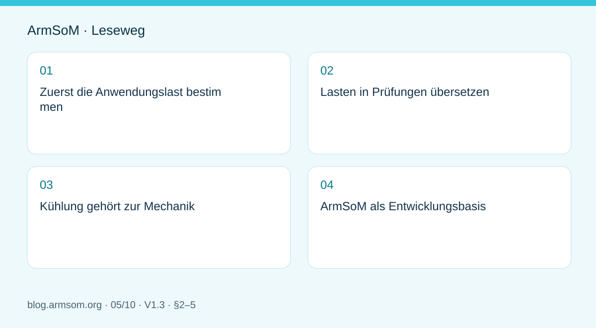

# RK3588 für Edge-KI: Versorgung, Kühlung und Erweiterung gemeinsam planen

## Geltungsbereich und Quellen

Dies ist ein thematischer Engineering-Leitfaden, keine seitenweise Übersetzung des gesamten PDF. Quellenbeispiele sind keine ArmSoM-Messungen. Spannungen, Pins, SDK/BSP und Kernel mit der tatsächlichen Platinenrevision abgleichen.

**Rockchip:** `RK3588 Hardware Design Guide-CN-V1.3-20230213.pdf` · V1.3 · §2–5

## Zuerst die Anwendungslast bestimmen

Ein Edge-Gerät führt mehr als ein Modell aus. Aufnahme, Vorverarbeitung, NPU, Display, Netzwerk und Speicher teilen Ressourcen. Eingänge, Auflösung, Latenz, Betriebsdauer und Umgebungstemperatur vor der Hardwarewahl festlegen. Die Beispiele sind Planungsszenarien, keine ArmSoM-Messwerte.

V1.3 behandelt Schaltungen in Kapitel 2, Wärme in Kapitel 4 und ESD/EMI in Kapitel 5. EVB-Werte und Hersteller-Thermosimulationen sind keine Messergebnisse für AIM7, Sige7 oder LM7.

## Lasten in Prüfungen übersetzen

| Szenario | Ressourcen | Beobachtung |
| --- | --- | --- |
| Sichtprüfung | Kamera, Speicher, NPU, Netzwerk | Verlorene Frames, Ende-zu-Ende-Latenz, Versorgungstransienten |
| Medienterminal | Decoder, Display, Audio, Touch | Displaykombinationen, Temperatur, Dauerstabilität |
| Datenerfassung | Netzwerk, Speicher, externe IO | Dauerhafte Schreiblast, Spannungsausfall, Wiederherstellung |

Platine, Anlaufspitzen der Peripherie und Wandlerverluste budgetieren; Spannungsabfälle an Kabeln und Steckern prüfen. Die typische Prozessorleistung bestimmt nicht das Netzteil des Gesamtgeräts. Werte unterschiedlicher Reglertopologien nicht vermischen.

## Kühlung gehört zur Mechanik

Den Wärmepfad zu Kühlkörper, Gehäuse und Umgebung definieren. Wärmeleitmaterial, Anpressdruck, Isolation und Luftstrom prüfen. Ein geschlossenes Gehäuse unterscheidet sich vom offenen Prüfplatz. Umgebung, Chiptemperatur, Frequenz, Inferenzlatenz und Frameverluste über die Zeit protokollieren.

Drosselungsprotokolle zeigen aktive Schutzfunktionen. Sinkende Leistung verlangt eine Prüfung von Wärmeweg und Versorgung, nicht das Abschalten des Schutzes für bessere Messzahlen.

## ArmSoM als Entwicklungsbasis

AIM7, Sige7 und LM7 anhand dokumentierter Mechanik und Schnittstellen auswählen. Modell, Videopfad und Peripherie vor der Festlegung von Gehäuse oder Träger prüfen. Bei Jetson-Migrationen CUDA-Abhängigkeiten und Modellbereitstellung getrennt bewerten; ähnliche Bauformen belegen keine Softwarekompatibilität.

Zur Übergabe gehören Schnittstellenkonfiguration, BSP- und Modellversionen, Kabel und Dauerlastprotokolle. Leistungsangaben gelten nur für die geprüfte Konfiguration.

## Abbildung aus der Quelle

Original aus dem englischen Dokument, gemeinsam für EN/RU/DE. Referenzdesign, kein ArmSoM-Platinenschaltplan.

`RK3588 hardware design guide-EN-V1.3-20230213.pdf` · PDF p. 25.

## Produkte und Entwicklungsunterlagen

- **AIM7** — [Produktseite](https://www.armsom.org/aim7) · [Dokumentation](https://docs.armsom.org/armsom-aim7)
- **Sige7** — [Produktseite](https://www.armsom.org/sige7) · [Dokumentation](https://docs.armsom.org/armsom-sige7)
- **LM7** — [Produktseite](https://www.armsom.org/lm7) · [Dokumentation](https://docs.armsom.org/armsom-lm7)

## Weitere Beiträge der Reihe

- [RK3576 in Betrieb nehmen: Minimalsystem und erste Einschaltprüfung](/de/articles/rk3576-hardware-bringup/)
- [ArmSoM CM5-Trägerplatine: Checkliste für Versorgung, Boot und Schnittstellen](/de/articles/019-cm5-carrier-production/)
- [RK3576-Hochgeschwindigkeitsschnittstellen: Schaltplan und PCB gemeinsam prüfen](/de/articles/rk3576-high-speed-interface-design/)
- [RK3588S-Hardwaredesign: vom Referenzschaltplan zur CM7s-Trägerplatine](/de/articles/rk3588s-cm7s-carrier-design/)
- [RK3588-PCB-Prüfung: Lagenaufbau, Impedanz und Leiterführung](/de/articles/rk3588-high-speed-pcb-review/)
- [RK3506-HMI-Hardware: Entwicklung mit CM1 oder Forge1](/de/articles/rk3506-industrial-hmi-hardware/)
- [RK3308-Varianten: Hardwarekompatibilität für P2-Pro-Audioprojekte](/de/articles/rk3308-hardware-variant-compatibility/)
- [RK3588S und RK3588S2: Prüfungen vor einer Hardwareänderung](/de/articles/rk3588s-rk3588s2-hardware-differences/)
- [Vom Rockchip-Prototyp zur Serie: Prozessvorgaben und Prüfunterlagen](/de/articles/rockchip-hardware-production-checklist/)
